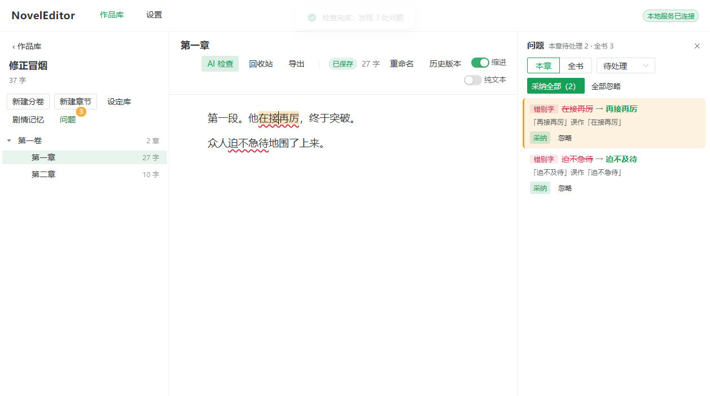

# NovelEditor

English | [简体中文](README.md)

A **local, offline-first novel editor** for authors of long-form web fiction. You write in the browser and your manuscript never leaves your machine. Plug in any OpenAI-compatible LLM to proofread, review, and check setting and character consistency, plus AI-flavor detection, inspiration capsules, smart continuation, and plot memory.

> The user interface and the built-in checking rules (skills) are in Simplified Chinese. The built-in skills encode Chinese web-novel conventions (Qidian / Yuewen style).



## Features

- **Never lose a draft**: browser draft + transactional saves with optimistic locking + per-chapter history + daily database backups. Deletions always go to a recycle bin.
- **Built for million-character novels**: drag-and-drop volumes and chapters; a 50k-character chapter opens instantly and saves in a few milliseconds.
- **Fully offline writing**: editing, saving, history, and export need no network. Only AI features and the skill hub do.
- **AI checks** (whole work / volume / chapter; pausable, resumable, cancellable): typos and punctuation, editorial review, setting consistency, character consistency, AI-flavor detection with one-click rewrite, inspiration capsule (five plot routes), smart continuation (current chapter only, inserted after you confirm), and setting extraction into a reviewable story bible.
- **Plot memory**: incrementally updated roughly every 3,000 new characters so late-stage checks stay grounded in earlier plot.
- **Skills**: every check is driven by a `SKILL.md` you can read, disable, or replace; install from SkillHub or import locally. Skills are used as prompts only; **no code is ever executed**.
- **Model agnostic**: presets for DeepSeek, Qwen, Kimi, Zhipu, Tencent Hunyuan, OpenAI, and local Ollama / LM Studio; JSON-output capability is probed with automatic fallback; runtime status and fix hints are shown.
- **No native dependencies**: the server uses only Node built-ins (`node:http`, `node:sqlite`). Windows ships as a single exe, macOS (Apple Silicon) as an `.app`.

## Quick start

### Release builds

Download from [Releases](https://github.com/wendellhua/novel-editor/releases): `NovelEditor.exe` (Windows 10/11 x64) or `NovelEditor-mac-arm64.tar.gz` (macOS 13.5+, Apple Silicon). Builds are unsigned, so the first launch needs a manual allow step; see the [user guide](docs/USER_GUIDE.md) (Chinese).

### Run from source

Requires Node.js **24 or later**.

```bash
git clone https://github.com/wendellhua/novel-editor.git
cd novel-editor
npm ci
npm run dev      # builds and starts; data goes to ./.devdata
```

Start without opening a browser (the login URL is printed to stdout):

```bash
npm run build
node --disable-warning=ExperimentalWarning dist/server.cjs --data-dir .devdata --no-browser
```

### Configure a model

Settings → Models → Add model. Pick a preset, enter your API key and model name, then click "Test connection". The key is stored only in `llm.json` in the local data directory; the UI shows a masked value and logs are redacted.

## Scripts

| Command | Purpose |
|---|---|
| `npm run dev` | Build and start with the dev data directory |
| `npm run build` | Build the web app (Vite) and the server (single-file esbuild bundle) |
| `npm run typecheck` | Type-check with `vue-tsc` |
| `npm test` | Unit and integration tests (Vitest; real SQLite and real HTTP) |
| `npm run test:perf` | Performance tests (synthetic 3M-character / 3000-chapter work) |
| `npm run smoke` / `npm run smoke:browser` | Process-level / browser smoke tests (needs local Chrome or Edge) |
| `npm run package:win` / `package:mac` | Build release artifacts into `release/` |

## Documentation

- [User guide](docs/USER_GUIDE.md) (Chinese)
- [Architecture](docs/ARCHITECTURE.md) (Chinese) and [ADRs](docs/adr/)
- [Changelog](CHANGELOG.md) · [Contributing](CONTRIBUTING.md) · [Security policy](SECURITY.md)

## Privacy and security

The server listens on `127.0.0.1` only, exchanges a one-time token for a session cookie, and validates Host and Origin. Manuscript text is sent only to the model endpoint **you configure**, and only when you start an AI task. There is no telemetry.

## License

[MIT](LICENSE)
