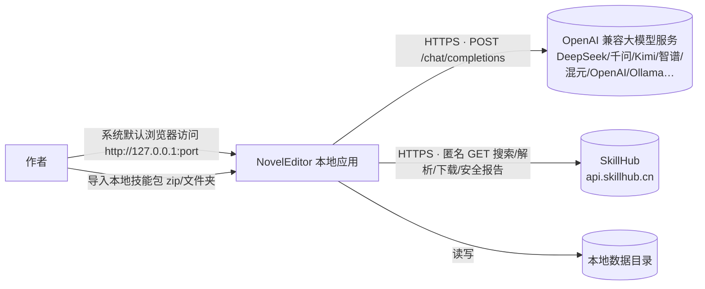
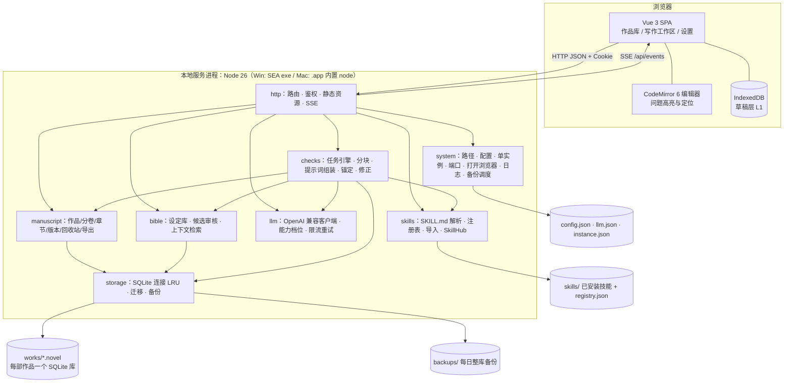

# 架构设计文档：NovelEditor（智能小说编辑器，暂定名）

> 本文档是本项目的唯一真理源（Single Source of Truth）。
> 任何影响架构、接口、数据模型、依赖或目录结构的代码变更，都必须同步更新本文档。
> 最后更新：2026-10-15 ｜ 文档版本：v1.17（M0～M4 全部任务完成，T1～T19；交付后优化：作品级操作移到编辑器顶栏、AI 修复；创作辅助（AI 味检测、灵感胶囊、智能扩写）与剧情记忆，schema v2；10 个内置技能升级到 2.0.0；模型运行状态与异常处理；待用户验证：内置技能升级前后的真实模型对照、Mac 实机运行（含发布包）、真实输入法、真实 Key 测试连接、三项真实模型基线 `baseline:typo` / `baseline:bible` / `baseline:consistency`）
> 选型依据：开发期的技术选型调研（未随仓库发布），结论已写入 §4 与各 ADR。正文中的「调研 F2」「调研 F9」等编号即指该调研中的发现。

---

## 1. 概述与目标

- **项目定位**：在 Windows 和 macOS 上双击即用的轻量小说编辑器。写作完全离线，可接入大模型，对作品做错别字、审稿和一致性检查。
- **核心问题**：作者写百万字长篇时，需要一个不丢稿的本地写作环境，还要能按整部作品、分卷或章节，让 AI 查错并一键修正，同时检查设定和角色是否前后一致。
- **使用者**：单个作者，在自己电脑上使用。

### 1.1 质量属性优先级

**数据安全（不丢稿） > 易用性 > AI 检查准确性（可定位、少误报） > 性能 > 可扩展性**

性能目标（以百万字、3000 章为基准）：

| 指标 | 目标 |
|---|---|
| 双击到浏览器打开 | < 2 s |
| 作品目录树加载 | < 200 ms |
| 打开 5 万字章节 | < 300 ms |
| 单次保存请求 | < 50 ms |
| 输入延迟 | 不卡顿（CodeMirror 只渲染可视区域） |

### 1.2 范围边界

**In scope（v1）**

| 功能块 | 内容 |
|---|---|
| 作品编辑 | 作品增删改；分卷、章节的新增、重命名、拖拽排序、跨卷移动、删除（进回收站，可恢复）；章节正文编辑；自动保存；章节历史版本与恢复；每日整库备份；导出整部作品为 TXT 或 Markdown |
| 模型配置 | 多个 OpenAI 兼容模型配置（内置常见厂商预设）；测试连接并自动探测 JSON 输出能力；为每类任务指定默认模型 |
| Skills | 解析 SKILL.md；从 SkillHub 搜索和安装；本地导入（zip 或文件夹）；启用、停用、删除；为技能指定适用的检查类型 |
| AI 检查 | 范围：作品、分卷、章节三级；类型：错别字（含一键修正）、编辑审稿、设定一致性、角色一致性；结果在正文中高亮定位，可采纳、忽略或一键修正；任务可暂停、恢复、取消；可选「只查有改动的章节」；作品级任务执行前预估 token 用量 |
| 设定库 | AI 从正文抽取角色和设定，生成候选；作者审核后入库（可接受、编辑、合并、拒绝）；手动编辑条目和事实 |

**Out of scope（v1）**

- 账号、云同步、多人协作
- 富文本排版、移动端
- 正文导入（v1 用粘贴代替）
- 全书搜索界面：全文检索索引已有，后续加界面成本很低
- AI 续写或生成正文
- Claude、Gemini 原生协议。Ollama 等 OpenAI 兼容服务可以直接配置使用，但不做专门适配
- 执行技能包里的脚本
- 向量检索、知识图谱
- Electron 桌面壳
- Intel Mac、Windows ARM
- 代码签名与公证

---

## 2. 约束

### 2.1 技术约束

| 类别 | 约束 |
|---|---|
| 平台 | Windows 10/11 x64；macOS 13.5+ Apple 芯片（arm64），只需在本机运行 |
| 运行时 | 用户无需安装 Node。安装包内置 Node 官方运行时（ADR-002） |
| 依赖 | **禁止原生模块**；运行时依赖只能是纯 JS，许可证限 MIT、ISC、BSD、Apache-2.0 |
| 网络 | 编辑、保存、版本、导出 100% 离线可用；只有 AI 检查和 SkillHub 安装需要联网。前端不得引用任何外部 URL（CDN、在线字体等） |
| 浏览器 | 系统默认浏览器：Chrome、Edge 或 Safari 最新版（Firefox 尽力支持） |
| 团队 | 单人维护，AI 辅助开发 → 架构保持模块化单体，依赖越少越好 |

### 2.2 关键假设（S4 期间逐项验证）

| # | 假设 | 验证方式 |
|---|---|---|
| A1 | 单部作品 ≤ 300 万字、≤ 3000 章、单章 ≤ 5 万字 | 性能测试使用 3000 章、300 万字的合成数据 |
| A2 | 单人单机使用；同一章可能在多个浏览器标签里同时打开 | 用 `rev` 乐观锁处理冲突（INV-4） |
| A3 | Node 26 将在 2026-10 下旬转为 LTS（⚠ 推断）；如果延期，就用 26.x Current，不影响架构 | 发布前确认。**2026-10-09 查 nodejs.org/dist/index.json**：最新 v26.11.1（2026-10-07）尚未标记 LTS，当前 LTS 为 v24.21.0；安装包固定使用 v26.11.1 |
| A4 | Node 官方 darwin-arm64 二进制自带有效签名，放进未签名的 `.app` 后本机可以直接运行（⚠ 待验证） | 在 Mac 上做打包冒烟测试。**2026-10-09 静态检查**：包内 `node` 为 arm64 Mach-O，含 `LC_CODE_SIGNATURE`（官方签名完整保留），权限 0755；**实机运行待用户在 Apple 芯片 Mac 上验证** |
| A5 | 中文约 1 token 对应 1～1.5 个汉字；预算按 1 字 = 1 token 保守估算 | 用真实章节统计 token 用量 |
| A6 | SkillHub 社区接口可以匿名访问（依据本机 CLI 源码，2026-10-09） | 冒烟测试时实际安装一次 |

---

## 3. 架构总览（C4 - Context & Container）

### 3.1 系统上下文



### 3.2 容器视图



**模块依赖规则**：
- `http` 只调用各业务模块暴露的 service。
- 业务模块之间只能按上图箭头方向依赖，禁止反向依赖。
- `storage` 不认识任何业务概念。
- `shared/` 只放纯函数和类型，前后端都可以用。

### 3.3 运行时视图（关键流程）

**F1 启动与单实例**
1. 确定数据目录（§5.2），按需创建子目录。
2. 加载并校验 `config.json`；首次运行时生成默认值，包括 `authSecret` 和 `hubClientId`。`llm.json` 由组合根在确认本进程是唯一实例之后（第 4 步之前）再加载和修复，避免两个进程同时写回同一文件。
3. 读取 `instance.json`。如果文件存在，就用 `authSecret` 请求已有实例的 `POST /api/system/nonce`：
   - 能连上：说明已有实例在运行，用拿到的 nonce 打开浏览器，然后本进程退出（INV-14）。
   - 连不上：视为残留文件，继续启动。
4. 监听 `127.0.0.1:config.port`。端口被占用（`EADDRINUSE`）时改用随机端口，并把新端口写回配置（INV-15）。
5. 原子写入 `instance.json`，内容为 `{ pid, port, startedAt }`。
6. 把状态为 `running` 的任务改为 `paused`。
7. 生成一次性 nonce，打开 `http://127.0.0.1:{port}/auth?n={nonce}`。
8. 退出方式：
   - 界面上的「退出程序」，或收到 SIGINT、SIGTERM、SIGHUP（Windows 关闭控制台窗口时会触发 SIGHUP）。
   - 退出时关闭所有数据库连接（执行 WAL checkpoint），并删除 `instance.json`。
   - 数据安全不依赖这一步：每次写入都已经在事务里提交。

**F2 编辑与自动保存（三层防丢稿，ADR-004）**
调度逻辑全部在 `web/editor/save-controller.ts`（`SaveController`，与 DOM 无关、可单测），参数见 `SAVE_TIMING`。

1. **L1 浏览器草稿**：内容变化后防抖 300 ms，写入 IndexedDB（库 `novel-editor`、表 `drafts`、键 `{workId}:{chapterId}`，`durability: 'strict'`）草稿 `{ body, baseRev, updatedAt }`。章节标题不在编辑器里改（走重命名接口，立即生效），所以草稿不含标题。内容改回已保存的状态时删除草稿。
2. **L2 服务端保存**：
   - 触发时机：停止输入 1500 ms；连续输入时最长每 10 s 一次；编辑器失焦、页面切到后台（`visibilitychange`）、切换章节（组件卸载时立即写草稿并保存）。
   - 同一时刻只有一个保存请求；请求期间的新改动在请求结束后继续保存。
   - `pagehide`：立即写草稿；正文 UTF-8 不超过 60 000 字节时再用 `keepalive` fetch 尽力提交（浏览器上限 64 KB）。关闭页面时真正的保障是 L1 草稿。
   - 发送 `PUT .../body { body, baseRev }`，服务端在事务中写入，`rev + 1`。成功且当前内容与已保存一致时删除草稿。
   - 错误处理：409 → 若服务端内容恰好与本地相同则视为已保存，否则进入「有冲突」状态、暂停自动保存并弹出对比框（保留我的 = 以新 `rev` 覆盖；使用已保存的版本 = 替换编辑器内容并删除草稿）；网络错误或 5xx → 「未连接」状态，每 3 s 重试；401 → 停止重试，内容留在草稿。
   - 外部更新：收到本章 `chapter.updated` 且 `rev` 更新、本地没有未保存改动时，重新读取正文并用最小差异替换（`replaceDocMinimal`，光标尽量不动）；本地有改动时不处理，留给下次保存的 409。
   - 恢复版本前先 `flush()`；有冲突或会话失效时拒绝恢复。
3. **L3 版本与备份**：
   - 保存时，如果该章最近一条版本早于 10 分钟，就追加一条 `auto` 版本。
   - 每部作品每天第一次放入连接池时（作品列表的临时打开不算），后台做一次整库备份，每部作品保留最近 7 份（`storage/daily-backup.ts`）。
   - 正文变化后，全文索引在后台防抖 3 s 重建（ADR-003 修订 1），不占保存请求的时间。
4. **恢复规则**（`decideDraftRecovery`）：打开章节时如果存在草稿：
   - 草稿与服务端内容相同：删除草稿。
   - `draft.baseRev === chapter.rev` 且内容不同：自动恢复草稿并立即保存，提示「已从浏览器草稿恢复上次未保存的内容」。
   - `draft.baseRev ≠ chapter.rev`（服务端在草稿之后又被改过）：弹出对比框，让作者选择恢复草稿或丢弃。
5. 服务不可达时：编辑器状态显示「未连接，内容已存在浏览器草稿」，作者可以继续写，每 3 s 重试一次。服务重启后沿用同一端口（INV-15），会话 Cookie 仍然有效，未保存内容自动同步回服务端。
6. **输入法兜底**（ADR-005）：编辑器提供「纯文本」开关，切到原生 `<textarea>`，保存逻辑完全相同；选择记在 `localStorage`（`ne.editorMode`）。段首缩进开关只影响显示（`ne.editorIndent`）。

**F3 AI 检查任务（ADR-006）**
1. `POST /jobs`：把检查范围展开成章节列表（未删除，按卷序、章序排列）。勾选 `onlyChanged` 时，跳过 `body_hash` 和上次同类型、同技能检查时一致的章节。
2. 生成执行单元：
   - 一致性检查和审稿先跑 `summary` 阶段，只为缺少有效摘要缓存的章节生成。
   - 然后是 `main` 阶段：长章节用 `splitParagraphChunks` 按段落边界切块，块大小取 `CHUNK_CHARS[type]`（§6.4）。
   - 审稿最后有一个 `reduce` 阶段，汇总生成整体报告。
3. 执行：全局任务队列按 FIFO 一次运行一个任务；任务内的单元按 `profile.maxConcurrency` 并发调用模型。阶段按 summary → main → reduce 依次进行，前一阶段没有待执行单元才进入下一阶段。
4. 每个单元：组装提示词（§7.4）→ 调用模型 → 用 Ajv 校验 → 失败时按重试策略处理 → 锚定原文 → 过滤 → 写入 `issue`，或写入报告、候选、分析结果（摘要缓存与审稿报告见 §7.4.5）。处理器可以声明「无需调用模型」（如审稿汇总时没有任何逐章意见），此时单元直接记为完成。**结果写入、单元状态与任务计数在同一个事务里提交**（INV-11、INV-18）：进程在任何时刻被杀，已提交的单元不会重复执行，未提交的单元下次重新执行，结果也不会写两遍。
   - 执行前读取章节快照：章节已删除 → 该单元移出任务（`total_units` 减少）；`body_hash` 与规划时不同（检查期间改了稿）→ 丢弃该章本阶段尚未执行、也不在进行中的单元，按当前正文重新切块排到本阶段末尾。提示词与锚定都基于同一份快照，问题记录快照的 `body_hash`。
   - **单元级失败**（只让这个单元 `failed`，任务继续）：两次输出都不合格（`invalid_output`）、截断、空内容（已按 §7.3 重试），以及与内容相关的 HTTP 400 / 413 / 422。一次运行中**没有任何成功、却连续 3 个单元失败**时视为整体性问题（如模型名错误），任务失败。
   - **任务级失败**（任务 `failed`，进行中的请求中止，未执行的单元保留）：鉴权、额度、404、限流与 5xx 重试耗尽、超时、网络错误、配置错误、内部错误。修好后「恢复」即可接着执行（T18「拔网线后可恢复」）。
5. 进度通过 SSE 推送 `job.updated`（单元完成时节流到每 250 ms 一次，状态变化立即推送）。可以暂停、恢复、取消；恢复时跳过已完成的单元，**失败的单元重新放回待执行**。
   - 暂停、取消会中止进行中的模型请求，等收尾完成后才返回；收尾前已经拿到的合格结果照常提交。
   - 退出程序时运行中的任务转为 `paused`，排队中的也转为 `paused`；进程被强杀时，下次**第一次访问该作品的任务**时把遗留的 `queued` / `running` 改为 `paused`（不在启动时扫描全部作品，避免拖慢启动）。
   - 删除作品前先暂停它的任务并释放连接（运行中的任务持有 `pin`），否则无法把文件移入回收站。

**F4 一键修正（ADR-006）**
1. 客户端先把当前章节保存到服务端（flush），再请求 `POST /issues/apply { issueIds }`。保存不成功（冲突、离线、会话失效）时不修正，提示先处理保存问题。
2. 服务端按章节分组（按卷序、章序），每章一个事务（`Manuscript.fixChapterBody`，正文仍只经 `writeChapterBody` 写入，INV-3）：
   - 校验或重新锚定该章全部「待处理」与「已忽略」的问题（INV-7），校验不通过的待处理问题标为 `stale`；所选问题中不是 `open` 的原样返回在 `stale` 中。
   - 去掉范围重叠的问题（保留 `start` 较小的）。
   - 先写入一条 `before_fix` 版本。
   - 按 `start` 从大到小依次替换。
   - 更新正文，`rev + 1`。
   - 把问题标为 `applied`。
   - **同章其余问题随修正平移**（`shared/anchor rebaseAnchor`）：target 与任何替换都不重叠的，位置按替换的长度差平移、excerpt 按新正文重新截取、`body_hash` 更新为新正文——否则相邻的问题（excerpt 常常覆盖到旁边的错字）会在下一次读取时失效。target 与替换重叠的不动，下次读取时重新锚定或标为失效。
   - 章节已删除时，所选问题标为 `stale`，不写正文。
3. **AI 修复**（没有修改建议的问题，如只给意见的审稿问题；问题面板单条「修复」、批量「全部修复」）：先由模型按意见生成修改建议，再走上面的一键修正，写正文的路径不变。
   - 客户端先保存当前章节，再对每条没有建议的问题请求 `POST W/issues/:iid/suggest`（并发 3 条，显示「AI 修复中 x/n」，可「停止」）；全部返回后，把已有建议与新生成建议的问题一起 `apply`（每章一个 `before_fix` 版本，编辑器内可撤销）。一条都没成功却连续失败 3 条时不再尝试其余的（多半是模型配置问题）。作者「停止」时中止进行中的请求（服务端随之中止模型调用），**不改正文**，已生成的建议留在问题上，可以逐条「采纳」。
   - 服务端（`checks/fix IssueFixer.suggest`）：问题必须是 `open`；已有建议的直接返回、不调用模型。先按当前正文对齐（INV-7，失效的标为 `stale` 并返回 400）；使用发现该问题的任务所用的模型，该配置已删除时用这类检查的默认模型。提示词：`FIX_PROTOCOL` + 修改意见（类别、意见、依据）、前文（400 字）、待修改的原文（`target`）、后文（200 字），上下文预算不足时前后文按比例缩短。输出 `{ replacement }` 经 Ajv 校验后整理（`cleanReplacement`：统一换行、去两端空白与模型自加的成对引号、去掉与前后文重复的部分）：与原文相同、或超过 `max(200, target 长度 × 4)` 时 400，不写入。只写 `replacement`（模型调用期间问题被处理的以库中为准），不改正文。
4. 推送 `chapter.updated`。已打开该章的编辑器：修正进行中不处理这条事件，改由修正结果同步——拉取新正文，按高亮的当前位置生成替换，作为**单独一步历史记录**写入编辑器（`isolateHistory`，Ctrl/Cmd+Z 恰好撤销这次修正，撤销后的内容照常自动保存）；结果与服务端正文不一致时改用最小差异替换。先更新保存控制器的基准版本再写入，不会多发一次保存。

**F5 设定抽取与审核（ADR-009）**
1. 创建 `bible_extract` 任务（检查面板选「设定抽取」，或设定库「AI 抽取设定」打开预选好的检查面板），逐章抽取实体和事实，按 `CHUNK_CHARS.bible_extract` 切块。章节 `body_hash` 没变、且上次全部片段都已完成的不重复抽取（`chapter_analysis` kind = `bible_extract`；有片段失败的章节下次整章重新抽取）；范围内全都抽取过时创建任务返回 400「都已抽取过」。③ 列出本片段中出现的已有条目（名称、别名、简介），让模型沿用设定库的叫法。
2. 服务端处理（`bible/candidates writeExtractCandidates`，在单元提交的事务内）：
   - 同一份输出里共享名称或别名的实体先合并（声明对方为别名的一方作为主名称）。
   - 所有事实的 `quote` 必须能在本章正文中逐字找到，否则丢弃该事实；名称与别名都没在正文中出现的实体丢弃（INV-8）。`new_entry` / `new_alias` 候选的引文取名称在正文中第一次出现处前后各 20 字。
   - 按名称或别名（INV-9 的比较键）匹配已确认条目：匹配上的生成 `new_alias`（正文中出现、还不属于任何条目的叫法）与 `new_fact`（条目还没有的属性 + 值）；没匹配上的生成 `new_entry`（别名中已属于其他条目的去掉）。
   - 去重：同一章节同键的待审核候选不重复写入——同名的新条目合并为一个候选（别名、事实取并集）；被拒绝过的键不再生成（拒绝是持久的）。写入前删除本章中引文已不在当前正文里的待审核候选（改稿后重新抽取）。
   - 任务结束时推送 `candidates.changed`。
3. 作者在「设定库 → 待审核」中逐条或批量决定：接受、编辑后接受、合并到已有条目、拒绝（`bible/candidates decideCandidates`，一个请求一个事务）。
   - 界面按条目分组（已有条目的候选按目标条目、新条目按名称），按出现次数从多到少排序；新条目组与已有条目同名时提示「合并到」。
   - 接受 `new_entry` 时按 INV-9 查重：与**本批中刚由其他候选新建的条目**冲突时自动合并进去（同名的一组可以一次全部接受）；与其他已有条目冲突时整批回滚并返回 409 `NAME_CONFLICT`（附 `entryId`、`entryName`、`candidateId`），界面提示合并。
   - 写入事实时，同条目已有相同属性与值的跳过；引文已不在来源章节当前正文中时（接受前改过稿）不保留引文（INV-8）。
   - 删除条目时，以它为目标的待审核候选一并删除。

**F6 剧情记忆（ADR-011）**
1. 触发：正文每次保存（`Manuscript.onChapterUpdated`）后，`PlotMemoryService.schedule` 防抖 3 s 检查尚未纳入的字数（`memory/coverage measurePending`：每章从接续位置到章末，只有空白的不算）：
   - ≥ `CREATIVE_LIMITS.memoryThresholdChars`（3000）且 ≤ `memoryAutoMaxChars`（30000）且有可用模型时，创建 `memory` 任务（系统任务，`Checks.createMemoryJob`），批次数 = ⌈待纳入字数 / `CHUNK_CHARS.memory`⌉；
   - 已有排队或运行中的剧情记忆任务时不重复创建；暂停的（如退出程序时）直接恢复；失败的距失败 10 分钟后才自动恢复（断网时不反复失败）；
   - 超过自动上限（如给已有的长篇第一次建立记忆）时不自动开始，作者在「剧情记忆」中点「立即更新」（`POST W/memory/update`，不受阈值与上限限制）。
2. 增量（只发送新写的正文）：`plot_memory_chapter` 记录每章已纳入的位置与末尾 32 字锚点（`resumePoint`）——锚点还在原位置时从那里接着取；已纳入的部分被改过（长度变了）时在原位置附近找回锚点；锚点找不到（大段改写）时按原字数估计。**已纳入部分的修改不会重新发送**，需要时「重建」（`POST W/memory/rebuild`：清空记录与进度后从头建立）。
3. 执行（`checks/memory-unit memoryMain`，`serial: true` 批次之间串行）：每个单元**执行时**才按当前正文选定批次（`takeBatch`：按目录顺序取片段，合计 ≤ 6000 字，长片段在段落边界截断，余下的留给下一批），所以任务创建后接着写的内容也能纳入；没有内容时跳过。提示词：① `MEMORY_PROTOCOL` + ② `builtin:plot-memory`；③ 批次中出现的设定条目（沿用设定库叫法）；④ 当前剧情记忆（最近一次更新后的状态，不可裁剪）+ 上次记录的事件；⑥ 批次正文（每章一个小标题，接着上次写的注明「接上次记录」）。
4. 提交（同一事务）：写入一条 `plot_memory_entry`（本批事件 + **更新后的全书状态快照**：主线进展、人物现状、未解决的冲突与伏笔、情绪走势，`cleanMemory` 去重限长），并把批次中各章的进度推进到批次末尾。任务结束推送 `memory.updated`。
5. 使用（`memory/context memoryBlocks`，放进 ④ 前情提要，比章节摘要晚裁）：按更新顺序累计已纳入章节在目录中的最大位置，取**最后一个仍在本章之前**的快照——检查较早的章节时不会把后文的发展当成前情。审稿、设定 / 角色一致性要求快照的全部章节都在本章之前（本章自己写到的不算前情）；灵感胶囊、智能扩写可以包含本章已写的部分。块内容：「【剧情记忆 · 截至第X卷第Y章】」状态快照 +「【近期剧情】」最近 3 次更新的事件（最多 15 条）。
6. 查阅：左侧「剧情记忆」（`GET W/memory`）——已纳入 / 待纳入字数、当前状态、每次更新的记录（范围、字数、事件），以及最近任务的状态（失败时可重试）。

**F7 创作辅助：AI 味检测、灵感胶囊、智能扩写（ADR-011）**
1. AI 味检测（`ai_flavor`，范围任意）：按 `CHUNK_CHARS.ai_flavor` 切块；③ 专名白名单；输出每处 AI 味的 excerpt / target / **replacement（去 AI 味的改写）**；锚定后本地过滤（`keepAiFlavorIssue`：改写与原文相同、target 超过 300 字、改写超过 max(200, target × 3)、改写丢掉了 target 中的设定库专名——不写入），写成 `ai_flavor` 类问题。完成提示「发现 N 处 · 一键优化」：确认后对这次检测的全部待处理问题走 F4 一键修正（存修正前版本、可撤销）；问题面板的「采纳全部」同样可用。
2. 灵感胶囊（`inspiration`，范围只能是当前章节）：summary 阶段补齐前 3 章摘要；main 阶段一个单元，⑥ 为本章结尾 `CHUNK_CHARS.inspiration` 字（`tailRange`，尽量从段落开头取起；本章可以为空，但本章与前文不能都没有正文）。③ 作品信息（书名、类型、简介，不可裁剪）+ 本章结尾、剧情记忆与上一章结尾中出现的设定条目（最多 30 个）；④ 剧情记忆（可含本章）+ 前 3 章摘要 + 本章不足 1500 字时附上一章结尾 1200 字。输出局势、情绪曲线与路线（标题、核心设想、3～5 个剧情节拍、张力来源、章末钩子、风险），本地渲染为 Markdown（`renderInspiration`，最多 5 条）存为整体报告，在审稿报告的同一个查看界面中以「灵感胶囊」显示。不改动正文。
3. 智能扩写（`expand`，范围只能是当前章节——**每次只根据前文完成当前这一章**）：上下文与灵感胶囊相同；⑥ 标题注明「本章已写 N 字」与「续写约 M 字」（`options.targetChars`，500～3000，默认 2000；所选模型的最大输出必须 ≥ M × 1.2 + 200，否则创建时 400）。输出整理（`cleanExpansion`：去代码块与段首空格、合并多余空行、去掉开头的章节标题、**遇到下一章的标题就截断**、去掉「未完待续」、去掉与前文结尾重复的开头、不超过目标两倍并在句末截断），空结果按单元失败处理；结果存入 `expansion`（不改正文）。
4. 插入章末（`POST W/jobs/:jid/expansion/apply`）：作者在扩写抽屉中预览后确认。客户端先保存当前章节；服务端经 `Manuscript.fixChapterBody(…, 'before_expand')` 写入——先存「AI 扩写前」版本、rev 加 1、推送 `chapter.updated`，同一事务把结果标为已插入（不能重复插入）。追加方式（`joinExpansion`）：章节为空或以换行结尾时原样追加；最后一句已写完时另起一段；没写完时直接接上。扩写之后本章有改动时返回 400（`stale: true`），确认后带 `force` 插入。编辑器中作为单独一步历史记录同步，Ctrl/Cmd+Z 可撤销。

---

## 4. 技术栈

| 层 | 选型 | 版本 | 理由 |
|---|---|---|---|
| 运行时 | Node.js 官方二进制 | 26.x（构建机至少 25.5，因为要用 `--build-sea`） | ADR-002；只用 `node:sqlite`、`node:http`、`fetch` 等内置能力 |
| 语言 | TypeScript（前后端共用类型） | 5.x | 保证接口契约一致（编码铁律 1） |
| 服务端 HTTP | `node:http` + 自写轻量路由 | 内置 | 依赖最少，SEA 单文件打包风险最低 |
| 数据存储 | `node:sqlite`（WAL + `synchronous=FULL` + FTS5 trigram） | 内置（Node 26 自带的 SQLite） | ADR-003；本机 PoC 验证通过 |
| SKILL.md 解析 | `yaml` | 2.9.x（ISC） | 支持多行 frontmatter；官方 CLI 的解析器不支持（调研 F9）；解析时禁用别名（`maxAliasCount: 0`） |
| 输出校验 | `ajv` | 8.x（MIT） | 校验大模型输出和配置文件 |
| 解压 | 技能包：自写中央目录解析（`skills/zip.ts`）+ 内置 `node:zlib`；打包脚本：`fflate` | 内置 · 0.8.x（MIT） | 技能包需要读 external attributes 识别符号链接，并用 `inflateRawSync` 的 `maxOutputLength` 硬性限额、`crc32` 核对，声明大小造假也突破不了上限（ADR-008 实施补充）；`fflate` 只在打包脚本中解压 Node 官方 zip（`scripts/lib/node-runtime.ts`） |
| 前端框架 | Vue 3 + Pinia + Vue Router | 3.5.x / 4.x / 5.x | 轻量，国内生态成熟 |
| UI 组件 | Naive UI | 2.45.x（MIT） | TypeScript 友好、可按需引入；自带树组件（支持拖拽）、对话框、表单 |
| 编辑器 | CodeMirror 6（`@codemirror/state`、`view`、`commands`） | 6.7 / 6.43 / 6.11（MIT；传递依赖 `@codemirror/language`、`@lezer/*`、`style-mod`、`w3c-keyname`、`crelt` 均为 MIT） | ADR-005；只渲染可视区域；`Decoration` 和位置映射适合标注问题 |
| 构建 | Vite（前端）+ esbuild（服务端打成单个 CJS 文件） | 8.x / 0.28.x | SEA 默认只能 `require` 内置模块，所以要打成单文件（调研 F2） |
| 类型检查 | TypeScript + vue-tsc | 6.0.x / 3.x | **不用 TS 7**：TS 7 是原生实现，不再提供 JS API（无 `lib/typescript.js`），vue-tsc 无法运行 |
| 测试 | Vitest | 4.x | 单元测试和集成测试共用一套 |
| 冒烟 | `npm run smoke`（进程级，`scripts/lib/smoke-runner.ts`，Vitest 复用）· `npm run smoke:browser`（本机 Chrome/Edge + 自写 CDP 客户端 `scripts/lib/cdp.ts`） | — | 零依赖；浏览器冒烟收集控制台错误、警告与 CSP 拦截，并截图到 `.cache/browser-smoke/` |
| 打包（仅开发期） | `node --build-sea`（Windows）；自写 ustar 读写（`scripts/lib/tar.ts`，生成 Mac 压缩包并精确设置可执行权限） | 内置 | ADR-002；在 Windows 上打包时文件系统没有可执行位，必须在 tar 头里直接写 0755 |
| 开发运行时 | Node.js | ≥ 24（`engines`） | 开发与测试只需要 `node:sqlite` 和直接运行 `.ts` 脚本；**安装包内置的运行时固定为 v26.11.1**（`scripts/lib/node-runtime.ts`，构建时下载并校验 SHA-256） |

依赖白名单：上表以外的运行时依赖，新增前必须先写 ADR。

---

## 5. 模块 / 目录结构

### 5.1 源码目录

```
novel-editor/
├─ README.md · README.en.md     # 项目简介、快速开始、功能与文档导航
├─ LICENSE · CHANGELOG.md · CONTRIBUTING.md · CODE_OF_CONDUCT.md · SECURITY.md
├─ .github/                     # CI 工作流（Windows + Linux，Node 24）· Issue / PR 模板
├─ docs/ARCHITECTURE.md         # 本文档（唯一真理源）
├─ docs/adr/                    # 架构决策记录 ADR-001…011
├─ docs/USER_GUIDE.md           # 使用说明（随安装包分发）：启动与放行（SmartScreen / xattr）、写作、模型、AI 检查、设定库、技能、数据与备份恢复、常见问题
├─ docs/images/                 # README 使用的界面截图
├─ package.json                 # 单包（不使用 workspaces）；engines.node = ">=24"（开发）
├─ tsconfig.json · vite.config.ts · vitest.config.ts   # 严格模式 + erasableSyntaxOnly（脚本可由 Node 直接运行）
├─ src/
│  ├─ env.d.ts                  # __APP_VERSION__（构建期注入）· *.vue 模块声明
│  ├─ shared/                   # 前后端共享：只放纯函数和类型，禁止引用 node:*、DOM 和第三方包
│  │  ├─ types.ts               # §6.2 配置类型 + §6.3 全部 DTO + §7.1 错误响应
│  │  ├─ constants.ts           # 枚举值、分块大小、限额、请求体上限、句末标点、模型配置默认值与范围（§6.4）
│  │  ├─ text.ts                # countWords · normalizeNewlines · splitParagraphChunks · normalizeForMatch · toOriginalRange
│  │  ├─ anchor.ts              # §7.4.3 锚定（前后端共用）：locate（首次锚定）· reanchor / isAnchored（INV-7）· resolveAnchor（前端在未保存正文上定位）
│  │  │                         # · applyEdits · mapPosition · rebaseAnchor（F4 修正与同章问题平移）
│  │  └─ schemas/               # api.ts（API 请求体 Schema，§7.1）· outputs.ts（大模型输出 Schema，§7.4.2，兼容 json_schema strict）
│  ├─ server/
│  │  ├─ main.ts                # 入口：启动流程 F1（参数 → 数据目录 → 配置 → 单实例 → 监听 → 锁文件 → 打开浏览器）与退出；启动失败写日志文件、退出码 1
│  │  ├─ app.ts                 # 组合根：加载期校验 → 连接池 + 每日备份 + 全文索引器 + Manuscript + Llm（此时加载 llm.json）+ Skills → 鉴权/事件/路由 → 监听；
│  │  │                         #   关闭顺序：断开连接 → 等备份完成 → 冲刷索引 → 关闭全部作品库。供 main 与集成测试共用
│  │  ├─ static-data.ts         # 加载期校验（§6.5 静态数据表）：findConstantProblems · findConfigDefaultProblems · findSchemaProblems
│  │  │                         # · 汇总 findBuiltinProblems / findPresetProblems / findMigrationProblems → validateStaticData()（StaticDataError）
│  │  ├─ system/                # args · paths · atomic（原子写）· ajv（全局实例）· config · instance · port · browser · logger · selfcheck · backup-scheduler
│  │  ├─ http/                  # server（请求管线）· router · auth · static · sse · errors（含 toHttpError）· body-parser · validate（Ajv 请求校验）
│  │  │  └─ routes/             # 各模块路由注册：system · works（删除作品前调用 beforeDeleteWork 钩子）· llm · skills · jobs（含扩写结果与插入）
│  │  │                         # · issues · bible · memory（剧情记忆：查阅、手动更新、重建）
│  │  ├─ storage/               # sqlite（Database/DatabaseSync 兼容封装）· tx（BEGIN IMMEDIATE + 嵌套 SAVEPOINT）· work-db（打开/创建作品库、PRAGMA、INV-1）
│  │  │                         # · db-pool（LRU，最多同时打开 8 个库，pin 防淘汰）· backup（在线备份 + 保留）· daily-backup（每日备份调度）
│  │                         # · fts（延迟全文索引：冲刷、检索、后台索引器）· migrations/（index（rebuildsTables：关外键重建表）· types · 001-initial
│  │                         #   · 002-creative（新任务类型 / 类别 / 版本原因、扩写与剧情记忆表）)
│  │  ├─ manuscript/            # index（门面：取连接、包事务、发事件）· works（作品与作品回收站）· structure（卷章结构、排序、作品内回收站）
│  │  │                         # · toc（不含正文的目录顺序，含全文索引 rid；checks 与 bible 共用）
│  │  │                         # · content（正文保存与版本）· export · repo（SQL 与唯一正文写入口）· rows（行类型 ↔ DTO）
│  │  ├─ errors.ts              # DomainError（VALIDATION / NOT_FOUND / REV_CONFLICT / NAME_CONFLICT），业务层抛出、http 层映射
│  │  ├─ bible/                 # index（门面 Bible：条目与事实增删改、候选审核、推送 candidates.changed）· repo（SQL、INV-8 assertQuote）
│  │  │                         # · names（INV-9 比较键、清洗、NameIndex 名称/别名匹配、409 冲突）· candidates（抽取结果 → 候选、审核）
│  │  │                         # · context（③ 设定上下文：截至上一章的可变事实；⑤ 前文提及：FTS / instr；抽取用的已有条目列表）· rows
│  │  ├─ memory/                # 剧情记忆（F6、ADR-011）：index（门面 PlotMemoryService：保存后防抖检查、自动 / 手动更新、重建、查阅）
│  │  │                         # · coverage（每章接续位置 resumePoint、待纳入正文 measurePending、批次 takeBatch）· context（快照选择 memorySnapshot：
│  │  │                         #   只取本章之前；④ 中的 memoryBlocks）· repo（plot_memory_entry / plot_memory_chapter）
│  │  ├─ llm/                   # index（门面 Llm：配置 + 客户端 + 测试连接）· client（chatJson / complete）· profiles（llm.json 读写、Key 保护）
│  │  │                         # · probe（能力探测，不占任务名额、限时、可中止）· limiter（每配置一个信号量，占用变化时通知）· retry（退避 + Retry-After）
│  │  │                         # · health（LlmHealth 运行状态、meansUnavailable、llmErrorHint 处理建议）· presets · errors（LlmError、用量、abortError）
│  │  ├─ skills/                # index（门面 Skills：列表、详情、启停与适用类型、删除、导入、SkillHub 安装、规则段）· parser（yaml frontmatter）
│  │  │                         # · zip（中央目录解析 + 限额解压）· importer（根目录识别、只留 .md/.txt）· registry（registry.json 校验修复）
│  │  │                         # · builtin（清单校验）· hub-client · prompt（§7.4.1 ② 规则段）· errors（SkillInvalidError → 422、HubError → 502）
│  │  ├─ checks/                # index（门面 Checks：校验请求、规划、预估、创建、暂停/恢复/取消/删除、重启后状态修正）
│  │  │                         # · job-runner（全局 FIFO、单元并发、单元级/任务级失败、改稿后重排、进度推送）· units（范围展开、切块、onlyChanged、
│  │  │                         #   summary/reduce 规划）· prompt（§7.4.1 组装与 ⑤→④→③ 裁剪）· protocol（① 编辑器协议）· handlers（各类型各阶段的
│  │  │                         #   处理器：Schema、协议、③～⑥ 来源、写入、可选的跳过）· filters（INV-10 本地过滤、设定库专名）· estimate（含 ④ 与汇总材料）
│  │  │                         # · analysis（chapter_analysis 摘要缓存：多片段凑齐后合并）· context（目录、④ 前情提要、汇总输入按预算裁剪 fitSections）
│  │  │                         # · report（job_report：逐章评语按片段分节排序、整体报告、读取）
│  │  │                         # · issues（门面 Issues：读取时重新锚定 INV-7、一键修正 F4、忽略）· repo（SQL、INV-18 断言、跨任务去重）· rows
│  │  │                         # · creative（F7：AI 味检测、灵感胶囊、智能扩写的处理器与共用上下文，renderInspiration）
│  │  │                         # · expansion（扩写结果的整理 cleanExpansion、存储、插入章末 joinExpansion / applyExpansion）
│  │  │                         # · memory-unit（F6：剧情记忆批次处理器，串行）· unit-kit（处理器共用工具，避免循环引用）
│  │  │                         # · fix（IssueFixer：AI 按意见为没有建议的问题生成 replacement、cleanReplacement 整理改写，F4 第 3 步）
│  │  │                         # · 锚定算法在 shared/anchor.ts（前端编辑器也要在本地正文上定位）
│  │  └─ assets.ts              # createAssetReader()：SEA 资源或磁盘文件的统一读取入口（磁盘模式 list() 只遍历前缀所在目录）
│  └─ web/                      # Vite root
│     ├─ index.html · main.ts · App.vue · router.ts · styles.css
│     ├─ public/                # favicon.svg 等原样复制的静态文件
│     ├─ main.ts · router.ts    # 路由：/（作品库）· /works/:workId/:chapterId?（工作区，meta.fullBleed 铺满）· /settings
│     ├─ api/                   # client（类型化请求 + ApiError，支持原始请求体与 AbortSignal 中止）· events（SSE 订阅）· works · llm · skills · jobs（含扩写结果与插入）· issues · bible · memory（各模块接口客户端）
│     ├─ stores/                # system（会话/连接状态 + onServerEvent 事件分发；pagehide 时断开 SSE，pageshow 从往返缓存恢复时重连）
│     │                         # · library（作品列表与作品回收站）
│     │                         # · workspace（目录树、结构操作、作品内回收站；变更后以服务端目录树为准重载）
│     │                         # · llm（模型配置、预设、默认模型；运行状态 + SSE llm.status，重连后重新读取；测试连接可取消、超过 135 s 前端兜底中止；
│     │                         #   首个模型自动成为全部任务的默认模型）· skills（内置与已安装技能）
│     │                         # · jobs（当前作品的任务列表，订阅 SSE job.updated 实时更新；onJobDone 通知本次会话中完成的任务；
│     │                         #   请求响应不覆盖在请求期间推送来的更新状态——很快完成的任务，done 的推送可能早于创建请求的响应）
│     │                         # · issues（当前作品全部问题，任务有进展时节流刷新；EditorBridge：保存、定位、修正后同步当前编辑器；
│     │                         #   fix：AI 修复——并发生成建议、进度、停止，再一键修正）
│     │                         # · bible（条目与待审核候选；按条目分组、按出现次数排序；candidates.changed 与抽取任务进展时刷新）
│     │                         # · memory（剧情记忆：memory.updated、剧情记忆任务进展、正文保存后节流刷新；手动更新与重建）
│     │                         # · issues.serverEdit（服务端直接写正文——如插入扩写——前先保存、写后作为一步可撤销的修改同步编辑器）
│     ├─ composables/           # usePrompt（输入框 / 确认框，输入法组字时回车不提交）
│     ├─ utils/                 # format（字数「x.x 万字」、token 数、相对时间）· labels（任务类型、任务状态、输出档位、问题类别的界面名称）
│     │                         # · markdown（审稿报告的简易解析：标题、列表、段落、**加粗**，输出结构化块，不产生 HTML 字符串）
│     ├─ drafts/                # db.ts：IndexedDB 草稿层（L1）
│     ├─ editor/                # save-controller（保存调度、冲突/离线/草稿恢复规则）· codemirror（写作主题、缩进、最小差异替换、revealRange 定位、
│     │                         #   applyFixToEditor 可撤销的修正）· issue-marks（问题高亮 StateField<DecorationSet>：随编辑映射、当前问题、点击回调）
│     ├─ views/                 # LibraryView · WorkspaceView · SettingsView（标签页「模型 / 技能 / 关于」，?tab=models|skills|about 可直达）
│     └─ components/            # OutlineTree（NTree 虚拟滚动；拖拽排序/跨卷移动 + 右键菜单）· TrashDrawer · WorkTrashDrawer
│                               # · WorkFormModal · ChapterEditor（顶栏始终显示，actions 插槽放作品级操作；编辑器 + 保存状态 + 纯文本兜底）
│                               # · WorkActions（编辑器顶栏右侧的作品级操作：AI 检查（运行中任务数，不含后台的剧情记忆）、回收站、导出；没有打开章节时也显示）
│                               # · ExpandDrawer（智能扩写结果：预览、插入到章末、复制、重新扩写；本章改动后插入需确认）
│                               # · MemoryDrawer（剧情记忆：已纳入 / 待纳入、当前状态、更新记录、立即更新、重建、失败重试）
│                               # · CompareModal（冲突 / 草稿对比）
│                               # · RevisionDrawer（历史版本）· LlmSettings（模型列表、状态标签「可用 / 异常 / 未检测 / 测试中」、原因与处理建议、
│                               #   进行中的请求、测试连接计时与取消、默认模型）· LlmProfileModal（预设、Key 掩码、高级参数）
│                               # · SkillSettings（已安装/内置技能、启停、适用类型、zip/文件夹导入）· SkillHubModal（搜索、详情、安全报告、安装）
│                               # · SkillDetailDrawer（SKILL.md 正文以纯文本显示、参考资料列表）
│                               # · CheckPanel（工作区「AI 检查」抽屉：类型/范围/技能/模型/只查改动、防抖预估、任务进度与暂停/继续/取消/删除；
│                               #   未实现的检查类型显示「即将提供」；不列出系统任务；灵感胶囊与智能扩写范围固定为当前章节，扩写可选篇幅；
│                               #   审稿可「查看报告」，灵感胶囊「查看灵感」，智能扩写「查看扩写」）· IssuePanel（正文右侧问题面板：本章/全书、按状态筛选、
│                               #   点击定位（跨章节自动打开）、逐条/全部采纳与忽略；没有建议的问题「修复」、批量「全部修复」由 AI 改写后修正）· ReportDrawer（审稿报告 / 灵感胶囊：整体报告 / 逐章评语与本任务的意见，
│                               #   点击意见在问题面板中定位）· MarkdownView（报告只读渲染，文本节点输出、不用 v-html）
│                               # · BibleDrawer（设定库：条目列表按类型筛选与搜索 / 待审核）· BibleEntryEditor（名称、别名、类型、简介；事实增删改、
│                               #   来源章节与引文）· BibleCandidates（分组审核：整组接受、合并到已有条目、编辑后接受、拒绝；冲突时提示合并）
├─ builtin-skills/              # 内置技能（SKILL.md 格式）+ manifest.json
│  ├─ manifest.json
│  ├─ typo-check/ · editorial-review/ · setting-consistency/ · character-consistency/
│  ├─ ai-flavor-check/ · inspiration-capsule/ · smart-expand/（创作辅助，F7）
│  └─ bible-extract/ · plot-memory/（剧情记忆，F6）· chapter-summary/
├─ scripts/                     # build.ts · package-win.ts · package-mac.ts · smoke.ts · browser-smoke.ts（Node 直接运行 .ts）
│  │                            # · release-e2e.ts（npm run e2e:release：干净环境中运行 release/NovelEditor.exe 的发布验收，T19）
│  │                            # · lib/user-guide（README-win.txt / README-mac.txt 文本，单一来源）
│  │                            # browser-smoke 按场景组合：lib/scenarios/{shell, outline, editor, settings, skills, checks, issues, review, bible, m3（全流程）, fix（顶栏操作与 AI 修复）, creative（剧情记忆、AI 味一键优化、灵感胶囊、智能扩写）}；lib/page-driver 封装点击/输入/按键/拖拽
│  │                            # · typo-baseline.ts（npm run baseline:typo：真实模型跑 20 处已知错误的样章，输出召回/误报，Key 只经环境变量传入）
│  │                            # · bible-baseline.ts（npm run baseline:bible：真实模型对 10 章样书抽取 → 全部接受 → 统计主要设定命中与事实章节标签）
│  │                            # · consistency-baseline.ts（npm run baseline:consistency：6 处矛盾 + 3 处合理变化的样书，统计检出与误报；
│  │                            #   另对比设定库为空 / 建好时错别字检查的专名误报）
│  └─ lib/                      # project · fs-utils · build-server · url-scan · node-runtime · tar · mac-bundle · smoke-runner · cdp
│                               # · zip（测试与冒烟共用的 zip 构造器，可制造恶意样本）· page-driver（含 clickAt 真实点击、setInputFiles 选择文件/目录、shortcut 快捷键）
│                               # · mock-typo（模拟错别字检查模型：从「待查正文」按词表返回 TypoOutput，测试与冒烟共用）· typo-sample（基线样章与 20 处已知错误）
│                               # · consistency-sample（一致性基线样书、矛盾与合理变化的位置、设定库种子）
│                               # · mock-review（按 system 开头的编辑器协议分派：章节摘要 / 审稿意见与评语 / 审稿汇总 / 设定抽取（「X的属性是值。」句式）/
│                               #   设定与角色一致性（正文命中触发词且 ③ 列出对应条目时才报告，用于证明 ③ 已接入）/ AI 修复（按 MOCK_FIXES 改写「待修改的原文」）/ AI 味（MOCK_AI_FLAVOR）/ 灵感胶囊（5 条路线，注明是否读到剧情记忆）/
│                               #   智能扩写（MOCK_EXPANSION）/ 剧情记忆（事件取【E…】标记，主线在上次基础上追加首尾标记），
│                               #   其余回落到 mock-typo）· baseline（真实模型基线脚本共用：启动构建产物、登录、建模型配置、建书、跑任务）· bible-sample（10 章样书）
├─ tests/                       # unit/ · integration/ · perf/（npm run test:perf，vitest.perf.config.ts）· helpers/ · fixtures/ · global-setup.ts
│                               # perf：manuscript（作品服务层）· system（T18：HTTP 层 §1.1 指标、M3 路径、作品级检查的堆内存、冷启动、加速时钟连续保存）
│                               # integration/resilience（T18：模型服务断开时任务失败保留进度、编辑照常、恢复后只执行剩余单元）
│                               # helpers：app（启动真实服务并登录，暴露脱敏后的日志）· manuscript（真实连接池 + 可控时钟）· dto-schemas（响应 DTO 逐字校验）
│                               # · mock-llm（node:http 实现的 OpenAI 兼容服务，记录请求、可注入延迟/断连/错误）· mock-hub（SkillHub：搜索/详情/302 下载）
│                               # · zip（再导出 scripts/lib/zip）· random · tmp；fixtures/skills/ai-architect（多行 description 样本）
│                               # unit/architecture.test.ts：自动检查 §3.2 模块依赖方向
└─ dist/                        # 构建产物（git 忽略）
```

### 5.2 运行时数据目录

| 平台 | 路径 |
|---|---|
| Windows | `%APPDATA%\NovelEditor\` |
| macOS | `~/Library/Application Support/NovelEditor/` |
| 开发模式 | `<repo>/.devdata/`（`npm start` 传入 `--data-dir .devdata`） |
| 其他平台（仅开发/测试） | `$XDG_DATA_HOME/NovelEditor/`，默认 `~/.local/share/NovelEditor/` |

启动参数（扫描全部 argv，不依赖位置，因为 SEA 中 `argv[1]` 也是可执行文件路径）：

| 参数 | 等价环境变量 | 作用 |
|---|---|---|
| `--data-dir <dir>` / `--data-dir=<dir>` | `NE_DATA_DIR` | 指定数据目录，相对路径按 cwd 解析；命令行优先于环境变量 |
| `--no-browser` | `NE_NO_BROWSER=1` | 不打开浏览器，只把登录地址打印到 stdout（不写入日志文件，因为地址里含一次性 nonce） |

配置文件损坏或有字段不合法时，原文件先复制为 `<文件名>.broken-<时间戳>`，再写入修复后的内容。

```
NovelEditor/
├─ config.json         # AppConfig（§6.2）
├─ llm.json            # LlmConfig（含 API Key，明文；只放在本机用户目录）
├─ instance.json       # 单实例锁 { pid, port, startedAt }
├─ works/{workId}.novel            # 每部作品一个 SQLite 库
├─ trash/{workId}-{deletedAt}.novel # 删除的作品（只移动文件，不 unlink）
├─ backups/{workId}/{YYYYMMDD}.novel # 每日整库备份，每部作品保留最近 7 份
├─ skills/registry.json · skills/{dir}/SKILL.md…  # 已安装技能（只保存 .md / .txt）；安装中途的 .tmp-* / .old-* 在启动时清理
└─ logs/app-{YYYYMMDD}.log         # 保留 7 天；日志中的 API Key 会脱敏
```

### 5.3 安装包结构

| 平台 | 命令 | 产物 | 结构 |
|---|---|---|---|
| Windows x64 | `npm run package:win`（必须在 Windows 上执行） | `release/NovelEditor.exe`（约 102 MB）+ `README-win.txt`（UTF-8 BOM、CRLF：SmartScreen 放行、控制台窗口、数据目录、备份与恢复）+ `USER_GUIDE.md` | SEA：用缓存的 Node v26.11.1 win-x64 执行 `node --build-sea dist/sea-config.json`；`server.cjs` 作为入口（`mainFormat: commonjs`）；`web/**` 和 `builtin-skills/**` 逐个登记为 SEA 资源；`useSnapshot` / `useCodeCache` 关闭；`execArgv: ["--disable-warning=ExperimentalWarning"]`；不签名 |
| macOS arm64 | `npm run package:mac`（任意平台都可组装） | `release/NovelEditor-mac-arm64.tar.gz`（约 44 MB） | `README-mac.txt`（xattr 放行、数据目录、备份与恢复）+ `USER_GUIDE.md` + `NovelEditor.app/`：`Contents/Info.plist`（`LSUIElement=true`、`LSMinimumSystemVersion=13.5`）· `Contents/MacOS/NovelEditor`（启动脚本，0755，LF 换行）· `Contents/Resources/node`（官方 darwin-arm64 二进制，保留原签名，0755）· `Contents/Resources/app/{server.cjs, web/**, builtin-skills/**}`（0644） |

Mac 启动脚本：用 `nohup` 在后台启动 `node app/server.cjs` 后立即 `exit 0`，单实例和打开浏览器都交给 F1 处理；启动早期输出追加到 `~/Library/Application Support/NovelEditor/logs/launcher.log`。这样再次双击 `.app` 时会重新执行脚本，从而打开浏览器。

Node 运行时获取（`scripts/lib/node-runtime.ts`）：版本固定为 `NODE_RUNTIME_VERSION = 'v26.11.1'`；先下载同源 `SHASUMS256.txt`，再下载发行包并校验 SHA-256，从中提取 `node.exe` / `bin/node`，缓存在 `.cache/node/{version}/{target}/`；下载源顺序为 `NE_NODE_MIRROR`（可选）→ nodejs.org → npmmirror。

打包自检：`package-mac` 写完后立即用 `readTarGz` 读回，断言两个可执行文件权限为 0755、启动脚本不含 CR。

---

## 6. 核心数据模型

**命名约定（防属性名漂移）**：
- SQLite 列名用 `snake_case`，API 和 TypeScript 一律用 `camelCase`，两者只在 repository 层转换。
- ID 一律用 `crypto.randomUUID()` 生成；时间一律是毫秒时间戳（`Date.now()`）。
- 文本偏移量一律是 **UTF-16 码元偏移**，与 JS 字符串和 CodeMirror 一致。

### 6.1 作品库 Schema（每个 `.novel` 文件，`meta.schema_version = 2`）

> v2（迁移 `002-creative`，ADR-011）：`job` 新增任务类型与 `options`、`issue` 新增 `ai_flavor` 类别、`chapter_revision` 新增 `before_expand` 原因——SQLite 不能修改 CHECK 约束，三张表按「新建 → 按 rowid 复制 → 删除旧表 → 改名 → 重建索引」重建（迁移声明 `rebuildsTables`，执行时关闭外键、提交前 `foreign_key_check`，否则删除旧表会级联删掉子表数据）；新增 `expansion`、`plot_memory_entry`、`plot_memory_chapter`。下面是 v2 的完整结构。

```sql
PRAGMA journal_mode = WAL;  PRAGMA synchronous = FULL;  PRAGMA foreign_keys = ON;  -- 连接选项 timeout = 5000

CREATE TABLE meta (key TEXT PRIMARY KEY, value TEXT NOT NULL);       -- schema_version · work_id · app_version

CREATE TABLE work (                                                   -- 恰好 1 行（INV-1）
  id TEXT PRIMARY KEY, title TEXT NOT NULL, author TEXT NOT NULL DEFAULT '',
  genre TEXT NOT NULL DEFAULT '', synopsis TEXT NOT NULL DEFAULT '',
  created_at INTEGER NOT NULL, updated_at INTEGER NOT NULL);

CREATE TABLE volume (
  id TEXT PRIMARY KEY, title TEXT NOT NULL, seq INTEGER NOT NULL,
  deleted_at INTEGER, created_at INTEGER NOT NULL, updated_at INTEGER NOT NULL);

CREATE TABLE chapter (
  rid INTEGER PRIMARY KEY,                                             -- 显式 rowid：VACUUM 不会改变它，FTS 外部内容表依赖它
  id TEXT NOT NULL UNIQUE, volume_id TEXT NOT NULL REFERENCES volume(id),
  title TEXT NOT NULL, seq INTEGER NOT NULL,
  body TEXT NOT NULL DEFAULT '', word_count INTEGER NOT NULL DEFAULT 0,
  body_hash TEXT NOT NULL, rev INTEGER NOT NULL DEFAULT 0,
  deleted_at INTEGER, created_at INTEGER NOT NULL, updated_at INTEGER NOT NULL);
CREATE INDEX idx_chapter_volume ON chapter(volume_id, seq);

CREATE TABLE chapter_revision (
  id INTEGER PRIMARY KEY AUTOINCREMENT,
  chapter_id TEXT NOT NULL REFERENCES chapter(id) ON DELETE CASCADE,
  rev INTEGER NOT NULL, title TEXT NOT NULL, body TEXT NOT NULL, word_count INTEGER NOT NULL,
  reason TEXT NOT NULL CHECK (reason IN ('auto','manual','before_fix','before_restore','before_expand')),
  created_at INTEGER NOT NULL);
CREATE INDEX idx_revision_chapter ON chapter_revision(chapter_id, created_at);

CREATE VIRTUAL TABLE chapter_fts USING fts5(                          -- 延迟构建（ADR-003 修订 1），rowid = chapter.rid
  body, content='', contentless_delete=1, tokenize='trigram');
CREATE TABLE chapter_fts_dirty (rid INTEGER PRIMARY KEY);              -- 正文已改、索引待重建的章节
-- 触发器：chapter_fts_ai（新增章节立即入索引）· chapter_fts_ad（删除章节时删索引和脏行）
--         · chapter_fts_au（AFTER UPDATE OF body：只登记脏行，不重建索引；只改标题不触发）
-- 重建：storage/fts.ts flushFtsIndex()（后台 FtsIndexer 防抖 3 s，或查询前同步执行）
-- 查询：searchChapterRids()——词长 ≥ 3 先冲刷再 MATCH '"词"'（双引号按短语，内部引号转义）；< 3 用 instr(body, ?) > 0

CREATE TABLE chapter_analysis (                                       -- 模型分析结果缓存
  chapter_id TEXT NOT NULL REFERENCES chapter(id) ON DELETE CASCADE,
  kind TEXT NOT NULL CHECK (kind IN ('summary','bible_extract')),
  body_hash TEXT NOT NULL, result TEXT NOT NULL,                       -- result：JSON 字符串
  model TEXT NOT NULL, created_at INTEGER NOT NULL,
  PRIMARY KEY (chapter_id, kind));
-- kind = 'bible_extract' 时 result = { bodyHash, count, done }：body_hash 只在同一正文版本的 count 个片段都完成后才更新（F5 第 1 步）；
-- kind = 'summary' 时 result = { summary, partial? }：summary 对应 body_hash 版本的完整摘要；
--   partial = { bodyHash, count, parts } 是长章节尚未凑齐的片段摘要（§7.4.5）。缓存有效 ⇔ body_hash = chapter.body_hash

CREATE TABLE bible_entry (
  id TEXT PRIMARY KEY,
  kind TEXT NOT NULL CHECK (kind IN ('character','location','faction','item','rule','other')),
  name TEXT NOT NULL, aliases TEXT NOT NULL DEFAULT '[]',              -- aliases：JSON string[]
  summary TEXT NOT NULL DEFAULT '', first_chapter_id TEXT,
  created_at INTEGER NOT NULL, updated_at INTEGER NOT NULL);

CREATE TABLE bible_fact (
  id TEXT PRIMARY KEY, entry_id TEXT NOT NULL REFERENCES bible_entry(id) ON DELETE CASCADE,
  attribute TEXT NOT NULL, value TEXT NOT NULL,
  mutable INTEGER NOT NULL DEFAULT 0 CHECK (mutable IN (0,1)),         -- 1 = 会随剧情变化（境界、位置、伤势…）
  chapter_id TEXT, quote TEXT NOT NULL DEFAULT '',                     -- chapter_id 为 NULL 表示作者手填
  created_at INTEGER NOT NULL, updated_at INTEGER NOT NULL);
CREATE INDEX idx_fact_entry ON bible_fact(entry_id);

CREATE TABLE bible_candidate (
  id TEXT PRIMARY KEY, job_id TEXT NOT NULL,
  op TEXT NOT NULL CHECK (op IN ('new_entry','new_fact','new_alias')),
  target_entry_id TEXT,                                                -- op ≠ new_entry 时必填
  payload TEXT NOT NULL,                                               -- JSON，结构见 §6.3 CandidatePayload
  chapter_id TEXT NOT NULL, quote TEXT NOT NULL,
  status TEXT NOT NULL CHECK (status IN ('pending','accepted','rejected')),
  created_at INTEGER NOT NULL, decided_at INTEGER);

CREATE TABLE job (
  id TEXT PRIMARY KEY,
  type TEXT NOT NULL CHECK (type IN ('typo','review','setting','character','ai_flavor','inspiration','expand','bible_extract','memory')),
  skill_id TEXT NOT NULL,
  scope_kind TEXT NOT NULL CHECK (scope_kind IN ('work','volume','chapter')), scope_id TEXT NOT NULL,
  profile_id TEXT NOT NULL, only_changed INTEGER NOT NULL DEFAULT 0,
  options TEXT NOT NULL DEFAULT '{}',                                  -- JSON JobOptions：智能扩写的 targetChars
  status TEXT NOT NULL CHECK (status IN ('queued','running','paused','done','failed','cancelled')),
  total_units INTEGER NOT NULL DEFAULT 0, done_units INTEGER NOT NULL DEFAULT 0,
  failed_units INTEGER NOT NULL DEFAULT 0,
  prompt_tokens INTEGER NOT NULL DEFAULT 0, completion_tokens INTEGER NOT NULL DEFAULT 0,
  error TEXT, created_at INTEGER NOT NULL, started_at INTEGER, finished_at INTEGER);

CREATE TABLE job_unit (
  job_id TEXT NOT NULL REFERENCES job(id) ON DELETE CASCADE,
  phase TEXT NOT NULL CHECK (phase IN ('summary','main','reduce')),
  chapter_id TEXT NOT NULL,                                            -- 不绑定章节的单元为 ''：审稿汇总（reduce）、剧情记忆批次（main）
  chunk_index INTEGER NOT NULL, range_start INTEGER NOT NULL, range_end INTEGER NOT NULL,
  body_hash TEXT NOT NULL,
  status TEXT NOT NULL CHECK (status IN ('pending','done','failed')),
  attempts INTEGER NOT NULL DEFAULT 0, error TEXT,
  PRIMARY KEY (job_id, phase, chapter_id, chunk_index));

CREATE TABLE issue (
  id TEXT PRIMARY KEY, job_id TEXT NOT NULL REFERENCES job(id) ON DELETE CASCADE,
  chapter_id TEXT NOT NULL,
  category TEXT NOT NULL CHECK (category IN ('typo','punctuation','grammar','review','setting','character','ai_flavor')),
  severity TEXT NOT NULL CHECK (severity IN ('error','warning','info')),
  excerpt TEXT NOT NULL,           -- 原文逐字片段（用于定位）
  target TEXT NOT NULL,            -- 问题文本，是 excerpt 的子串
  start_offset INTEGER NOT NULL, end_offset INTEGER NOT NULL,           -- target 在 body 中的位置（UTF-16）
  replacement TEXT,                -- NULL 表示不可一键修正
  message TEXT NOT NULL, evidence TEXT NOT NULL DEFAULT '',
  body_hash TEXT NOT NULL,         -- 锚定时的正文哈希
  status TEXT NOT NULL CHECK (status IN ('open','applied','ignored','stale')),
  created_at INTEGER NOT NULL, updated_at INTEGER NOT NULL);
CREATE INDEX idx_issue_chapter ON issue(chapter_id, status);

CREATE TABLE job_report (
  job_id TEXT NOT NULL REFERENCES job(id) ON DELETE CASCADE,
  chapter_id TEXT NOT NULL DEFAULT '',                                 -- '' 表示整体报告（审稿汇总、灵感胶囊）
  markdown TEXT NOT NULL, PRIMARY KEY (job_id, chapter_id));

CREATE TABLE expansion (                                              -- 智能扩写的结果（F7），每个扩写任务一条
  job_id TEXT PRIMARY KEY REFERENCES job(id) ON DELETE CASCADE,
  chapter_id TEXT NOT NULL, body_hash TEXT NOT NULL,                   -- 生成时的正文哈希：与当前不同即 stale
  text TEXT NOT NULL,
  status TEXT NOT NULL CHECK (status IN ('ready','applied')),          -- applied：已插入章末，不能重复插入
  created_at INTEGER NOT NULL, applied_at INTEGER);

CREATE TABLE plot_memory_entry (                                      -- 剧情记忆的一次增量更新（F6、ADR-011），不随任务删除
  id TEXT PRIMARY KEY, seq INTEGER NOT NULL UNIQUE,                    -- seq：更新顺序
  job_id TEXT NOT NULL DEFAULT '',
  chapter_ids TEXT NOT NULL,                                           -- JSON string[]：本次纳入的章节（按目录顺序）
  label TEXT NOT NULL, chars INTEGER NOT NULL,                         -- 「第1卷第3章～第1卷第5章」、本次纳入的字数
  events TEXT NOT NULL,                                                -- JSON string[]：本次新正文中的关键事件
  state TEXT NOT NULL,                                                 -- JSON PlotMemoryState：更新后的全书状态快照
  created_at INTEGER NOT NULL);

CREATE TABLE plot_memory_chapter (                                    -- 每章已纳入剧情记忆的进度
  chapter_id TEXT PRIMARY KEY REFERENCES chapter(id) ON DELETE CASCADE,
  covered_chars INTEGER NOT NULL,                                      -- 正文前 covered_chars 个码元已纳入
  anchor TEXT NOT NULL,                                                -- 已纳入部分末尾 32 个码元：改稿后据此找回接续位置
  updated_at INTEGER NOT NULL);
```

### 6.2 应用级配置（JSON 文件，`version` 字段用于迁移）

```ts
interface AppConfig { version: 1; port: number; authSecret: string; hubClientId: string;
  ui: { fontSize: number; theme: 'light' | 'dark' | 'system' } }

interface LlmConfig { version: 1; profiles: LlmProfileRecord[]; defaults: Record<TaskKind, Id | null> }
interface LlmProfileRecord { id: Id; name: string; baseUrl: string; apiKey: string; model: string;
  jsonMode: JsonMode; maxConcurrency: number; timeoutMs: number; maxOutputTokens: number;
  contextTokens: number; temperature: number; extraBody: Record<string, unknown> }

interface SkillRegistry { version: 1; skills: SkillRecord[] }
interface SkillRecord { id: Id; source: 'skillhub' | 'local'; dir: string; name: string; description: string;
  version: string; enabled: boolean; appliesTo: JobType[];             // 已安装技能不能用于 'summary'
  hub: { namespace: string; slug: string } | null; installedAt: number }
```

默认值：
- `port = 17321`
- `maxConcurrency = 3`
- `timeoutMs = 180000`
- `maxOutputTokens = 4096`
- `contextTokens = 64000`
- `temperature = 0.2`
- `jsonMode = 'json_object'`（测试连接后自动更新为探测结果）

### 6.3 共享 DTO（`src/shared/types.ts`，前后端逐字一致）

```ts
type Id = string;
type CheckType = 'typo' | 'review' | 'setting' | 'character';
type JobType = CheckType | 'bible_extract';
type TaskKind = JobType | 'summary';
type JsonMode = 'json_schema' | 'json_object' | 'prompt';
type JobStatus = 'queued' | 'running' | 'paused' | 'done' | 'failed' | 'cancelled';
type IssueCategory = 'typo' | 'punctuation' | 'grammar' | 'review' | 'setting' | 'character';
type Severity = 'error' | 'warning' | 'info';
type IssueStatus = 'open' | 'applied' | 'ignored' | 'stale';
type RevisionReason = 'auto' | 'manual' | 'before_fix' | 'before_restore';
type EntryKind = 'character' | 'location' | 'faction' | 'item' | 'rule' | 'other';
interface Scope { kind: 'work' | 'volume' | 'chapter'; id: Id }

interface WorkSummary { id: Id; title: string; author: string; wordCount: number; chapterCount: number; updatedAt: number }
interface Work { id: Id; title: string; author: string; genre: string; synopsis: string; createdAt: number; updatedAt: number }
interface ChapterNode { id: Id; volumeId: Id; title: string; seq: number; wordCount: number; updatedAt: number }
interface VolumeNode { id: Id; title: string; seq: number; chapters: ChapterNode[] }
interface WorkTree { work: Work; volumes: VolumeNode[] }
interface Chapter { id: Id; volumeId: Id; title: string; seq: number; body: string; rev: number; wordCount: number; updatedAt: number }
interface SaveBodyRequest { body: string; baseRev: number }
interface SaveBodyResponse { rev: number; wordCount: number; updatedAt: number }
interface RevisionMeta { id: number; chapterId: Id; rev: number; reason: RevisionReason; wordCount: number; createdAt: number }
interface RevisionDetail extends RevisionMeta { title: string; body: string }
interface TrashItemRef { kind: 'volume' | 'chapter'; id: Id }
interface TrashedWork { file: string; workId: Id; title: string; deletedAt: number }   // file = `{workId}-{deletedAt}.novel`
type ExportFormat = 'txt' | 'md';
interface CreateWorkRequest { title: string; author?: string; genre?: string; synopsis?: string }
type UpdateWorkRequest = Partial<Pick<Work, 'title' | 'author' | 'genre' | 'synopsis'>>;
interface CreateVolumeRequest { title: string; afterVolumeId?: Id | null }      // 省略或 null：放到末尾
interface CreateChapterRequest { volumeId: Id; title: string; afterChapterId?: Id | null }
interface MoveChapterRequest { volumeId: Id; index: number }                  // index 超出范围时放到末尾
// 文本约束：标题去首尾空白、换行合并为空格，1～100 字；author/genre/synopsis ≤ 2000 字
interface TrashList { volumes: { id: Id; title: string; deletedAt: number }[];
  chapters: { id: Id; volumeId: Id; title: string; deletedAt: number }[] }

interface LlmProfile extends Omit<LlmProfileRecord, 'apiKey'> { apiKeyMasked: string }   // 响应中永远不含明文 Key；无 Key 时为 ''
interface ProbeResult { ok: boolean; latencyMs: number; jsonMode: JsonMode; error: string | null; hint: string | null }  // 失败时 jsonMode 为原值，hint 为处理建议
// 模型运行状态（§7.3「运行状态」）：本次启动以来最近一次请求的结果与进行中的请求，只在内存中
interface LlmProfileStatus { state: 'unknown' | 'ok' | 'error'; at: number | null; source: 'test' | 'task' | null;
  latencyMs: number | null; error: string | null; hint: string | null; active: number; waiting: number; retrying: number }
interface LlmPreset { name: string; baseUrl: string; modelHint: string }   // modelHint 只做输入框占位提示
type CreateLlmProfileRequest = Pick<LlmProfileRecord, 'name' | 'baseUrl' | 'model'>
  & Partial<Omit<LlmProfileRecord, 'id' | 'name' | 'baseUrl' | 'model'>>;   // 省略的字段取 §6.2 默认值
type UpdateLlmProfileRequest = Partial<Omit<LlmProfileRecord, 'id'>>;      // 至少一个字段；apiKey 为空或省略表示不修改
type LlmDefaults = Record<TaskKind, Id | null>;

interface SkillInfo { id: Id; name: string; description: string; source: 'builtin' | 'skillhub' | 'local';
  version: string; enabled: boolean; appliesTo: TaskKind[]; installedAt: number | null }   // 内置 chapter-summary 为 ['summary']
interface SkillDetail extends SkillInfo { body: string; references: { path: string; size: number }[] }   // references/ 下的 .md/.txt
interface UpdateSkillRequest { enabled?: boolean; appliesTo?: JobType[] }             // 至少一个字段；appliesTo 非空、不含 'summary'
interface ImportSkillFilesRequest { files: { path: string; contentBase64: string }[] } // 文件夹导入，前端只上传 .md/.txt
interface HubSecurityReport { provider: string; status: string; statusText: string; reportUrl: string }   // reportUrl 只接受 https://
interface HubSkillDetail extends HubSkill { securityReports: HubSecurityReport[] }
interface HubInstallRequest { namespace: string; slug: string; version?: string }
interface HubSkill { namespace: string; slug: string; name: string; summary: string; version: string }

interface CreateJobRequest { type: JobType; skillId?: Id; scope: Scope; profileId?: Id; onlyChanged?: boolean }
interface JobEstimate { chapters: number; chars: number; units: number; skippedChapters: number; estimatedInputTokens: number }
  // chapters/chars：进入 main 阶段的章节数与字数；skippedChapters：onlyChanged 跳过的章节；token 按 1 字 = 1 token（A5），含 ①② 与标题开销
interface Job { id: Id; type: JobType; skillId: Id; scope: Scope; profileId: Id; onlyChanged: boolean; status: JobStatus;
  totalUnits: number; doneUnits: number; failedUnits: number; promptTokens: number; completionTokens: number;
  error: string | null; createdAt: number; startedAt: number | null; finishedAt: number | null }
interface Issue { id: Id; jobId: Id; chapterId: Id; category: IssueCategory; severity: Severity;
  excerpt: string; target: string; start: number; end: number; replacement: string | null;
  message: string; evidence: string; status: IssueStatus; createdAt: number }
interface ApplyIssuesResponse { applied: Id[]; stale: Id[]; chapters: { id: Id; rev: number }[] }

interface BibleEntry { id: Id; kind: EntryKind; name: string; aliases: string[]; summary: string;
  firstChapterId: Id | null; createdAt: number; updatedAt: number }
interface BibleFact { id: Id; entryId: Id; attribute: string; value: string; mutable: boolean;
  chapterId: Id | null; quote: string; createdAt: number; updatedAt: number }
interface NewEntryPayload { kind: EntryKind; name: string; aliases: string[]; summary: string;
  facts: { attribute: string; value: string; mutable: boolean; quote: string }[] }
interface NewFactPayload { attribute: string; value: string; mutable: boolean }
interface NewAliasPayload { alias: string }
type CandidatePayload = NewEntryPayload | NewFactPayload | NewAliasPayload;
interface BibleCandidate { id: Id; jobId: Id; op: 'new_entry' | 'new_fact' | 'new_alias'; targetEntryId: Id | null;
  payload: CandidatePayload; chapterId: Id; quote: string; status: 'pending' | 'accepted' | 'rejected'; createdAt: number }
interface CandidateDecision { id: Id; action: 'accept' | 'reject' | 'merge'; mergeIntoEntryId?: Id; payload?: CandidatePayload }

type ServerEvent =
  | { type: 'job.updated'; workId: Id; job: Job }
  | { type: 'chapter.updated'; workId: Id; chapterId: Id; rev: number }
  | { type: 'candidates.changed'; workId: Id; pending: number }
  | { type: 'memory.updated'; workId: Id }
  | { type: 'llm.status'; profileId: Id; status: LlmProfileStatus };   // 不属于某部作品：推送给所有连接

interface SystemInfo { appVersion: string; dataDir: string; platform: string; nodeVersion: string }
interface SelfcheckResult { ok: boolean; sqliteVersion: string; fts5: boolean; trigram: boolean; error: string | null }
type ErrorCode = 'VALIDATION' | 'UNAUTHORIZED' | 'FORBIDDEN' | 'NOT_FOUND' | 'REV_CONFLICT' | 'NAME_CONFLICT'
  | 'PAYLOAD_TOO_LARGE' | 'SKILL_INVALID' | 'LLM_ERROR' | 'HUB_ERROR' | 'INTERNAL';
interface ErrorBody { error: { code: ErrorCode; message: string; [extra: string]: unknown } }   // REV_CONFLICT 附带 rev、body；NAME_CONFLICT 附带 name、entryId、entryName、candidateId?
```

### 6.4 共享纯函数与常量（`src/shared/text.ts`、`constants.ts`）

| 名称 | 精确定义 |
|---|---|
| `countWords(text)` | 统计**非空白 Unicode 码点**的个数，即 `[...text]` 中不匹配 `/\s/u` 的字符数（标点计入） |
| `normalizeNewlines(text)` | 把 `\r\n` 和 `\r` 统一转为 `\n`；服务端在每次写入正文前调用 |
| `bodyHash(body)` | `sha256(body)` 的十六进制字符串（仅服务端，用 `node:crypto`） |
| `splitParagraphChunks(body, maxChars)` | `maxChars` 必须是 ≥ 2 的整数（否则抛 `RangeError`）；空正文返回 `[]`。先把正文拆成原子片段：不超过上限的段落（含末尾 `\n`）整段作为一个片段；超长段落在句末标点 `SENTENCE_END_CHARS = '。！？!?…”」』'` 之后切开（连续标点视为一个整体，如 `……”`）；仍超长的句子按 `maxChars` 硬切，且不拆开代理对。再把片段贪心合并成块。返回 `{ start, end }[]`，各块首尾相接覆盖全文，每块长度 ≤ `maxChars` |
| `normalizeForMatch(s)` | 逐码点执行 NFKC → 统一中英文常见标点（`。`→`.`、`、`→`,`、各类引号→`"`/`'`、破折号→`-`、`《》〈〉`→`<>`、`【】`→`[]`）→ 删除空白。返回 `{ text, starts, ends }`：`text[i]` 由原文 `[starts[i], ends[i])` 范围内的码点产生 |
| `toOriginalRange(n, a, b)` | 把归一化文本上的 `[a, b)` 映射回原文 `{ start: n.starts[a], end: n.ends[b-1] }`；范围非法时抛 `RangeError` |
| `CHUNK_CHARS` | `{ typo: 2500, review: 8000, setting: 6000, character: 6000, ai_flavor: 3000, inspiration: 6000, expand: 8000, bible_extract: 8000, memory: 6000, summary: 12000 }`（inspiration / expand 只取当前章节结尾这么多字；memory 是每个批次最多纳入的新正文） |
| `AUTO_JOB_TYPES` · `CHAPTER_SCOPE_JOB_TYPES` | `['memory']`（只由系统创建，检查面板不列出，`POST W/jobs` 400）· `['inspiration', 'expand']`（范围只能是当前章节） |
| `CREATIVE_LIMITS` | `{ memoryThresholdChars: 3000, memoryAutoMaxChars: 30000, inspirationRoutes: 5, expandMinChars: 500, expandDefaultChars: 2000, expandMaxChars: 3000 }`；`EXPAND_TOKENS_PER_CHAR = 1.2`（扩写输出预估，最长扩写必须放得进默认最大输出） |
| `LLM_DEFAULT_FALLBACKS` | 后加的任务类型没有单独设置默认模型时依次沿用：`ai_flavor → review / typo`、`inspiration → review`、`expand → review`、`memory → summary / review`（`LlmProfiles.resolve`） |
| `LIMITS` | `{ chapterBodyMaxChars: 200000, skillZipMaxBytes: 10485760, skillUnpackedMaxBytes: 20971520, skillMaxFiles: 500, skillPromptMaxChars: 24000, autoRevisionKeep: 30, autoRevisionIntervalMs: 600000, dailyBackupKeep: 7, typoTargetMaxChars: 8, typoLengthDeltaMax: 2 }` |
| `BODY_LIMITS` | HTTP 请求体上限（字节）：`{ default: 1048576, chapterBody: 2097152, skillImport: 29360128 }`（§7.1；`skillImport` 为 28 MiB，容得下 base64 编码的 20 MB 文件夹，§6.5） |
| `DEFAULT_PORT` | `17321` |
| `LLM_PROFILE_DEFAULTS` | §6.2 的模型配置默认值：`{ jsonMode: 'json_object', maxConcurrency: 3, timeoutMs: 180000, maxOutputTokens: 4096, contextTokens: 64000, temperature: 0.2 }` |
| `LLM_PROFILE_RANGES` | 数值字段闭区间：`maxConcurrency [1, 16]`、`timeoutMs [10000, 600000]`、`maxOutputTokens [256, 131072]`、`contextTokens [4096, 2000000]`、`temperature [0, 2]`。配置修复（`system/config.ts`）、请求 Schema（`shared/schemas/api.ts`）、设置表单三处共用 |
| `LLM_FIELD_MAX` | 字符串上限：`name 100`、`baseUrl 500`、`apiKey 1000`、`model 200`、`extraBodyJson 10000`（`JSON.stringify(extraBody)` 的长度） |
| `LLM_PROMPT_HEADROOM` | `2000`：`contextTokens ≥ maxOutputTokens + 2000` |
| `LLM_EXTRA_BODY_RESERVED` | `['model', 'messages', 'stream', 'response_format', 'n']`：`extraBody` 不得覆盖的字段（保存时拒绝，组装请求时也会忽略） |
| `LLM_RETRY_DELAYS_MS` · `LLM_RETRY_AFTER_MAX_MS` | `[2000, 4000, 8000]`（重试次数 = 长度）· `60000`（`Retry-After` 最多等待的时长） |
| `LLM_TIMEOUT_RETRIES` | `1`（超时最多重试 1 次：每次超时都要等满 `timeoutMs`，重试 3 次会让任务卡住十几分钟） |
| `LLM_PROBE_REQUEST_TIMEOUT_MS` · `LLM_PROBE_DEADLINE_MS` | `60000`（测试连接单次请求的超时上限，取它与配置 `timeoutMs` 的较小值）· `120000`（整个探测的时限） |
| `PROMPT_BUDGET_MARGIN_TOKENS` | `1000`：§7.4.1 提示词预算 = `contextTokens − maxOutputTokens − 1000` |
| `PROMPT_PROTOCOL_MAX_CHARS` | `4000`：§7.4.1 ① 编辑器协议 + ⑥ 片段标题的长度上限；每段协议加最长片段标题都不超过它（§6.5「checks/handlers.ts」），§6.5 用它校验提示词预算 |
| `ENABLED_JOB_TYPES` | `['typo']`：已有单元处理器、可以创建任务的类型（与 `JOB_HANDLERS` 一致，§6.5）。T15～T17 逐步加入；前端只把这些类型列为可选，服务端对其余类型返回 400 |
| `RECAP_CHAPTERS` | `3`：④ 前情提要取前几章的摘要；summary 阶段为每个待查章节的前 3 章（全书顺序）生成摘要单元 |
| `MAX_ISSUES_PER_UNIT` | `200`：单个单元最多处理模型返回的多少条问题，防止失控输出拖垮写入 |

### 6.5 运行时不变量（Runtime Invariants）

| # | 不变量 | 作用域 | 维护方 | 校验方式 |
|---|---|---|---|---|
| INV-1 | 每个 `.novel` 的 `work` 表恰好 1 行，且 `work.id = meta.work_id = 文件名中的 workId`；workId 必须是小写 UUID（`WORK_ID_RE`，同时防路径穿越） | 打开库、创建库时 | storage/work-db | `openWorkDb()` / `createWorkDb()` 调用 `assertWorkIdentity()`，失败抛 `WorkDbError('IDENTITY')` 并拒绝打开；集成测试覆盖改名复制、0 行、2 行 |
| INV-2 | 同一父级下，未删除兄弟节点（卷，或某卷内的章）的 `seq` 是 `0..n-1`，连续且不重复 | 所有新增、排序、删除、恢复操作 | manuscript/repo（`placeVolume` · `placeChapterAfter/At` · `renumber*` · `reorder*`） | 事务内整体重排 `seq`；`findSeqViolations()` 诊断；属性测试：随机 1000 步操作后每步都断言 |
| INV-3 | `chapter.word_count = countWords(body)`，`chapter.body_hash = bodyHash(body)`，且 `body` 不含 `\r` | 每次写入正文 | manuscript/repo | 写入函数唯一入口 `writeChapterBody()`（同时校验 `chapterBodyMaxChars`）；正文与标题都没变时不写入、rev 不变；集成测试 |
| INV-4 | 每次正文写入必须带 `baseRev`。`baseRev ≠ rev` 时返回 409（附当前 `rev`、`body`、`title`），不写入；写入成功则 `rev` 恰好加 1 | `PUT body`、修正、恢复 | manuscript/repo（`assertBaseRev` + `UPDATE … WHERE rev = ?`） | 集成测试：过期 baseRev 冲突且正文不变 |
| INV-5 | 用户清空回收站之前，任何删除都可以恢复。分卷、章节是软删除（`deleted_at`）；作品删除只把文件移到 `trash/{workId}-{deletedAt}.novel`，绝不 unlink。恢复的章节若所在分卷也已删除，分卷一并恢复 | 删除操作 | manuscript/structure · manuscript/works | 集成测试：章节、分卷、作品删除 → 恢复 → 内容一致；彻底删除只对回收站中的条目生效 |
| INV-6 | AI 修正、版本恢复之前，必须先写一条 `before_fix` / `before_restore` 版本，并与正文更新放在**同一事务**里 | F4、恢复 | checks / manuscript/content | 集成测试：恢复后查到 `before_restore` 快照（内容为恢复前的标题与正文）；baseRev 过期时不写快照 |
| INV-7 | 对状态为 `open` 的问题：当 `issue.body_hash = chapter.body_hash` 时，必须满足 `body.slice(start, end) === target`。哈希不一致的问题，读取或应用前先用 `excerpt` 重新锚定，失败就标为 `stale` | 读取问题、F4 | shared/anchor（`locate` 写入的 excerpt/target 取自原文、`reanchor` 只返回逐字一致的位置、`rebaseAnchor`）· checks/issues（`alignChapter`：哈希一致时用 `isAnchored` 校验，不一致时重新锚定；「已忽略」的问题也随之对齐） | `isAnchored()`；属性测试（`tests/unit/anchor.test.ts`，每项 400 组随机正文）：首次锚定的逐字与归一化片段、excerpt 外插入任意文字后重新锚定（excerpt 唯一时位置恰好平移）、excerpt 内加空白后归一化重新锚定、target 被改掉后不返回不一致的位置、随机修正后平移；集成测试：改稿后读取自动重新锚定、问题文字被改掉的标为失效 |
| INV-8 | 入库的 `bible_fact.quote` 和 `bible_candidate.quote`（非空时）在写入那一刻，必须是来源章节正文的逐字子串 | F5、手动编辑 | bible（候选：`candidates.writeExtractCandidates` 丢弃引文不在本章正文中的事实、名称没出现在正文中的实体；事实：`repo.assertQuote`——引文非空时必须注明来源章节且逐字出现，手填事实不能带引文；接受候选时引文已不在当前正文中则不保留引文；换来源章节而没给新引文时清空引文） | 写入前 `body.includes(quote)` 校验；集成测试：编造的引文与正文中没有的实体被丢弃、所有候选引文都是来源章节子串（**变异：关掉校验后失败**）、手动编辑的四种情形；浏览器冒烟与 `baseline:bible` 都核对入库事实的引文 |
| INV-9 | 已确认条目的名称和别名，在 `normalizeForMatch` 后不得重复（同一条目内部、不同条目之间都不行） | 接受候选、编辑条目 | bible（`names.nameKey` = normalizeForMatch 后再转小写；`cleanNames` 去掉条目内部重复的别名与等于名称的别名；`NameIndex.conflict` 查不同条目之间） | 写入前查重；冲突时 409 `NAME_CONFLICT`（附冲突条目），界面提示合并；同一批审核中由其他候选新建的同名条目自动合并（**变异：去掉后批量接受失败**）；单元测试覆盖空白、全半角、标点、大小写 |
| INV-10 | `typo` 和 `punctuation` 类问题必须同时满足：① `target ≠ replacement`；② `1 ≤ target.length ≤ 8`；③ 两者长度差 ≤ 2；④ `target` 不包含任何已确认的设定名称或别名。违反 ①④ 的丢弃，违反 ②③ 的改为 `grammar` 类 | 锚定之后 | checks/filters（`filterTypoIssue`，`typoMain.commit` 写入前调用）：长度按码点计；① 对所有类别生效（没有修改的建议没有意义）；④ 另外丢弃落在正文中某个 ≥ 2 字专名**内部**的问题（如把「林惊羽」中的「惊羽」改成「惊雨」），专名取设定库全部条目的名称与别名 | 单元测试覆盖每条规则（含码点计数、相邻不重叠、单字专名）；集成测试：写入前过滤，日志记录过滤条数 |
| INV-11 | 大模型输出必须先通过对应的 JSON Schema（Ajv）校验，才能生成问题、候选、报告或分析结果；校验不通过的输出**不产生任何写入** | 每个执行单元 | llm/client（`chatJson` 校验 + 1 次修复重试，仍失败抛 `invalid_output`）· checks/job-runner（只有 `chatJson` 成功才调用处理器的 `commit`，且与单元状态同事务） | 单元测试：注入非法输出（llm）；集成测试：坏 JSON 与违反 Schema（枚举值不对）的两章都是单元失败、0 条问题，其余章节正常写入 |
| INV-12 | 服务只监听 `127.0.0.1`。**所有请求**（含静态资源和 `/auth`）的 `Host` 必须是 `127.0.0.1:{port}` 或 `localhost:{port}`，否则 403；除 `/auth`、静态资源和 `/api/system/nonce` 外，所有 `/api/*` 请求都要通过会话 Cookie 校验；写请求（POST/PUT/PATCH/DELETE）若带 `Origin`，必须是本服务自身，否则 403（不带 `Origin` 的本机客户端放行，此时仍需 Cookie 或密钥） | http | http/server · http/auth | 单元测试 + 集成测试 + 进程冒烟：无 Cookie 401、错误 Host 403（含静态资源）、跨源写请求 403 且不触发退出 |
| INV-13 | 技能包要求：根目录有 `SKILL.md`（UTF-8），frontmatter 的 `name` 和 `description` 非空；压缩包 ≤ 10 MB，解压后 ≤ 20 MB，文件数 ≤ 500；路径中不能有绝对路径、盘符、`..` 或符号链接；不支持加密、ZIP64、分卷与 stored/deflate 以外的压缩方式。**只保存** `.md` 和 `.txt`，其余文件直接丢弃，**任何文件都不会被执行** | 导入、安装、加载 | skills/zip（`normalizeEntryPath`、外部属性识别符号链接、`inflateRawSync` 的 `maxOutputLength` 硬限额 + 实际大小与 CRC 核对）· skills/importer · skills/index（临时目录写完再整体 rename） | 单元测试用 `scripts/lib/zip.ts` 构造的恶意样本：`..`（含反斜杠形式）、绝对路径、盘符、符号链接、加密、未知压缩方式、重复文件、声明大小造假、CRC 错误、超文件数/大小、zip 炸弹（5 MB 零字节声明 10 字节，在限额处中止且 < 1 s）；接口测试：8 类恶意包均 422 且不留任何文件 |
| INV-14 | 同一时刻只有一个服务实例占用数据目录 | 启动 | system/instance | 冒烟测试：连续双击两次 |
| INV-15 | 端口优先使用 `config.port`，只有被占用（`EADDRINUSE`）或被系统保留（Windows 动态排除端口段返回 `EACCES`）时才换随机端口，并写回配置。这样浏览器草稿所在的 origin 保持稳定 | 启动 | system/port | 单元测试 + 冒烟（强杀后重启复用同一端口） |
| INV-16 | 所有 JSON 配置的写入都是原子写（写临时文件 → fsync → rename）；`.novel` 只能通过事务写入 | 全局 | system / storage | 代码审查 + 单元测试 |
| INV-17 | API Key 不会出现在日志、API 响应和前端中（响应只返回掩码 `sk-****abcd`）；浏览器从不直接请求外部域名，CSP 为 `connect-src 'self'`。Key 只发给它所属的服务：修改配置时 `baseUrl` 的 origin 变了而没有提供新 Key，旧 Key 被清空；请求不跟随重定向 | 全局 | llm/profiles（`toLlmProfile` 掩码、换域名清 Key、启动和保存时向 Logger 登记 Key）· llm/client（错误信息用 `redact()` 脱敏、`redirect: 'manual'`）· http | 单元测试：服务端在 401 错误中回显 Key、断连错误、日志行；集成测试：收集全部接口响应与服务端日志断言不含 Key；浏览器冒烟：页面 HTML 与接口响应不含 Key、编辑表单不回填 Key |
| INV-18 | 任务计数：`done_units + failed_units ≤ total_units`；`status = done` 时两者之和等于 `total_units` | 任务引擎 | checks/repo（计数只在 `insertUnits` / `finishUnit` / `dropPendingUnits` / `resetFailedUnits` 中变动，每次变动后 `assertJobCounts()`）· checks/job-runner（`finalize` 再断言一次；断言失败即任务失败） | 状态转换处断言；集成测试：暂停→恢复、改稿重排与删章后计数正确；**真实进程**强杀（暂停后与运行中各一次）→ 重启为 paused → 恢复完成，每个任务每章恰好 1 条问题、没有未完成单元 |

**静态数据合法性约束**（加载时校验，并有遍历断言测试）：

- **加载期校验**（`server/static-data.ts validateStaticData()`）：组合根的**第一步**按下表逐项执行（各项的 `find*Problems()` 返回全部问题），汇总后抛 `StaticDataError`：`静态数据不合法（共 N 项），程序无法启动：` + 每项一行（带 `[来源]` 前缀）。此时还没有打开或写入任何数据文件（`llm.json`、`skills/registry.json`、作品库），也还没有写锁文件；`main.ts` 把这段文字写进日志文件（双击运行时控制台窗口会随进程关闭）并以退出码 1 结束，不附堆栈。
- **测试**（`tests/unit/static-data.test.ts`）：每行一个 `describe`，先断言当前数据合法，再逐项「故意改坏」断言能被发现；最后读取本表，断言**表中每一行都有对应的测试、测试也没有多出表外的行**。进程级测试改坏构建产物中的内置技能，断言退出码 1、stderr 与日志都列出问题、不留锁文件。

| 数据 | 约束 |
|---|---|
| `builtin-skills/manifest.json` | 每项恰好有 `{ id, dir, jobType }` 三个字段：`dir` 为小写字母数字与连字符，`id = builtin:{dir}` 且唯一；`dir` 下的 `SKILL.md` 能解析（`name`、`description` 非空）；`jobType` 属于 `TaskKind`；每种 `TaskKind` 恰好有 1 个内置技能；**每个内置技能的规则段（正文 + references）不超过 `skillPromptMaxChars`**，即永远不会被截断（`skills/builtin.ts findBuiltinProblems()`） |
| `skills/registry.json` | 与其他配置文件一样经 `loadJsonConfig` 读取：每条记录按 Ajv 严格校验（`dir` 必须是 `{ns}__{slug}` 形式的安全目录名，`appliesTo` 为非空且不含 `summary` 的 `JobType[]`），不合法、id 或目录重复、冒充 `builtin:` 的记录整条丢弃，有修复时先备份原文件；目录已不存在的记录在启动时移除 |
| `llm/presets.ts` | 每个预设的 `baseUrl` 以 `https://` 开头，或是 `http://localhost`、`http://127.0.0.1`（可带端口和路径），且不以 `/` 结尾；`name` 非空且唯一；`modelHint` 非空（`findPresetProblems()`）。预设只在服务端，经 `GET /api/llm/presets` 下发，前端产物中不含任何厂商地址 |
| `storage/migrations` | `SCHEMA_VERSION` 是 ≥ 1 的整数；版本号从 1 开始连续递增；每个迁移有非空 `name` 与 `up()`；最新版本等于 `SCHEMA_VERSION`（`findMigrationProblems()`）。每个迁移连同 `meta.schema_version` / `app_version` 更新在同一事务中执行，失败整体回滚；文件版本高于 `SCHEMA_VERSION` 时拒绝打开（`TOO_NEW`）。声明 `rebuildsTables` 的迁移在事务外关闭外键、提交前 `foreign_key_check` 必须为空、结束后恢复（v1 → v2 的集成测试核对数据、顺序、自增 id 与级联；**变异：去掉 `rebuildsTables` 后子表数据被级联删除、测试失败**） |
| `shared/constants.ts` | `findConstantProblems()`，`SHARED_CONSTANTS` 必须登记全部导出（测试断言，新增常量不会漏检）：<br>· 枚举非空、无重复、无空值，`CHECK_TYPES ⊆ JOB_TYPES ⊆ TASK_KINDS`；`DEFAULT_PORT ∈ [1024, 65535]`<br>· `CHUNK_CHARS` 的键恰好是 `TASK_KINDS`，值是 ≥ 2 的整数；`LIMITS`、`BODY_LIMITS`、`LLM_FIELD_MAX` 的值都是正整数；`typoLengthDeltaMax < typoTargetMaxChars`<br>· **请求体上限容得下业务允许的最大内容**（否则用户先撞上 413 而不是业务提示）：`BODY_LIMITS.chapterBody ≥ chapterBodyMaxChars × 3 + 64 KB`；`BODY_LIMITS.skillImport ≥ max(skillZipMaxBytes + 64 KB, ⌈skillUnpackedMaxBytes / 3⌉ × 4 + skillMaxFiles × 2 KB)`（文件夹导入是 base64）；两者都不小于 `default`<br>· `SENTENCE_END_CHARS` 非空、逐码点不重复、不含空白<br>· `LLM_PROFILE_RANGES` 是合法闭区间（除 `temperature` 外上下限为整数），五个字段齐全；`LLM_PROFILE_DEFAULTS` 每项在区间内、`jsonMode ∈ JSON_MODES`、满足 `contextTokens ≥ maxOutputTokens + LLM_PROMPT_HEADROOM`；`contextTokens` 下限 ≥ `maxOutputTokens` 下限 + `LLM_PROMPT_HEADROOM`<br>· `LLM_EXTRA_BODY_RESERVED` 无重复且包含 `model`、`messages`、`stream`、`response_format`；`LLM_RETRY_DELAYS_MS` 非空、正整数、不递减；`LLM_RETRY_AFTER_MAX_MS` ≥ 最长退避；`LLM_TIMEOUT_RETRIES` 是 0～`LLM_RETRY_DELAYS_MS` 长度之间的整数；`LLM_PROBE_REQUEST_TIMEOUT_MS ≥ 10000`、`LLM_PROBE_DEADLINE_MS ≥ LLM_PROBE_REQUEST_TIMEOUT_MS`<br>· **提示词预算**（§7.4.1 ①②⑥ 不裁剪，按 1 字 = 1 token）：`max(CHUNK_CHARS) + skillPromptMaxChars + PROMPT_PROTOCOL_MAX_CHARS ≤ 默认 contextTokens − 默认 maxOutputTokens − PROMPT_BUDGET_MARGIN_TOKENS`（当前 12000 + 24000 + 4000 = 40000 ≤ 58904） |
| `shared/schemas/outputs.ts` | 模型输出 Schema（§7.4.2）会原样作为 `json_schema` 档发给模型，必须兼容 strict 模式：Ajv 严格模式能编译；每个节点都有 `type`；凡有 `properties` 的对象都 `additionalProperties: false` 且 `required` 列出全部属性；只使用 `type`、`properties`、`required`、`additionalProperties`、`items`、`enum`（长度、条数等质量约束由本地锚定与过滤处理，不放进 Schema）（`findOutputSchemaProblems()`） |
| `checks/handlers.ts` | 处理器注册表 `JOB_HANDLERS` 的类型集合等于 `ENABLED_JOB_TYPES`；每个启用的类型有 `main` 阶段，`NEEDS_SUMMARY` 类型有 `summary`、`NEEDS_REDUCE` 类型有 `reduce`；每个阶段的 `schemaName` 合法、`schema` 取自 `OUTPUT_SCHEMAS`、协议中出现「JSON」（`json_object` 档要求）、**协议长度 + 最长片段标题 ≤ `PROMPT_PROTOCOL_MAX_CHARS`**、固定技能必须是 `builtin:`（`findHandlerProblems()`） |
| `checks/fix.ts` | AI 修复的协议 `FIX_PROTOCOL` 出现「JSON」、长度 ≤ `PROMPT_PROTOCOL_MAX_CHARS`；输出 Schema 取自 `OUTPUT_SCHEMAS.fix`（`findFixProblems()`） |
| `shared/schemas/api.ts` | 每个请求 Schema 都能在 Ajv **严格模式**（`AJV_OPTIONS`）下编译（关键字拼错、类型拼错、`required` 中有未声明的属性都会失败）；凡声明了 `properties` 的对象都必须 `additionalProperties: false`，没有 `properties` 的自由对象（如 `extraBody`）除外（`findSchemaProblems()`） |
| 配置文件 | 用 Ajv **逐字段**校验（`system/config.ts`），不合法的字段重置为默认值，其余字段保留；有任何修复时先备份原文件。<br>`config.json`：`port ∈ [1024, 65535]`；`authSecret` 为 64 位小写十六进制；`hubClientId` 为 UUID；`ui.fontSize ∈ [12, 32]`；`ui.theme ∈ {light, dark, system}`。<br>`llm.json` 每个模型配置：`id` 为 1～64 字符（缺失则整条丢弃，重复 id 保留第一条）；`name` 1～100 字符；`baseUrl` 为空或以 `http(s)://` 开头；`jsonMode ∈ JSON_MODES`；`maxConcurrency ∈ [1, 16]`；`timeoutMs ∈ [10000, 600000]`；`maxOutputTokens ∈ [256, 131072]`；`contextTokens ∈ [4096, 2000000]`；`temperature ∈ [0, 2]`；`extraBody` 为对象；跨字段规则 `contextTokens ≥ maxOutputTokens + 2000`（不满足则两项都重置）。<br>`defaults` 中指向不存在配置的项改为 `null`。<br>**默认值本身必须能通过校验**：`config.json`、`llm.json`、`skills/registry.json` 的默认值，以及用 `LLM_PROFILE_DEFAULTS` 填出的模型配置，再校验一次都不得有任何修复（`findConfigDefaultProblems()`，加载期执行）。测试对上述每个字段遍历「非法值被重置、合法边界值保留、其余字段不受影响」 |
| 前端构建产物 | `dist/web/**` 中不得出现 `http://`、`https://` 开头的外部资源引用。`npm run build` 结束时扫描，命中即构建失败。白名单（`scripts/lib/url-scan.ts`）只能放「从不被请求的标识字符串」，每条都要写明理由，目前有：`http://www.w3.org/`（SVG 命名空间）、`https://vuejs.org/error-reference/`（Vue 报错文本中的说明链接）、`https://www.naiveui.com/`（Naive UI 组件误用警告中的说明链接）。测试：白名单每条都是以 `/` 结尾的 URL 前缀、互不重复、同一行写有理由注释；`src/web/` 源码中不出现任何模型预设或 SkillHub 的域名。这一行是构建期校验，不在启动时执行 |

---

## 7. 关键接口 / API 约定

### 7.1 HTTP 约定

- **基础**：`http://127.0.0.1:{port}`；请求和响应都是 `application/json; charset=utf-8`。
- **请求体大小上限**：默认 1 MB；正文保存 2 MB；技能导入 28 MB（文件夹导入以 base64 上传，20 MB 的文本编码后约 26.7 MB）。
- **鉴权**：
  - `GET /auth?n={nonce}`：nonce 一次性、60 s 内有效。校验通过后设置 Cookie `ne_session = HMAC-SHA256(authSecret, 'session')`（`HttpOnly; SameSite=Strict; Path=/`），并 302 跳转到 `/`。
  - `POST /api/system/nonce`：请求头 `X-Auth-Secret: {authSecret}`，返回 `{ nonce }`。仅供本机第二个实例使用。
- **错误格式**：`{ error: { code, message } }`。

  | code | HTTP 状态 |
  |---|---|
  | `VALIDATION` | 400 |
  | `UNAUTHORIZED` | 401 |
  | `FORBIDDEN` | 403（Host 或 Origin 校验失败，INV-12） |
  | `NOT_FOUND` | 404 |
  | `REV_CONFLICT` | 409，额外附带 `rev`、`body`、`title`（服务端当前值） |
  | `NAME_CONFLICT` | 409（INV-9），额外附带 `name`（冲突的名称）、`entryId`、`entryName`（已占用它的条目），审核候选时还有 `candidateId` |
  | `PAYLOAD_TOO_LARGE` | 413（超过 `BODY_LIMITS`，响应带 `Connection: close`） |
  | `SKILL_INVALID` | 422 |
  | `LLM_ERROR` | 502（大模型服务失败） |
  | `HUB_ERROR` | 502（SkillHub 不可用：网络、超时、5xx、响应格式不对；不影响编辑与本地导入） |
  | `INTERNAL` | 500 |

- **错误映射**（`http/errors.ts toHttpError`）：业务层只抛 `DomainError`（`VALIDATION` / `NOT_FOUND` / `REV_CONFLICT`）、存储层的 `WorkDbError` 和 llm 的 `LlmError`，由 http 层统一映射；`WorkDbError` 的 `NOT_FOUND` → 404、`EXISTS` → 400，其余（`IDENTITY` / `TOO_NEW` / `CORRUPT`）→ 500 并写日志；`LlmError` → 502 `LLM_ERROR`；skills 的 `SkillInvalidError` → 422 `SKILL_INVALID`、`HubError` → 502 `HUB_ERROR`。外部服务失败（`LLM_ERROR` / `HUB_ERROR`）只记一行 warn（路径不含查询串），不按内部错误记录堆栈。业务模块不依赖 http。
- **请求体校验**：每个带请求体的接口都用 `shared/schemas/api.ts` 中的 JSON Schema 校验（`additionalProperties: false`，多余字段、缺字段、类型错误都返回 400，消息只说明第一条错误）。全部 Schema 在启动时预编译。
- **成功响应**：返回数据时 200；无返回内容时 204。所有接口响应带 `Cache-Control: no-store`。

### 7.2 REST API

前缀 `W = /api/works/:workId`。`workId` 不是合法 UUID 时直接 404。

| 方法 & 路径 | 请求 | 响应 |
|---|---|---|
| `GET /auth?n={nonce}`（无需 Cookie） | — | nonce 有效：`302 Location: /` + `Set-Cookie`；nonce 无效但已有有效会话：`302 /`；否则 `401` 失效说明页（HTML） |
| `POST /api/system/nonce`（无需 Cookie） | 请求头 `X-Auth-Secret` | `{ nonce }`（32 位十六进制）\| `401` |
| `GET /api/system/info` | — | `SystemInfo` |
| `GET /api/system/selfcheck` | — | `SelfcheckResult`：在 `works/` 下真实建临时库，验证 SQLite、FTS5 与中文 trigram 检索，随后删除 |
| `POST /api/system/shutdown` | — | `204`；响应发送完毕（`finish`）后才触发退出流程 |
| `GET /api/works` | — | `WorkSummary[]` |
| `POST /api/works` | `CreateWorkRequest`：`{ title, author?, genre?, synopsis? }` | `Work`；新作品自带「第一卷 / 第一章」 |
| `PATCH W` · `DELETE W` | `UpdateWorkRequest`（至少一个字段） | `Work` · `204`（先关闭连接，再把文件移入 `trash/{workId}-{deletedAt}.novel`） |
| `GET /api/trash/works` · `POST /api/trash/works/restore` · `DELETE /api/trash/works/:file` | — · `{ file }` · — | `TrashedWork[]` · `WorkSummary`（同一作品已存在时 400） · `204`（彻底删除） |
| `GET W/tree` | — | `WorkTree`（只含未删除节点） |
| `GET W/export?format=txt\|md` | — | 附件下载：`Content-Disposition: attachment; filename="<ASCII 回退>"; filename*=UTF-8''<作品名>.txt`。TXT 为 UTF-8 BOM + CRLF；MD 为 `#` 作品 / `##` 卷 / `###` 章，段落间空行，行首 Markdown 符号转义 |
| `POST W/volumes` · `PATCH W/volumes/:vid` · `DELETE W/volumes/:vid` | `{ title, afterVolumeId? }` · `{ title }` | `VolumeNode` · `VolumeNode` · `204` |
| `PUT W/volumes/order` | `{ volumeIds: Id[] }`（必须是未删除卷的完整排列） | `204` |
| `POST W/chapters` | `{ volumeId, title, afterChapterId? }` | `Chapter` |
| `GET W/chapters/:cid` · `PATCH W/chapters/:cid` · `DELETE W/chapters/:cid` | — · `{ title }` · — | `Chapter` · `ChapterNode` · `204` |
| `PUT W/chapters/:cid/body`（请求体上限 2 MB） | `SaveBodyRequest` | `SaveBodyResponse` \| `409 REV_CONFLICT`；正文未变化时不写入、`rev` 不变；写入后推送 `chapter.updated` 并安排后台重建全文索引 |
| `POST W/chapters/:cid/move` | `{ volumeId, index }` | `204` |
| `PUT W/volumes/:vid/chapters/order` | `{ chapterIds: Id[] }`（必须是完整排列） | `204` |
| `GET W/chapters/:cid/revisions` · `POST W/chapters/:cid/revisions` | — · `{}`（手动存一个版本） | `RevisionMeta[]` · `RevisionMeta` |
| `GET W/chapters/:cid/revisions/:rid` · `POST W/chapters/:cid/revisions/:rid/restore` | — · `{ baseRev }` | `RevisionDetail` · `SaveBodyResponse`（恢复标题与正文；`rid` 不是正整数时 404） |
| `GET W/trash` · `POST W/trash/restore` · `DELETE W/trash` | — · `TrashItemRef` · `TrashItemRef` 或 `{ all: true }`（清空） | `TrashList` · `204`（恢复到父级末尾；章节所在分卷也在回收站时一并恢复） · `204`（彻底删除，只对回收站中的条目生效） |
| `GET /api/llm/profiles` · `POST` · `PATCH /:id` · `DELETE /:id` | — · `CreateLlmProfileRequest` · `UpdateLlmProfileRequest` · — | `LlmProfile[]` · `LlmProfile` · `LlmProfile` · `204`（指向它的默认模型改为 `null`）。服务端规范化：名称、模型名去首尾空白；`baseUrl` 去末尾 `/` 与误粘贴的 `/chat/completions`，不得含用户名密码、`?`、`#`；`PATCH` 中 `apiKey` 为空表示不修改，但 `baseUrl` 的 origin 变了时旧 Key 被清空（INV-17）；`contextTokens < maxOutputTokens + 2000` 或 `extraBody` 含保留字段时 400 |
| `POST /api/llm/profiles/:id/test` | — | `ProbeResult`：连接失败也返回 200 + `ok: false`（错误信息已脱敏，`hint` 为处理建议）；探测成功后把 `jsonMode` 写回 `llm.json`；结果记入运行状态。不占任务的并发名额，单次请求 ≤ 60 s、整个探测 ≤ 120 s（§7.3）；客户端断开时中止；测试期间配置被修改时 502 `LLM_ERROR`（「模型配置已修改…」） |
| `GET /api/llm/status` | — | `Record<Id, LlmProfileStatus>`：全部模型配置的运行状态；之后的变化通过 SSE `llm.status` 推送（合并 200 ms 内的变化） |
| `GET /api/llm/presets` · `GET/PUT /api/llm/defaults` | — · `LlmDefaults`（必须包含全部 6 种 `TaskKind`，值为已有配置 id 或 `null`） | `LlmPreset[]` · `LlmDefaults` |
| `GET /api/skills` · `GET /api/skills/:id` | — | `SkillInfo[]`（先 6 个内置技能，按 `TASK_KINDS` 顺序，再按安装顺序列已安装技能）· `SkillDetail`。技能 id 含 `:` 与 `/`，路径中必须 `encodeURIComponent` |
| `PATCH /api/skills/:id` · `DELETE /api/skills/:id` | `UpdateSkillRequest`（内置技能不可改、不可删，400） | `SkillInfo` · `204`（同时删除技能目录） |
| `POST /api/skills/import`（请求体上限 28 MB） | `Content-Type: application/zip`（或 `x-zip-compressed`、`octet-stream`）原始字节，或 JSON `ImportSkillFilesRequest` | `SkillInfo`（`local:` 技能，默认启用、`appliesTo = ['review']`）\| `422 SKILL_INVALID` |
| `GET /api/skills/hub/search?q=&limit=` | `q` 必填（截断到 100 字），`limit` 限制在 1～50，默认 20 | `HubSkill[]`（缺 namespace 或坐标含不安全字符的条目被过滤）\| `502 HUB_ERROR` |
| `GET /api/skills/hub/detail?namespace=&slug=` | — | `HubSkillDetail` |
| `POST /api/skills/hub/install` | `HubInstallRequest`（namespace、slug 只允许 `[A-Za-z0-9._-]`，首字符为字母数字） | `SkillInfo`；已安装同一技能时原地更新，保留启用状态与适用类型；SkillHub 上不存在 → 404 |
| `POST W/jobs/estimate` · `POST W/jobs` | `CreateJobRequest`（`skillId` 省略时用该类型的内置技能；`profileId` 省略时用该类型的默认模型，后加的类型没有设置时按 `LLM_DEFAULT_FALLBACKS` 沿用；`options.targetChars` 只用于智能扩写，500～3000，默认 2000） | `JobEstimate` · `Job`（创建后立即入队，响应中可能已是 `running`）。400：类型不在 `ENABLED_JOB_TYPES`、系统任务（`memory`）、灵感胶囊 / 智能扩写的范围不是章节、非扩写任务带 `targetChars`、所选模型的最大输出放不下目标字数、技能不存在/已停用/不适用、模型配置不存在或没有默认模型、所选模型上下文放不下最长片段（①②⑥ + `CHUNK_CHARS[type]` > 预算）、范围内没有需要检查的正文（`create` 时；灵感 / 扩写为「本章和前面的章节都还没有正文」）；404：范围不存在或已删除 |
| `GET W/jobs` · `GET W/jobs/:jid` · `DELETE W/jobs/:jid` | — | `Job[]`（按创建时间倒序）· `Job` · `204`（运行中的先取消；同时删除其单元、问题、报告与未审核候选） |
| `POST W/jobs/:jid/pause` · `/resume` · `/cancel` | `{}` 或空 | `Job`。pause：`queued` 直接转 `paused`，`running` 中止进行中的请求、收尾后返回 `paused`；`paused` 原样返回；已结束 400。resume：`paused` / `failed` → `queued`（失败的单元重新放回待执行）；`done` / `cancelled` 400。cancel：任何未结束状态 → `cancelled`；`done` 400 |
| `GET W/jobs/:jid/report` | — | `JobReport { overall: string \| null; chapters: { chapterId, markdown }[] }`：整体报告（没有时为 `null`）与逐章评语，按卷序、章序，已删除的章节不返回；灵感胶囊只有整体报告（五条路线的 Markdown）；其他任务返回空报告；任务不存在 404 |
| `GET W/jobs/:jid/expansion` · `POST W/jobs/:jid/expansion/apply` | — · `{ force?: boolean }` | `Expansion { jobId, chapterId, text, status: 'ready' \| 'applied', stale, createdAt, appliedAt }`（没有扩写结果 404）· `ApplyExpansionResponse { chapterId, rev, inserted }`（F7 第 4 步：插入章末，存 `before_expand` 版本）。400：已插入过、内容为空、插入后超过章节字数上限、本章在扩写后有改动且没有 `force`（附 `stale: true`）；404：章节已删除 |
| `GET W/memory` · `POST W/memory/update` · `POST W/memory/rebuild` | — · 无请求体 · 无请求体 | `PlotMemory { state, entries（新的在前）, coveredChars, pendingChars, thresholdChars, autoMaxChars, updatedAt, job, hasModel }` · `Job`（F6：手动更新不受阈值与自动上限限制；未完成的旧任务先删除；没有新正文 400；正在更新 400）· `Job`（重建：清空记录与进度后从头建立；作品没有正文或没有可用模型 400） |
| `GET W/issues?chapterId=&jobId=&status=&category=` | 参数都可省略；`status` / `category` 不在枚举内时 400 | `Issue[]`：读取前对涉及的章节按 INV-7 重新锚定（会更新位置或标为 `stale`）；按卷序、章序、`start` 排序；已删除章节（含回收站中）的问题不返回 |
| `POST W/issues/apply` · `POST W/issues/ignore` | `{ issueIds: Id[] }`（1～10000 个，可重复，服务端去重） | `ApplyIssuesResponse`（F4；`chapters` 按目录顺序）· `204`（待处理或已失效的改为 `ignored`，已采纳的不变）。有不存在的 id 时 404；apply 中有 `replacement` 为 `null` 的问题时 400 |
| `POST W/issues/:iid/suggest` | 无请求体 | `Issue`（F4 第 3 步 AI 修复：为没有建议的待处理问题生成 `replacement`，不改正文；已有建议的原样返回、不调用模型）。404：问题不存在或所在章节已删除；400：已处理过、原文已改动（同时标为 `stale`）、没有可用模型、上下文不足、AI 认为不需要修改或改写过长；502 `LLM_ERROR`：模型调用失败。客户端断开连接时中止模型调用 |
| `GET W/bible/entries?kind=` · `POST` · `PATCH /:eid` · `DELETE /:eid` | `Omit<BibleEntry, 'id'\|'createdAt'\|'updatedAt'>`（POST 只要求 `kind`、`name`；PATCH 至少一个字段） | `BibleEntry[]`（按类型、名称排序）· `BibleEntry` · `204`；名称冲突 `409 NAME_CONFLICT`；`firstChapterId` 不存在 400；删除时事实级联、以它为目标的待审核候选一并删除 |
| `GET W/bible/entries/:eid/facts` · `POST` · `PATCH W/bible/facts/:fid` · `DELETE W/bible/facts/:fid` | `Omit<BibleFact, 'id'\|'entryId'\|'createdAt'\|'updatedAt'>`（POST 只要求 `attribute`、`value`） | `BibleFact[]`（按创建顺序）· `BibleFact` · `204`；引文不合 INV-8 时 400 |
| `GET W/bible/candidates?status=pending\|accepted\|rejected` · `POST W/bible/candidates/decide` | `{ decisions: CandidateDecision[] }`（1～10000 条；`payload` 表示编辑后接受，按候选类型逐字段校验） | `BibleCandidate[]`（按创建顺序）· `{ accepted: number; rejected: number }`（已处理过的候选跳过、不计数；候选不存在 404；冲突 409 并整批回滚）；处理后推送 `candidates.changed` |
| `GET /api/events` | SSE 长连接，可用 `?workId=` 过滤（不属于某部作品的事件如 `llm.status` 推送给所有连接） | `ServerEvent` 流，每 15 s 发一次心跳注释。前端在 `pagehide` 时主动断开、`pageshow`（从往返缓存恢复）时重连：浏览器把页面放进往返缓存时会保留这条长连接，每个主机最多 6 条连接，整页导航几次后新页面的请求要排队几十秒 |

### 7.3 LLM 客户端约定（`llm/client.ts`）

- **接口**：`LlmClient.chatJson<T>({ profile, messages, schema, schemaName, signal? }) → { value, usage, requests, repaired }`（结构化调用，含重试与修复）；`complete()` 是单次 HTTP 请求（不重试、不占信号量），供 `chatJson` 和能力探测使用。
- **请求**：`POST {baseUrl 去掉末尾 /}/chat/completions`，请求头 `Authorization: Bearer {apiKey}`（Key 为空时不发送）、`User-Agent: NovelEditor/{ver}`；`redirect: 'manual'`，收到 3xx 直接报错「请填写最终地址」，不跟随（INV-17）。
  - 请求体：`{ model, messages, temperature, max_tokens: maxOutputTokens, response_format?, ...extraBody }`，非流式。`extraBody` 中值为 `null` 的键表示**删除**该字段（如 `{"max_tokens": null, "max_completion_tokens": 4096}`），`LLM_EXTRA_BODY_RESERVED` 中的键被忽略。
  - `response_format` 按 `jsonMode` 决定：`json_schema` 档传 `{ type:'json_schema', json_schema:{ name, strict:true, schema } }`；`json_object` 档传 `{ type:'json_object' }`，提示词中必须出现 "JSON"（`ensureJsonKeyword()`：没有时在第一条 system 消息末尾补一句，没有 system 就新增一条）；`prompt` 档不传。
  - 超时：`AbortSignal.timeout(timeoutMs)` 覆盖连接与读取响应体；外部 `signal`（任务取消）与之合并。
- **能力探测**（`probe.ts`，测试连接时）：依次尝试 `json_schema` → `json_object` → `prompt`，用最小 schema `{ ok: boolean, reply: string }` 请求，取第一个返回 200 且输出通过校验的档位；`latencyMs` 为成功那次请求的耗时。
  - 视为「该档不支持」、继续下一档：HTTP 400 / 422、响应不是 chat/completions 格式、输出未通过校验；空内容或截断时同一档先再试一次。
  - 其余错误（401/402/403/404、429、5xx、超时、网络错误）与档位无关，**立即结束**并返回 `ok: false`，`jsonMode` 保持原值——避免把连通性问题误判为能力不足。失败结果带 `hint`（`llmErrorHint`；三档都不通过时提示检查模型名）。
  - 探测不做退避重试，也不做修复重试。
  - **测试连接是作者主动发起的诊断，不占任务的并发名额**——否则任务的请求卡在超时重试时，测试会排在后面一直「测试中」。单次请求的超时取 `min(timeoutMs, LLM_PROBE_REQUEST_TIMEOUT_MS = 60 s)`，整个探测不超过 `LLM_PROBE_DEADLINE_MS = 120 s`（超过时返回「测试超时」）；客户端断开（界面「取消测试」、关闭页面）或测试期间配置被修改时中止，抛 `LlmError('aborted')`，不记录结果。前端另有 135 s 兜底。
- **重试**（`retry.ts withRetry`）：以下情况按指数退避重试，间隔 2 s、4 s、8 s，最多 3 次：HTTP 429（429 / 503 带 `Retry-After` 时按其等待，最多 60 s）、5xx、超时、网络错误、`content` 为空、`finish_reason = length`。**超时最多重试 `LLM_TIMEOUT_RETRIES = 1` 次**（每次都要等满 `timeoutMs`）。不重试：其他 4xx、3xx、非 chat/completions 响应、配置缺失、已取消。
  - Schema 校验失败（含不是合法 JSON）时，先做 1 次「修复重试」：在消息末尾追加模型原输出（assistant）和校验错误（user），不等待直接请求。仍失败抛 `LlmError('invalid_output')`，该单元标为 `failed`。
- **结果读取**：只读 `choices[0].message.content`，忽略 `reasoning_content`。所有档位都先整体 `JSON.parse`，失败再取第一个 `{` 到最后一个 `}` 之间的内容解析（兼容 `prompt` 档和带代码围栏的输出）；再用 Ajv 校验（INV-11）。先判断 `finish_reason = length`，再判断空内容。
- **并发**：每个 profile 一个信号量（`LimiterRegistry`），大小为 `maxConcurrency`，每次取用时同步最新配置；**一次 `chatJson` 调用（含重试等待）占用一个名额**，限流时不会让其他单元一起涌上去。排队中被取消会移出队列。
- **错误**：`LlmError.kind ∈ config | http | timeout | network | empty | length | bad_response | invalid_output | aborted`，`retryable` 由 kind 和 HTTP 状态决定；错误信息中服务端返回的文字截断到 300 字并用 `redact()` 去掉 Key。
- **用量统计**：累加 `usage.prompt_tokens` 和 `usage.completion_tokens` 到 job；失败的尝试（空内容、截断、修复前的输出）也计入；`chatJson` 抛错时 `LlmError.usage` 为整次调用的累计值。
- **运行状态**（`health.ts LlmHealth`，`GET /api/llm/status`、SSE `llm.status`）：每个模型配置在本次启动以来最近一次请求的结果，只在内存中。
  - `state`：`unknown`（还没有结果，或服务地址 / Key / 模型名刚改过）→ 每次单个 HTTP 请求成功为 `ok`；失败且说明服务不可用（`meansUnavailable`：配置缺失、超时、网络、非 chat/completions 响应、3xx、400 / 413 / 422 以外的 HTTP 错误）为 `error`，附 `llmErrorHint` 处理建议。与请求内容有关的失败（输出不合格、截断、空内容、400 / 413 / 422）和取消不改变状态。测试连接的逐档尝试不计入，最终结果由 `Llm.test` 记录（`source: 'test'`）。
  - `active` / `waiting`：信号量的进行中 / 排队数（占用变化时通知）；`retrying`：失败后正在等待或进行重试的 `chatJson` 调用数。变化合并 200 ms 推送。
  - 页面顶栏的「本地服务已连接」只表示页面与本机服务的 SSE 连接，与模型是否可用无关（有提示说明）；模型状态显示在「设置 → 模型」每一行（可用 / 异常 / 未检测 / 测试中 + 原因、建议、进行中的请求），AI 检查面板在所选模型或进行中任务的模型异常时提示。
- **修改配置时的处理**（`Llm.updateProfile` / `removeProfile` → `LlmClient.restart`）：每个模型配置的请求属于同一「代」（`AbortController`，与调用方的 `signal` 合并）。服务地址、Key 或模型名变了，或模型正处于 `error` 且有请求在进行 / 排队（多半卡在超时重试）时，中止这一代的全部请求，原因为「模型配置已修改，进行中的请求已停止，请重试」；连接配置变了时状态回到 `unknown`。任务把被中止的单元留作待执行，**每个单元执行时读取最新配置**，所以立即按新配置重新发送；AI 修复把原因返回给界面。删除配置时同样中止，任务以「模型配置已被删除」失败。

### 7.4 AI 检查协议（`checks/`）

#### 7.4.1 提示词组装（顺序固定）

| 部分 | 内容 | 来源 |
|---|---|---|
| system ① 编辑器协议 | 角色、通用规则（逐字引用原文；`excerpt` 8～40 字且包含 `target`；不得修改专名；只报告不改写全文）、输出 JSON 结构说明 | `checks/protocol.ts`，按 `JobType` 固定 |
| system ② 技能规则 | `## 检查规则（技能：{name}）` + SKILL.md 正文 + references（按文件名排序，总长不超过 `skillPromptMaxChars`，超出部分截断并注明） | 所选技能 |
| user ③ 设定上下文 | 本块中出现的条目（本地按名称、别名匹配得出）：名称、别名、类型、简介、不变事实，以及**截至上一章**最新的可变事实（附章节标签） | bible/context（setting、character、typo 白名单） |
| user ④ 前情提要 | 前 3 章摘要 | `chapter_analysis.summary`（setting、character、review） |
| user ⑤ 前文提及 | 每个条目最多取 2 段早于本章的原文片段（前后各 80 字）。名称 ≥ 3 字走 FTS5 MATCH，< 3 字走 `instr()` | bible/context（setting、character） |
| user ⑥ 待查正文 | `【第{卷序}卷 {卷名} · 第{章序}章 {章名} · 片段 {i}/{n}】` + 本块原文 | 当前单元 |

超出预算（`contextTokens - maxOutputTokens - PROMPT_BUDGET_MARGIN_TOKENS`，按 1 字 = 1 token 估算）时，依次裁剪 ⑤ → ④ → ③ 中较早的可变事实。①②⑥ 不裁剪；在默认模型配置下它们一定放得下（§6.5「shared/constants.ts」的提示词预算约束），对用户自定义的小上下文模型，创建任务时就会拒绝（§7.2）。

实现（`checks/prompt.ts assemblePrompt`）：
- 消息结构：`system` = ① + 空行 + ②；`user` = 依次 `## 设定上下文`、`## 前情提要`、`## 前文提及`（各部分没有内容时整段省略）、`## 待查正文` + ⑥ 标题行 + 片段原文，段落之间空一行。
- ③④⑤ 由处理器给出若干段落 `{ text, trimmable, order }`：条目名称与不变事实 `trimmable = false`，永不裁剪；`order` 越小越先裁（③ 中较早章节的可变事实、④ 中较早章节的摘要）。超预算时按 ⑤ → ④ → ③ 逐段裁剪，每裁一段重新计算，刚好放得下就停止；返回被裁掉的段落（日志与快照测试使用）。
- ⑥ 标题中的「片段 i/n」按该章本阶段、同一正文版本的单元计算（改稿重排后从 1 重新编号）。
- 各任务类型使用哪些部分由处理器决定：
  - 错别字检查：③ 专名白名单（`nameWhitelistBlocks`：本片段中出现的设定库名称与别名，一段、可裁剪，告诉模型一律视为正确；本地 INV-10 ④ 仍兜底）+ ⑥；设定库为空时没有 ③。
  - 审稿 main：④ + ⑥；摘要与审稿汇总只有 ⑥。
  - 设定一致性：③（本片段中出现的全部条目）+ ④ + ⑤ + ⑥；角色一致性：同上，但 ③⑤ 只取人物条目。
  - 审稿、设定 / 角色一致性的 ④ = 剧情记忆（`memoryBlocks`，快照只取本章之前，F6 第 5 步）+ 前 3 章摘要。
  - AI 味检测：③ 专名白名单 + ⑥。
  - 灵感胶囊、智能扩写：③ 作品信息（不可裁剪）+ 设定条目；④ 剧情记忆（可含本章）+ 前 3 章摘要 + 上一章结尾（本章不足 1500 字时）；⑥ 本章结尾（F7 第 2、3 步）。
  - 剧情记忆：③ 已有条目列表；④ 当前剧情记忆（不可裁剪）+ 上次记录的事件；⑥ 本批次新正文（F6 第 3 步）。
  - 设定抽取：③（只列已有条目的名称、别名、简介，可裁剪）+ ⑥。
- ③ ⑤ 的实现（`bible/context`，T16 完成、T17 接入一致性检查）：
  - 「本块中出现的条目」：已确认条目的名称或别名在片段原文中出现（不少于 2 个字的名称才参与匹配，单字名随处可见）。
  - ③ `settingBlocks`：每个条目一段不可裁剪的内容（`【类型】名称（别名：…）：简介` + 全部不变事实）；可变事实按属性只取来源章节在本章**之前**的最新一条（作者手填、来源章节已删除的视为最早），每条一段、注明「截至第X卷第Y章」或「作者设定」，可裁剪，越早越先裁。
  - ⑤ `mentionBlocks`：每个条目取**第一次出现**与**最近一次出现**的两章（都早于本章，按目录顺序；已删除的章节不算）各一段原文（名称前后各 80 字）；依次尝试条目在本块中出现的名称（长的优先），≥ 3 字走 FTS5 trigram 短语匹配（查询前先冲刷索引）、2 字走 `instr()`。
- ④ 前情提要（`checks/context recapBlocks`）：全书目录顺序中本章之前 `RECAP_CHAPTERS` 章的摘要，每章一段 `【第{卷序}卷 {卷名} · 第{章序}章 {章名}】{摘要}`，没有摘要的章跳过；用的是该章**最近一次完整的摘要**，即使它对应较早的正文版本（摘要单元失败、或检查期间改了稿），也比没有好。

#### 7.4.2 模型输出 Schema（`shared/schemas/`，字段名逐字固定）

```ts
interface TypoOutput { issues: { excerpt: string; target: string; replacement: string;
  category: 'typo' | 'punctuation' | 'grammar'; severity: 'error' | 'warning'; message: string }[] }
interface ReviewOutput { issues: { excerpt: string; target: string; replacement: string | null;
  severity: 'warning' | 'info'; message: string }[]; comment: string }
interface ReviewReduceOutput { report: string }   // 整体审稿报告（Markdown）
interface ConsistencyOutput { issues: { excerpt: string; target: string; replacement: string | null;
  severity: 'error' | 'warning'; entryName: string; evidence: string; message: string }[] }
interface ExtractOutput { entities: { name: string; kind: EntryKind; aliases: string[]; summary: string;
  facts: { attribute: string; value: string; mutable: boolean; quote: string }[] }[] }
interface SummaryOutput { summary: string }       // 不超过 200 字
```

定义在 `shared/schemas/outputs.ts`（`OUTPUT_SCHEMAS`：`typo` · `review` · `review_reduce` · `consistency` · `extract` · `summary` · `fix`（AI 修复 `{ replacement }`，F4 第 3 步）· `ai_flavor`（`{ issues: { excerpt, target, replacement, severity, message }[] }`）· `inspiration`（`{ situation, emotion, routes: { title, premise, beats[], tension, hook, risk }[] }`）· `expand`（`{ text }`）· `memory`（`{ events[], mainline, characters: { name, status }[], threads[], emotion }`）），同时是 Ajv 校验用的 Schema 和 `json_schema` 档发给模型的 Schema（§6.5 保证兼容 strict 模式）。

字段映射：
- `ReviewOutput.issues` 的 `category` 一律为 `'review'`；锚定同 §7.4.3（只取 excerpt 内第一次出现），不做 INV-10 过滤，参与跨任务去重；`replacement` 与原文相同时改为 `null`（意见保留，但不可一键修正）。`comment` 写入 `job_report`（§7.4.5）。
- `ReviewReduceOutput.report` 写入 `job_report` 的整体报告（`chapter_id = ''`）。`SummaryOutput.summary` 写入 `chapter_analysis`（合并空白为一段，最多 300 字）。
- `ConsistencyOutput.issues` 的 `category` 取任务类型（`'setting'` 或 `'character'`）；`evidence` 写成 `【{entryName}】{evidence}`（`entryName` 为空时只写依据）。锚定只取 excerpt 内第一次出现，不做 INV-10 过滤，参与跨任务去重；`replacement` 与原文相同时改为 `null`。问题面板中依据显示在意见下方。

#### 7.4.3 锚定算法（`shared/anchor.ts`，前后端共用）

```
locate(body, unit{rangeStart, rangeEnd}, excerpt, target, category) → {start, end}[]
 1. region = body.slice(rangeStart, rangeEnd)
 2. hits = 在 region 中找出 excerpt 的所有出现位置
    如果为空：用 normalizeForMatch 后的文本再匹配，并通过 map 映射回原文偏移
    仍为空：返回 []（丢弃，并计入 job 日志的 unanchored 计数）
 3. t = excerpt.indexOf(target)；t = -1 时返回 []
 4. typo、punctuation 类：每个 hit 都生成一个位置；其他类别：只取第一个 hit
    start = rangeStart + hit + t；end = start + target.length
 5. 按 (chapterId, start, end, category) 去重，与本任务之前写入的问题也要去重
```

实现补充（`locate`，T13）：归一化匹配命中后，`target` 同样先在原文片段里精确查找，找不到再归一化查找并映射回原文；写入问题时 `excerpt` 与 `target` **取自原文**而不是模型的写法，保证 `body.slice(start, end) === target`（例如模型把半角逗号写成全角，问题里存的仍是原文的半角逗号，`replacement` 不变）。归一化映射回原文时按整个码点取，所以原文 target 归一化后**包含**模型的 target（如「…」归一化为三个点）。单个单元最多处理 `MAX_ISSUES_PER_UNIT` 条；无法定位、被 INV-10 过滤、与已有问题重复的条数在任务结束时写入日志。

第 5 步去重（T14 扩展）：除了本任务在同一正文版本下写入的问题，**其他任务中仍「待处理」或「已忽略」的问题**也参与去重（位置先按本单元的正文快照重新锚定再比较）。所以对同一章重复检查不会列出两遍，作者忽略过的问题也不会因为再查一次而重新出现。

**重新锚定**（INV-7，`reanchor`）：在整章正文中查找 `excerpt`（先精确，找不到再归一化），对每处出现、以及 excerpt 内 `target` 的每处出现，取离原 `start` 最近的位置；`target` 必须在当前正文中逐字出现，否则返回失败。返回的 excerpt 取自当前正文，下次可以精确匹配。

- 读取问题（`GET W/issues`）时，对 `body_hash` 与章节不一致的「待处理」和「已忽略」问题执行：成功则更新位置、excerpt 与 `body_hash`；失败时待处理的标为 `stale`，已忽略的保持不变。哈希一致却没有逐字对齐的（不应发生）标为 `stale` 并记警告。
- 前端编辑器用 `resolveAnchor` 在本地正文（可能有未保存的改动）上定位高亮：原位置仍逐字一致就直接用，否则重新锚定；找不到的不高亮。

#### 7.4.4 修正应用

见 F4。范围重叠时，保留 `start` 较小的那个问题，另一个保持 `open` 并在结果中返回为 `stale`（它的原文已被另一处修正改掉，下次读取时会重新锚定或标为失效）。

- 替换（`applyEdits`）要求互不重叠，按 `start` 从大到小进行；`replacement` 写入问题前已统一换行（`normalizeNewlines`）。
- 位置映射（`mapPosition`）：替换之前的位置不变，之后的累加长度差，落在替换内部的按方向映射到替换的开头或结尾；`rebaseAnchor` 用它平移同章其余问题并重新截取 excerpt（F4 第 2 步）。
- 修正只改服务端正文与问题状态；编辑器里的撤销是一次普通的修改，会照常保存（产生新的 `rev`），问题保持「已采纳」，修正前的内容另有 `before_fix` 版本可恢复。

#### 7.4.5 摘要缓存与审稿报告（T15）

- **摘要缓存**（`checks/analysis.ts`）：summary 单元用内置技能 `builtin:chapter-summary`，按 `CHUNK_CHARS.summary` 切块。只有一个片段时，结果直接成为该正文版本的完整摘要；多个片段时先记入 `partial`，同一正文版本、同一片段数的片段**凑齐后按片段顺序合并**（并发乱序完成也不影响顺序），凑齐之前保留上一个完整版本供 ④ 使用、缓存不算有效。片段数或正文版本变了就重新收集。规划时（F3 第 2 步）`body_hash` 与当前正文一致的章节不再生成摘要单元——第二次运行不调用模型，改了哪章只重算哪章。
- **逐章评语**（`checks/report.ts`）：审稿 main 单元的 `comment` 写入 `job_report(job_id, chapter_id)`。一章只有一个片段时就是评语原文；多个片段时按片段分节，每节以独占一行的 `**片段 i/n**` 开头、按 i 排序；章节在检查期间被修改、重新切分后 n 可能变化，只保留与本次 n 相同的分节。模型评语里恰好出现这种分节行时去掉加粗。空评语不写。
- **整体报告**（reduce 单元）：输入 ⑥ 由本任务各章的材料组成——`### 第{卷序}卷 {卷名} · 第{章序}章 {章名}` + 评语 + 问题（最多 5 条，「target」+ 意见）+ 摘要，按目录顺序。放进 ⑥ 的预算（提示词预算 − ① − ② − 标题框架）的方法（`fitSections`）：放得下就原样拼接；放不下时给每章同一个上限（二分查找能放下的最大值），超出的截断并以「…」结尾；上限为 0 仍放不下（章节极多）时按目录顺序保留能放下的章节并注明省略了几章——**汇总的提示词一定不超过预算**。没有任何评语与审稿意见时不调用模型，单元直接完成，整体报告为空。
  - 局限：章节极多（数千章）时一次汇总只能覆盖前面的章节；需要时按分卷分别审稿。
- **预估**：审稿任务的预估包含摘要单元、每个 main 单元的 ④（按 3 章 × 230 字估算）与汇总材料（每章 600 字，不超过预算）；一致性检查的每个 main 单元另加 ③⑤ 约 1500 字。
- **前端**（T15 决策点：不引入 Markdown 渲染库，无需 ADR）：`utils/markdown.ts` 只识别标题、有序 / 无序列表、段落与 `**加粗**`，输出结构化块，`MarkdownView` 以 Vue 文本节点渲染、不使用 `v-html`——模型输出里的任何 HTML 都只作为文字出现。其余语法（链接、图片、表格、代码）按原文显示；代码围栏与分隔线去掉。

### 7.5 Skills 约定（`skills/`）

- **ID 规则**：`builtin:{dir}`、`hub:{namespace}/{slug}`、`local:{slug}-{6 位随机串}`。本地 slug 取 SKILL.md `name` 中的 ASCII 字母数字（其余合并为 `-`，最多 40 字），全是中文时为 `skill`。
- **安装位置**：
  - 已安装技能放在 `skills/{dir}/`，其中 `dir = {namespace}__{slug}` 或 `local__{slug}-{rand}`。
  - zip 根目录下没有 `SKILL.md`、且全部文件都在同一个子目录里并且该子目录含 `SKILL.md` 时，自动把该子目录当作根。整理前先去掉 macOS 附带的 `__MACOSX/`、`._*`、`.DS_Store`。
  - 只保存 `.md` / `.txt`（含 SKILL.md），其余文件丢弃并在日志中记数。
  - 写入流程：全部写进 `skills/.tmp-{rand}/` → 整体 rename 为目标目录（覆盖安装时旧目录先挪到 `.old-{rand}`，失败则还原）→ 原子写 `registry.json`。启动时清理残留的 `.tmp-*` / `.old-*`。
- **zip 读取**（`skills/zip.ts`）：自己解析 EOCD 与中央目录；文件名未标记 UTF-8 时先按 UTF-8 严格解码、失败再按 GBK（中文 Windows 自带压缩工具）；先按声明大小做总量与文件数预检，解压时再用 `maxOutputLength` 硬限额并核对实际大小与 CRC（INV-13）。
- **解析**：用 `yaml`（core schema、禁用别名）解析 frontmatter，读取 `name`（≤ 100 字）和 `description`（必填，超过 4000 字截断）、`version`（可选，数字也接受，默认 `'0.0.0'`），其他字段忽略。支持 BOM 与 CRLF。
- **`appliesTo`**：安装后默认 `['review']`，作者可在设置中修改（非空，只能是 `JobType`）。内置技能的类型由 `manifest.json` 固定，始终启用。
- **规则段**：`Skills.rulesFor(id)` 生成 §7.4.1 ②：`## 检查规则（技能：{name}）` + 正文 + `references/` 下的 .md/.txt（按路径排序，`### 参考资料：{path}`），总长不超过 `skillPromptMaxChars`，超出截断并注明。
- **SkillHub 适配**（依据本机 CLI 源码的接口契约，2026-10-09 实测）：基址 `https://api.skillhub.cn`，浏览器从不直连（INV-17）。
  - 请求头：`User-Agent: NovelEditor/{ver}`、`X-SkillHub-Client-Id: {hubClientId}`、`Accept`；搜索与详情超时 15 s，下载 60 s。
  - 搜索：`GET /api/v1/search?q=&limit=`，读取 `results[].{slug, displayName|name, summary|description, version, namespace.handle}`。
  - 详情与安全报告：`GET /api/v1/skills/{slug}?namespace=`，读取 `skill.{displayName, summary}`、`latestVersion.version`、`securityReports.{keen|keen-xti → 科恩实验室, sanbu → 云鼎实验室}.{status, statusText, reportUrl}`；`reportUrl` 不是 `https://` 的报告丢弃（界面会渲染成链接）。
  - 下载：`GET /api/v1/download?slug=&namespace=&version=`，302 到对象存储，跟随重定向；按 `Content-Length` 与流式计数限制 10 MB。下载后按 INV-13 校验再安装。不使用 `resolve` 接口：搜索结果已给出 `namespace.handle` 与可直接下载的 `slug`。
  - 名称：安装后的技能名优先用 SkillHub 详情的 `displayName`（作者在搜索结果中看到的名字；SKILL.md 的 `name` 常是英文标识符），取详情失败时回退到 SKILL.md 的 `name`。

### 7.6 静态资源访问（`server/assets.ts`）

`createAssetReader(appRoot)` 返回唯一的读取入口：

```ts
interface AssetReader { readonly mode: 'sea' | 'disk'; read(relPath: string): Buffer | null; list(prefix: string): string[] }
```

- `node:sea` 的 `isSea()` 为真时：`read` 用 `sea.getAsset(relPath)`（结果缓存在内存），`list` 基于 `sea.getAssetKeys()`。SEA 资源键名等于相对路径，用 `/` 分隔。
- 否则：从 `{appRoot}/{relPath}` 读取。`appRoot` = 打包后 `server.cjs` 所在目录（`__dirname`）：Mac 包中是 `Contents/Resources/app`，开发模式下是 `dist/`。
- 路径必须通过 `isSafeRelPath`：相对路径、`/` 分隔、无空段、无 `.`/`..`、无反斜杠和 NUL；不通过时返回 `null`（磁盘模式另外校验解析后的路径仍在 `appRoot` 内）。

静态文件规则（`http/static.ts`）：
- 带扩展名的路径按文件处理：`/assets/*`（带哈希）`Cache-Control: public, max-age=31536000, immutable`，其他文件 `no-cache`；不存在时 404，**不回退**到首页。
- 不带扩展名的路径（含 `/`）一律返回 `web/index.html`（前端路由回退），`no-cache`；首页缺失时 503。

所有响应都带的安全头（`http/server.ts`）：
- `Content-Security-Policy: default-src 'self'; connect-src 'self'; img-src 'self' data:; style-src 'self' 'unsafe-inline'; frame-ancestors 'none'; base-uri 'none'; form-action 'self'`（`style-src 'unsafe-inline'` 是 Naive UI 运行时注入样式所需）
- `X-Content-Type-Options: nosniff` · `Referrer-Policy: no-referrer` · `X-Frame-Options: DENY` · `Cross-Origin-Resource-Policy: same-origin`
- 接口响应默认 `Cache-Control: no-store`

---

## 8. 架构决策记录（ADR 索引）

| ADR | 标题 | 结论 |
|---|---|---|
| [ADR-001](adr/ADR-001-architecture-style.md) | 架构风格 | 本地模块化单体：一个 Node 服务进程 + 浏览器 SPA；不用 Electron，不拆服务 |
| [ADR-002](adr/ADR-002-runtime-packaging.md) | 运行时与打包 | Node 26 官方运行时；Windows 用 SEA 打成单个 exe；Mac arm64 用 `.app` 内置官方 node；不签名、不公证 |
| [ADR-003](adr/ADR-003-storage.md) | 数据存储 | `node:sqlite`，每部作品一个 `.novel` 库；WAL + FULL；FTS5 trigram（不足 3 字的查询回退 `instr`）；**修订 1**：全文索引延迟构建（contentless_delete + 脏行表 + 后台冲刷） |
| [ADR-004](adr/ADR-004-no-data-loss.md) | 防丢稿策略 | 三层：浏览器草稿 / 带 rev 乐观锁的事务保存 / 章节版本 + 每日整库备份；删除一律可恢复 |
| [ADR-005](adr/ADR-005-editor-ui.md) | 编辑器与前端 | CodeMirror 6 纯文本编辑 + Vue 3 + Naive UI；中文输入法列为必测项 |
| [ADR-006](adr/ADR-006-check-pipeline.md) | AI 检查流程 | 模型只报告问题；用原文片段锚定；本地过滤（专名、长度）；修正前先校验并写快照；**实施补充**：单元原子提交、单元级/任务级两级失败、按需重启修正、改稿重新切分、类型逐步启用；锚定前后端共用、修正后平移同章问题、跨任务去重（忽略持久）、撤销走编辑器历史；摘要按正文版本凑齐再生效、汇总一定放进预算、无材料不调用模型、报告渲染不引入库；**补充 2**：AI 修复——模型只为一处 target 生成建议、本地整理与限长，正文仍只经一键修正写入 |
| [ADR-007](adr/ADR-007-llm-integration.md) | 大模型接入 | 只接 OpenAI 兼容的 chat/completions；结构化输出三档降级 + Ajv 校验 + 重试；**实施补充**：探测错误分类、换域名清 Key、名额覆盖重试等待、`extraBody` null 删除语义；**补充 2**：运行状态、测试连接不占任务名额且限时、超时只重试 1 次、修改配置后中止并按新配置重发 |
| [ADR-008](adr/ADR-008-skills.md) | Skills 兼容层 | SKILL.md 只作为提示词包，不执行任何代码；内置检查也写成技能；支持 SkillHub 直连安装和本地导入；**实施补充**：自写 zip 读取 + `node:zlib` 硬限额、只保存 .md/.txt、名称用 displayName、内置技能加载期校验 |
| [ADR-009](adr/ADR-009-story-bible.md) | 设定库 | AI 抽取候选 → 作者确认后入库；每条事实带来源章节和逐字引用，并区分可变与不变；**实施补充**：拒绝持久、同名一组一次接受、输出内实体先合并、实体须在正文中出现、按正文版本缓存、「截至上一章」严格早于本章 |
| [ADR-010](adr/ADR-010-local-security.md) | 本地访问安全 | 只监听 127.0.0.1；一次性 nonce 换取 Cookie；校验 Host 和 Origin；API Key 只保存在服务端 |
| [ADR-011](adr/ADR-011-creative-assist-and-plot-memory.md) | 创作辅助与剧情记忆 | 剧情记忆：满 3000 字自动增量更新（按章接续位置只发送新正文、批次串行、每次存全书状态快照），使用时只取本章之前的快照；三个子功能走统一任务引擎：AI 味检测为可一键优化的问题，灵感胶囊为报告，智能扩写只完成当前章、由作者确认后插入章末；schema v2 迁移重建表时关闭外键 |

---

## 9. 实施计划（任务清单）

> 状态：[ ] 未开始 [~] 进行中 [x] 已完成

**适用于所有任务的验证基线**：
- 单元测试和集成测试必须用真实的 SQLite 和真实的 HTTP 调用链（编码铁律 3）。
- 每个可交付里程碑都要做一次**冒烟验证**：启动服务 → 浏览器打开首屏 → 走一遍该里程碑的核心路径。简报中说明实际验证了哪条路径（编码铁律 5）。
- 防丢稿专项冒烟：输入正文 → 强杀进程 → 重启 → 内容完好。

**排序原则**：
1. 高风险前置：T4 先打通两端打包，提前暴露 ADR-002 的风险。
2. 依次推进：基础设施 → 数据模型 → 领域服务 → API → UI。
3. 每个里程碑结束时，都有一个能实际启动、实际操作的交付物。

**需要用户配合的验证**：

| 任务 | 需要用户做什么 |
|---|---|
| T4、T19 | 在 Apple 芯片 Mac 上实测，验证假设 A4 |
| T10、T14～T17 | 提供一个真实的大模型 API Key，用于冒烟测试 |
| T9 | 用真实输入法试写：Windows 微软拼音、搜狗/QQ 拼音；Mac 系统拼音（连续输入、中文标点、候选词上屏、撤销）。自动化冒烟只能用 CDP 模拟组字事件 |

### M0 地基：能打包、能启动、能安全访问

- [x] **T1 项目脚手架与共享内核**
  - 组件：`package.json`、tsconfig、Vite、esbuild、Vitest 配置；`src/shared/`（types、constants、text）；`src/web/` 的 Vue 空壳（App 和路由占位）
  - 依赖：无
  - 验证：
    - `npm run build` 产出 `dist/server.cjs` 和 `dist/web/`
    - `npm test` 全部通过，至少覆盖：
      - `countWords`：中英混排、标点、emoji
      - `splitParagraphChunks`：各块首尾相接、覆盖全文、单段超长时在句末切分
      - `normalizeForMatch`：属性测试，`map` 映射回原文的偏移正确

- [x] **T2 系统层：数据目录、配置、单实例、端口、退出**
  - 组件：`server/system/`（paths、config、instance、port、browser、logger）、`server/main.ts`（F1 的第 1～6 步）
  - 依赖：T1
  - 验证：
    - 单元测试：
      - 配置原子写入（INV-16）
      - 配置被损坏后先备份、再重置
      - 端口被占用时切换到其他端口，并把新端口写回配置（INV-15）
      - 日志中的 Key 已脱敏
    - 冒烟：`node dist/server.cjs` 启动后，日志打印监听地址；按 Ctrl+C 后 `instance.json` 被删除

- [x] **T3 HTTP 骨架、本地鉴权与前端空壳托管**
  - 组件：`server/http/`（router、body-parser 限额、errors、auth、static、CSP、sse）、`server/assets.ts`、F1 的第 7 步、`/api/system/*`
  - 依赖：T2
  - 验证：
    - 集成测试（真实进程 + fetch），覆盖 INV-12：
      - 无 Cookie 访问 API 返回 401
      - 错误的 Host、跨源 Origin 被拒绝
      - nonce 只能用一次
    - 冒烟：
      - 启动后浏览器自动打开，首屏返回 200，SSE 能收到心跳
      - 再启动一次，不会出现第二个进程，浏览器重新打开且可以访问（INV-14）

- [~] **T4 打包链路早期验证（Windows SEA 和 Mac .app）**——Windows 部分已全部验证；Mac 实机运行待用户执行
  - 组件：`scripts/build.ts`、`package-win.ts`、`package-mac.ts`、`smoke.ts`；构建完成后扫描外部 URL（§6.5 静态数据约束）
  - 依赖：T3
  - 验证：
    - Windows：双击 `NovelEditor.exe`，浏览器打开首屏；SEA 内部可以读取 assets；`node:sqlite` 能在数据目录中建库并读写；关闭控制台窗口后进程退出，`instance.json` 被清理
    - Mac（用户执行）：解压 tar.gz，双击 `.app`，浏览器打开首屏
    - Mac 验证失败时，先修订 ADR-002，再继续后续任务

### M1 离线写作可用：不接 AI 也是一个完整的编辑器

- [x] **T5 存储层**
  - 组件：`server/storage/`（db-pool 连接池，LRU 最多 8 个；`tx()`；迁移框架；schema v1，含 FTS 触发器；backup）
  - 依赖：T2
  - 验证（集成测试，真实 SQLite）：
    - 迁移版本号连续，最新版本等于 `SCHEMA_VERSION`
    - 写入、修改、删除正文后，FTS 同步更新：3 字及以上的词能用 MATCH 命中，2 字词用 `instr` 能命中
    - `tx()` 中途抛异常后，数据完整回滚
    - INV-1 检查：库文件名与 `work_id` 不一致时拒绝打开
    - `sqlite.backup()` 生成的备份文件能正常打开

- [x] **T6 作品领域服务（manuscript）**
  - 组件：`server/manuscript/`
    - 作品、分卷、章节的增删改，排序和跨卷移动
    - `writeChapterBody()`
    - 版本：auto、manual、before_restore 三种，并执行保留策略
    - 回收站：软删除；作品删除时把文件移入 trash
    - 导出 TXT、MD
    - 每日备份调度
  - 依赖：T5
  - 验证：
    - 集成测试覆盖 INV-2～6：
      - 随机执行 1000 次新增、排序、删除、恢复操作后，每卷的 `seq` 始终从 0 连续
      - 用过期的 `baseRev` 写入返回冲突
      - 删除后恢复，内容与删除前逐字一致
    - 性能测试（300 万字、3000 章合成库，A1 假设），服务端耗时：

      | 操作 | 目标 |
      |---|---|
      | 目录树 | < 200 ms |
      | 读取一章 5 万字 | < 300 ms |
      | 保存 | < 50 ms |

- [x] **T7 作品 REST API**
  - 组件：`server/http/` 下的作品、分卷、章节、版本、回收站、导出路由（§7.2）；SSE 推送 `chapter.updated`；`web/api/` 类型化客户端
  - 依赖：T3、T6
  - 验证：HTTP 集成测试覆盖 §7.2 中作品相关的全部路由，包括：
    - 正常流程
    - 400、404、409（409 响应中带回 `rev` 和 `body`）
    - 请求体超过 2 MB 被拒绝
    - 响应字段名与 `shared/types.ts` 逐字一致：用 Ajv 校验响应结构

- [x] **T8 前端：作品库与目录树**
  - 组件：
    - `LibraryView`：作品卡片，新建、编辑、删除
    - `WorkspaceView` 布局
    - 目录树：新增、重命名、拖拽排序、跨卷移动、删除
    - 回收站面板（章节、分卷、作品）
    - 导出
  - 依赖：T7
  - 验证：
    - 冒烟（浏览器实测）：新建作品 → 建 2 卷 → 每卷建 3 章 → 拖拽排序 → 跨卷移动 → 删除 1 章 → 从回收站恢复 → 导出 TXT，导出顺序与目录树一致
    - 刷新页面后结构保持不变

- [x] **T9 章节编辑器与三层自动保存**——真实输入法实测待用户执行（见上表）
  - 组件：
    - `web/editor/`：CodeMirror 写作主题，段落样式
    - `web/drafts/`：IndexedDB 草稿
    - 保存调度器（F2）
    - 冲突对比对话框
    - 断线提示与重试
    - 版本历史面板：查看、手动存版本、恢复
    - IME 降级用的 textarea 模式（ADR-005）
  - 依赖：T8
  - 验证（冒烟，必须实测）：
    - **防丢稿专项**：
      - 输入正文后立即强杀进程，重启后内容完好
      - 关闭标签页后重新打开，草稿自动恢复
      - 两个标签页同时编辑同一章，出现冲突对话框
    - **IME**：
      - Windows：微软拼音和搜狗（或 QQ）拼音，测试连续输入、中文标点、候选词上屏、撤销
      - Mac：系统自带拼音
      - 如复现 Chromium 回归，提示用户并启用降级模式
    - **性能**：5 万字章节输入不卡顿
  - **→ M1 交付**：重新打包 Windows exe，确认离线写作全流程可用

### M2 AI 基础设施：能配置模型、能安装技能

- [x] **T10 LLM 客户端与模型配置**——真实 Key 测试连接待用户执行（设置 → 模型 → 添加 DeepSeek 或千问 → 测试连接）
  - 组件：
    - `server/llm/`：client（三档 `response_format`）、probe、retry、limiter、presets、profiles（读写 `llm.json`）
    - 路由：`/api/llm/*`
    - 设置页「模型」：列表、增删改、测试连接、为每类任务选默认模型
  - 依赖：T8
  - 验证：
    - 单元测试：用本地 mock 的 OpenAI 服务（`node:http`）覆盖以下情况：
      - 429 加 `Retry-After`
      - 空 content
      - `finish_reason=length`
      - 返回非法 JSON 后触发一次修复重试
      - 探测逐档降级
    - INV-17：响应和日志中都不出现明文 Key
    - 冒烟：用真实 Key 配置 DeepSeek 或千问，测试连接后显示探测到的 `jsonMode` 和延迟

- [x] **T11 Skills 层与内置技能**
  - 组件：
    - `server/skills/`：parser（`yaml`）、registry、zip + importer（自写中央目录解析 + `node:zlib` 限额解压，见 §4）、hub-client、builtin、prompt
    - `builtin-skills/`：manifest 和 6 个 SKILL.md 初版（只写领域规则；角色、输出结构与定位规则由编辑器协议提供，ADR-008）
    - 路由：`/api/skills/*`
    - 设置页「技能」：列表、启用或停用、设置 `appliesTo`、zip 或文件夹导入、SkillHub 搜索（含详情和安全报告）、安装
  - 依赖：T8
  - 验证：
    - 单元测试覆盖 INV-13，用恶意 zip 样本：
      - 路径中带 `..` 或绝对路径
      - 包含符号链接
      - 超出大小或文件数限制
      - 缺少 SKILL.md
    - 多行 `description` 能正确解析（以本机 ai-architect 为样本）
    - 冒烟：
      - 在 SkillHub 搜索「小说」，安装一个技能，列表中出现，详情能显示正文
      - 本地导入一个 zip 技能

- [x] **T12 静态数据约束校验**
  - 组件：`validateBuiltinManifest`、`validatePresets`、`validateMigrations`、`validateLimits`、配置 Schema；启动时在加载阶段执行校验；对应的遍历断言测试
    - 实施名称：`findBuiltinProblems` · `findPresetProblems` · `findMigrationProblems` · `findConstantProblems`（即 validateLimits，范围扩大到全部共享常量）· `findConfigDefaultProblems` · `findSchemaProblems`，由 `server/static-data.ts validateStaticData()` 汇总
  - 依赖：T5、T10、T11
  - 验证：§6.5「静态数据合法性约束」表中每一行都有对应的测试，并在 CI（`npm test`）中执行；故意改坏任意一项数据，测试必须失败
  - **→ M2 交付**：冒烟：配置模型并测试连接成功，安装技能成功

### M3 AI 检查：四类检查 + 设定库

- [x] **T13 任务引擎与检查面板**——为了让引擎能端到端跑通，T13 同时实现了错别字检查的 main 阶段处理器与 §7.4.3 首次锚定（`anchor.locate`）；`ENABLED_JOB_TYPES` 目前只有 `typo`
  - 组件：
    - `server/checks/`：job-runner（FIFO 队列、并发信号量）、units（分块、onlyChanged）、prompt（§7.4.1 组装和预算裁剪）、estimate
    - 状态机：暂停、恢复、取消；重启后把运行中的任务改为 paused
    - Ajv 输出校验
    - SSE 推送 `job.updated`
    - 路由：`/jobs/*`
    - 前端检查面板：选择范围（作品、卷、章）、类型、技能、模型，显示预估、进度，提供控制按钮
  - 依赖：T6、T10、T11、T12
  - 验证：
    - 集成测试（mock LLM）：
      - 作品级任务跑到一半时暂停 → 杀进程重启 → 任务状态为 paused → 恢复 → 完成，且不重复执行已完成的单元（INV-18）
      - 注入非法输出时不产生任何写入（INV-11）
      - onlyChanged 只为改动过的章节生成单元
    - 提示词组装快照测试：裁剪顺序依次为 ⑤ → ④ → ③

- [x] **T14 错别字检查、锚定与一键修正**——真实模型基线待用户执行（`npm run baseline:typo`，见 Changelog）
  - 组件：
    - `checks/anchor.ts`（§7.4.3；首次锚定 `locate` 已在 T13 完成，这里补重新锚定 INV-7）、`filters.ts`（INV-10，接入 `typoMain.commit`）、`apply.ts`（F4）
    - 实施位置：锚定算法移到 `shared/anchor.ts`（前端也要用）；F4 在 `checks/issues.ts`（`Issues.apply`），正文写入经 `Manuscript.fixChapterBody`
    - 路由：`/issues/*`
    - 前端问题列表、编辑器问题高亮（`StateField<DecorationSet>`）、点击定位
    - 逐条或批量采纳、忽略、一键修正
    - 调优 `typo-check` 技能
  - 依赖：T9、T13
  - 验证：
    - 属性测试（INV-7）：随机正文、随机片段、归一化后的片段，锚定结果都满足 `body.slice(start,end)===target`
    - 集成测试：修正后存在 `before_fix` 版本、`rev` 加 1；范围重叠的问题返回 stale；正文被改过之后，重新锚定能找到位置或正确标为 stale
    - 冒烟（真实模型）：对一篇埋了 20 处已知错误的样章做检查，记录召回数和误报数（作为基线写入 Changelog）；执行一键修正后，编辑器内撤销可用

- [x] **T15 章节摘要与编辑审稿**
  - 实施位置：`checks/analysis.ts`（摘要缓存）、`checks/context.ts`（④ 与汇总裁剪）、`checks/report.ts`（报告）、`handlers.ts`（summaryPhase · reviewMain · reviewReduce）；前端 `ReportDrawer` + `MarkdownView`。决策点结论：不引入渲染库（§7.4.5）
  - 组件：
    - summary 阶段，以及 `chapter_analysis` 缓存（用 `body_hash` 判断是否命中）
    - review 的 main 阶段和 reduce 阶段
    - 路由：`/jobs/:jid/report`
    - 前端审稿报告视图：整体报告和逐章报告；其中的问题与 T14 共用问题列表
    - 调优 `editorial-review`、`chapter-summary` 两个技能
  - 依赖：T14
  - 验证：
    - 集成测试：第二次运行时摘要命中缓存，不再调用模型；某章被修改后，只重新生成这一章的摘要
    - 冒烟：对 10 章样书执行审稿，得到整体报告和逐章意见
  - **决策点**：报告是 Markdown，前端需要渲染。若引入 `markdown-it` 之类的渲染库，需先补一份 ADR 并更新 §4；否则只做安全的简易渲染（转义后只处理标题、列表、段落）。

- [x] **T16 设定库：抽取、审核与上下文**——真实模型冒烟待用户执行（`npm run baseline:bible`，见 Changelog）
  - 实施位置：`server/bible/{index, repo, names, candidates, context, rows}`（matcher 即 `names.NameIndex`，entries / facts 合在 `repo`）；抽取处理器 `checks/handlers extractMain`；前端 `BibleDrawer` / `BibleEntryEditor` / `BibleCandidates`
  - 组件：
    - `server/bible/`：entries、facts、candidates、matcher、context（§7.4.1 的 ③⑤：3 字及以上走 FTS，2 字走 `instr`）
    - `bible_extract` 任务
    - 路由：`/bible/*`
    - 前端设定库视图：条目和事实的增删改；待审核列表，支持按条目分组、批量接受、合并、拒绝
    - 调优 `bible-extract` 技能
  - 依赖：T13
  - 验证：
    - 集成测试：
      - quote 不是原文子串的结果被丢弃（INV-8）
      - 名称或别名冲突时提示合并（INV-9）
      - 可变事实只取「截至上一章」的最新值
    - 冒烟（真实模型）：对 10 章样书执行抽取 → 审核 → 设定库中出现主要角色，且事实带有章节标签

- [x] **T17 设定一致性与角色一致性检查**——真实模型基线待用户执行（`npm run baseline:consistency`，见 Changelog）
  - 实施位置：`checks/handlers consistencyMain`（`settingMain` / `characterMain`）、`bible/context nameWhitelistBlocks`（typo ③）、两段协议 `SETTING_PROTOCOL` / `CHARACTER_PROTOCOL`
  - 组件：
    - 把 consistency 输出映射为问题
    - 接入 ③④⑤ 上下文
    - 前端在问题中展示 evidence
    - 调优 `setting-consistency`、`character-consistency` 两个技能
    - 把设定库专名接入 typo 检查的白名单
  - 依赖：T14、T15、T16
  - 验证：冒烟（真实模型），对一本埋了 6 处矛盾、另有 3 处合理变化（如境界提升）的样书检查：
    - 记录检出数，以及把合理变化误报为矛盾的数量（基线写入 Changelog）
    - 对比开启和关闭专名白名单时，typo 误报数的变化
  - **→ M3 交付**：冒烟：作品级「抽取 → 审核 → 四类检查 → 一键修正」全流程——**已交付**（2026-10-10，`smoke:browser` 场景 m3，全部经由界面操作，mock 模型）

### M4 验收与发布

- [x] **T18 性能与稳健性验收**
  - 实施位置：`tests/perf/system.perf.ts`（与 `manuscript.perf.ts` 一起由 `npm run test:perf` 运行）、`tests/integration/resilience.test.ts`（日常 `npm test`）
  - 「连续运行 2 小时」用可控时钟加速执行（每 10 s 一次共 720 次，再延长到 6 小时验证清理），保留策略基于时间，加速不影响结论
  - 组件：`tests/perf/`，基于合成数据集
  - 依赖：T17
  - 验证：
    - 300 万字、3000 章的作品：§1.1 中的全部性能指标达标
    - 用 mock LLM 跑完一次作品级 typo 任务，进程内存没有持续增长
    - 连续运行 2 小时、每 10 s 保存一次：没有出错，版本数量符合保留策略
    - 拔网线时：编辑正常，AI 任务失败后可以恢复执行

- [x] **T19 发布打包与端到端验收**——Windows 已自动验收；Mac 待用户按 `docs/USER_GUIDE.md` 实机执行
  - 实施位置：`package-win.ts`（另写出 `README-win.txt`、复制 `USER_GUIDE.md`）、`package-mac.ts`（tar.gz 内附 `README-mac.txt`、`USER_GUIDE.md`）、`scripts/lib/user-guide.ts`、`docs/USER_GUIDE.md`、`scripts/release-e2e.ts`
  - 「干净环境」的自动化做法：exe 复制到含中文与空格的目录、PATH 只保留系统目录（没有任何 `node.exe`）、`%APPDATA%` 等指向空的临时目录（走默认数据目录而不是 `--data-dir`）；浏览器由脚本驱动，全部经由界面操作；模型为本机 mock
  - 组件：
    - 最终的 `package-win.ts`、`package-mac.ts`
    - 使用说明：SmartScreen 选择「仍要运行」、Mac 执行 `xattr` 去除隔离属性、数据目录位置、备份与恢复方法
  - 依赖：T4、T18
  - 验证：在干净环境（未安装 Node）中：
    - Windows：双击 exe → 新建作品写作 → 配置模型 → 执行错别字检查 → 一键修正 → 退出 → 重启，数据完好
    - Mac（用户执行）：同上
  - **→ M4 交付**（2026-10-10）：Windows 发布验收通过；`smoke:browser --win`（打包产物）97 项全通过

---

## 10. 变更日志（Changelog）

| 日期 | 变更摘要 | 影响的章节 | 关联任务/ADR | 验证方式 |
|---|---|---|---|---|
| 2026-10-09 | 初始架构建立（方案 A；Mac 只做 arm64、仅本机运行、不签名） | 全部 | ADR-001～010 | 用户评审（门控③通过） |
| 2026-10-09 | S3 任务拆解：M0～M4 共 19 个任务 | §9 | T1～T19 | 用户认可 |
| 2026-10-09 | T1 完成：脚手架、共享内核、Vue 空壳、构建脚本；依赖版本按实际安装更新（Vite 8、Vitest 4、Vue Router 5、Pinia 4）；TypeScript 锁定 6.x（TS 7 无 JS API，vue-tsc 不可用）；新增架构依赖规则测试；外部 URL 扫描接入构建；`normalizeForMatch` 返回值细化为 `{ text, starts, ends }` 并新增 `toOriginalRange` | §4 §5.1 §6.3 §6.4 §6.5 | T1 | `vitest run` 43 项通过（含属性测试）；`vue-tsc` 零错误；`npm run build` 产出 `dist/server.cjs` 与 `dist/web/`，扫描实际拦截到 1 处 Vue 文档链接并按规则加入白名单；`node dist/server.cjs` 可运行 |
| 2026-10-09 | T2 完成：系统层（参数解析、数据目录、原子写、Ajv 逐字段配置修复、日志脱敏与 7 天保留、单实例锁与探测、端口回退、打开浏览器）+ 组合根 `app.ts` + 启动/退出流程；新增启动参数 `--data-dir`、`--no-browser`；INV-15 补充 Windows 保留端口 `EACCES` | §5.1 §5.2 §6.5 INV-15 | T2 | `vitest run` 83 项通过；`vue-tsc` 零错误；**冒烟**：真实启动 `dist/server.cjs`，133 ms 内生成 `instance.json`（pid 正确）、配置、日志与全部子目录，日志打印监听地址；强杀进程后锁文件残留，再次启动识别为残留锁、正常启动并复用 17321 端口。**未自动化**：Windows 上无法向子进程发送 Ctrl+C，信号退出路径与 T3 的退出接口共用同一个 `shutdown()`，在 T3 用接口验证 |
| 2026-10-09 | T3 完成：HTTP 请求管线（安全头 → Host → 路由/会话/Origin → 静态资源）、轻量路由、nonce 换 Cookie 鉴权、请求体限额、SSE 事件中心、系统路由（nonce · /auth · info · selfcheck · shutdown · events）、`AssetReader`（SEA/磁盘统一读取 + 防穿越）、`node:sqlite` 兼容封装；前端接入 API 客户端、SSE 订阅、会话状态与「退出程序」；新增 `GET /api/system/selfcheck`；INV-12 收紧为所有请求都校验 Host；CSP 增加 `frame-ancestors`/`base-uri`/`form-action`；新增进程级冒烟执行器与零依赖浏览器冒烟（CDP） | §4 §5.1 §6.5 §7.2 §7.6 INV-12 | T3 | `vitest run` 137 项通过（含真实服务集成测试与构建产物进程测试）；`vue-tsc` 零错误；`npm run smoke` 9 步全通过（启动 194 ms）；`npm run smoke:browser` 在 Chrome 150 中 12 项全通过：首屏渲染、SSE 137 ms 内连接、登录后地址栏不含 nonce、菜单切换到设置页、数据目录显示正确、点击「退出程序」后页面显示已退出且进程退出码 0、锁文件删除、**控制台零错误零警告零 CSP 拦截**；截图人工确认 |
| 2026-10-09 | T4（Windows 部分完成，Mac 待实机）：固定版本运行时下载器（v26.11.1，SHA-256 校验 + 镜像回退 + 缓存）、零依赖 ustar 读写（取代原计划的 `tar` 依赖，可直接写 0755）、Windows SEA 打包、Mac `.app` 组装（含 README 与打包后自检）；Mac 启动脚本保持 nohup 方案并把早期输出写入 `launcher.log` | §4 §5.1 §5.3 §2.2 A3/A4 | T4 / ADR-002 | `vitest run` 147 项通过；**对 `release/NovelEditor.exe`（Node 26.11.1、资源来自 SEA）执行** `npm run smoke -- --win` 9 步全通过（冷启动 616 ms，SQLite 3.53.4 FTS5/trigram 可用）与 `npm run smoke:browser -- --win` 12 项全通过（控制台零错误）；Mac 包：系统 bsdtar 独立列出权限（启动脚本与 node 均为 `-rwxr-xr-x`）、解压后确认 node 为 arm64 Mach-O 且保留官方 `LC_CODE_SIGNATURE`、启动脚本为 LF。**未验证**：Mac 实机双击运行（需用户）；Windows 上真正双击 exe 时由 rundll32 拉起默认浏览器、关闭控制台窗口触发 SIGHUP 清理（需人工操作，异常时由残留锁恢复兜底，已验证） |
| 2026-10-09 | T5 完成：存储层（`tx` 嵌套 SAVEPOINT、迁移框架 + schema v1、`work-db` 原子创建与 INV-1 校验、`WorkDbPool` LRU + pin、在线备份与保留）；FTS 触发器只在正文变化时重建；修复连接池缺陷——最久未用的连接被 pin 时，刚打开的连接会被立即淘汰并以关闭状态返回 | §5.1 §6.1 §6.5 INV-1 | T5 | 集成测试 19 项（真实 SQLite 文件）：迁移失败整体回滚；PRAGMA 实测为 wal / FULL(2) / foreign_keys=1；改名复制、work 表 0 行/2 行、数据版本过新、非数据库文件分别被拒绝；FTS 插入/改正文/只改标题/删除后同步，2 字词 MATCH 为 0、instr 命中；删行 + VACUUM 后 FTS `integrity-check` 通过；嵌套事务只回滚内层；LRU 淘汰与 pin；备份文件可打开且内容一致、只保留最新 N 份 |
| 2026-10-09 | T6 完成：manuscript 模块（作品库、卷章结构与排序、作品内/作品级回收站、正文保存与版本、导出 TXT/MD、门面 `Manuscript`）、`storage/daily-backup`；新建作品自带「第一卷 / 第一章」；正文未变化时不写入；TXT 导出为 UTF-8 BOM + CRLF。**ADR-003 修订 1**：性能测试发现保存 5 万字章节 51.4 ms 超标，剖析后把全文索引改为延迟构建（contentless_delete + 脏行表 + 后台防抖冲刷），schema v1 同步修改（尚未发布，无需迁移） | §3.3 F2 §5.1 §6.1 INV-2～6 §8 | T6 / ADR-003 | 集成测试 19 项（含 1000 步随机操作每步断言 INV-2；冲突不写入；auto 版本 10 分钟节流与保留 30 条；恢复前快照同事务；三级删除与恢复；导出顺序；每日备份 9 天后只留 7 份）；存储测试改为覆盖延迟索引（脏行登记、冲刷、查询前自动冲刷、引号转义、防抖索引器）；**性能测试**（`npm run test:perf`，308 万字符 / 3000 章）：目录树冷 14.5 ms / 热 11.2 ms，读取 5 万字章节 0.6 ms，保存 5 万字章节 3.0 ms（修订前 51.4 ms），保存 1000 字章节 0.7 ms，作品列表 10.2 ms，导出 TXT 85 ms；后台冲刷 5 万字索引 64.3 ms（不在保存路径上） |
| 2026-10-09 | T7 完成：作品相关全部路由（`http/routes/works.ts`）、请求体 Schema（`shared/schemas/api.ts`）+ 启动期预编译、业务错误统一映射（`toHttpError`）、组合根装配连接池/每日备份/全文索引器/`Manuscript` 并接通 `chapter.updated` 推送；前端 `web/api/works.ts` 类型化客户端；新增 DTO（`RevisionDetail`、`TrashItemRef`、`TrashedWork`、各请求类型）；`DELETE W/trash` 支持 `{ all: true }` 清空；409 额外带 `title` | §5.1 §6.3 §7.1 §7.2 | T7 | `vitest run` 218 项通过；作品接口集成测试 11 项（真实服务 + 真实 HTTP）：每个响应都用严格 DTO Schema（字段齐全且无多余字段）逐字核对；作品/卷/章/版本/回收站完整流程；409 结构；保存后 SSE 收到 `chapter.updated` 且后台索引在防抖后写入；导出附件头与中文文件名；缺字段/多余字段/类型错误/坏 JSON 均 400；非法 workId 404；正文 2 MB、其他 1 MB 上限（413）；无 Cookie 401、跨源 403；进程级测试（构建产物）随新组合根正常启动与退出；`vue-tsc` 零错误 |
| 2026-10-09 | T8 完成：作品库（卡片、新建/编辑/导出/删除、作品回收站）、写作工作区（侧栏目录树 + 工具栏 + 章节面板占位）、`OutlineTree`（拖拽排序与跨卷移动、右键菜单新建/重命名/上下移/移动到/删除）、作品内回收站；前端只发送契约字段（修复：回收站恢复时多传 `title`/`deletedAt` 被服务端 Schema 正确拒绝为 400）；外壳高度链修复，工作区铺满；浏览器冒烟重构为场景组合 | §5.1 | T8 | `npm run smoke:browser`（Chrome 150）20 项全通过：新建作品进入工作区；工具栏与右键菜单建 2 卷 6 章（默认标题自动编号、回车确认）；右键上移；**拖拽**跨卷移动与分卷排序（派发 HTML5 拖拽事件，走 NTree 真实落点计算）；删除 → 回收站 → 恢复；界面目录树与服务端完全一致；导出 TXT 卷章顺序一致；刷新后结构不变；作品库卡片章节数；退出码 0；**控制台零错误零警告零 CSP 拦截**；截图人工确认布局 |
| 2026-10-09 | T9 完成：`SaveController`（F2 全部时间规则、单请求、冲突/离线/未授权、keepalive、外部更新）、IndexedDB 草稿层、草稿恢复规则、CodeMirror 写作编辑器（写作主题、缩进开关、最小差异替换）、纯文本兜底模式、冲突与草稿对比框、历史版本抽屉（预览、恢复、手动存版本）；新增依赖 CodeMirror 6（MIT）；草稿不含标题（标题走重命名接口） | §3.3 F2 §4 §5.1 §9 | T9 / ADR-004 / ADR-005 | `SaveController` 单元测试 19 项（可控时钟覆盖 300 ms / 1.5 s / 10 s / 3 s 重试、并发、409 两种选择、内容相同的 409、401、keepalive 阈值、卸载）；`npm run smoke:browser` 新增 16 项：输入 + **模拟输入法组字**（CDP `imeSetComposition`）自动保存且逐字一致；**强杀进程**后显示未连接、离线继续写、重启后自动补存全部内容；服务不可达时关闭标签页 → 重开自动从草稿恢复并保存；另一端先保存触发冲突框并「保留我的」；恢复最早版本且生成「恢复前」快照；纯文本模式保存；**5 万字章节**打开 39～125 ms、输入到渲染中位数 16.6 ms（≈一帧）；全程控制台零错误 |
| 2026-10-09 | **M1 交付**：重新打包 `NovelEditor.exe`（101.6 MB）与 Mac 包（44.2 MB） | — | M1 | `vitest run` 252 项通过；`npm run test:perf` 6 项达标；对 **exe** 执行 `smoke -- --win` 9 步通过（新 exe 首次启动 2.7 s，为 Windows 首次扫描新程序；复测 177～185 ms）与 `smoke:browser -- --win` **36 项两次全通过**（离线写作全流程）。**未验证**：真实输入法（需用户）；Mac 实机（需用户） |
| 2026-10-09 | T10 完成：`server/llm/`（`LlmClient` 三档 `response_format`、退避重试 + `Retry-After`、1 次修复重试、用量累计含失败尝试；`probeProfile` 逐档降级并区分「档位不支持」与连通性错误；`LlmProfiles` 规范化与跨字段规则；信号量；内置 8 个预设 + 加载期校验；门面 `Llm`）、`/api/llm/*` 路由、`LlmError` → 502；设置页改为「模型 / 关于」标签页（模型列表、添加/编辑表单含预设与高级参数、测试连接显示档位与延迟、默认模型，首个模型自动成为全部任务的默认）；模型配置默认值与范围提为共享常量；`llm.json` 改在单实例确认后加载。**INV-17 加固**：换域名未给新 Key 时清空旧 Key、不跟随重定向、错误信息脱敏；新增 `extraBody` 值为 `null` 删除字段的约定 | §3.3 F1 §5.1 §5.3 §6.3 §6.4 §6.5 INV-17 §7.1 §7.2 §7.3 | T10 / ADR-007 | `vitest run` 320 项通过（新增 68 项）：llm 单元测试 46 项用 `node:http` mock 服务覆盖 **429 + Retry-After**（等待 2000 ms）、5xx 退避 2 s/4 s、**空 content**（重试且用量计入）、**finish_reason=length**（4 次请求后抛错、用量 4 倍）、**非法 JSON 与缺/多字段的修复重试**（第 2 次请求带原输出与错误）、超时、取消、断连、HTML 响应、3xx、并发上限 2、**探测降级**（json_schema 400 → json_object；两档 400 → prompt；输出不合格降级；空内容同档重试；401/429/断连立即失败不降级）、服务端回显 Key 被脱敏；接口集成测试 8 项（严格 DTO 校验、校验 400、换域名清 Key、测试连接写回 `llm.json`、默认模型完整映射与删除后置空、**全部响应与服务端日志不含 Key**）；`npm run build` 的外部 URL 扫描拦下表单占位文字中的厂商网址并已改掉；`npm run smoke` 9 步通过；`npm run smoke:browser` 新增 10 项共 46 项全通过（预设填充、掩码 Key、首个模型成为默认、对只支持 prompt 档的 mock 服务测试连接显示「提示词约束 · N ms」且降级顺序正确、编辑不回填 Key、换域名警告、页面 HTML 无 Key），控制台零错误；截图人工确认。**未验证**：真实 Key 连接 DeepSeek / 千问（需用户） |
| 2026-10-09 | T11 完成：`server/skills/`（`yaml` 解析多行 frontmatter；**自写 zip 读取**——中央目录解析识别符号链接/加密/ZIP64，`inflateRawSync` 的 `maxOutputLength` 硬限额 + 实际大小与 CRC 核对，GBK 文件名；包整理只保存 .md/.txt；临时目录 + rename 安装；注册表严格校验修复；内置清单加载期校验；SkillHub 搜索/详情/302 下载限额；§7.4.1 ② 规则段）、`/api/skills/*`、新错误码 `HUB_ERROR`（502）；6 个内置技能 SKILL.md 初版；设置页新增「技能」标签（已安装/内置列表、启停、适用类型、zip/文件夹导入、SkillHub 搜索/详情/安全报告/安装、正文抽屉）。**选型调整**：技能解压不用 `fflate`（拿不到外部属性、无法硬限额），改为 `node:zlib`，`fflate` 只保留在打包脚本中；新增依赖 `yaml` 2.9.1（§4 白名单内）。修复浏览器冒烟的 `waitForPage`：表达式返回 Promise 时恒为真，改为先 await | §4 §5.1 §5.2 §6.3 §6.5 INV-13 §7.1 §7.2 §7.5 §9 | T11 / ADR-008 | `vitest run` 378 项通过（新增 58 项）：skills 单元测试 36 项（ai-architect 折叠块 description、字面块/引号折行/BOM+CRLF、5 类非法 frontmatter；**13 类恶意 zip**：`..`/反斜杠 `..`/绝对路径/盘符/符号链接/加密/未知压缩/重复/声明大小造假/CRC 错误/超文件数/超大小/**zip 炸弹 5 MB 零字节声明 10 字节，限额处中止 < 1 s**；GBK 文件名；包整理；内置清单 10 类改坏全部被发现；规则段排序与截断；注册表修复；安装/更新/删除/残留清理；mock SkillHub 搜索过滤、安全报告去掉 `javascript:`、302 下载、超大包、404、连不上）；接口集成测试 7 项（DTO 逐字校验、内置不可改删、8 类恶意包 422 且不留文件、10 MB 422、25 MB 声明即 413、文件夹导入、SkillHub 全流程、不可用时 502 只记 warn）；`npm run smoke` 通过；`npm run smoke:browser` 新增 11 项（内置技能正文、zip 与**文件夹**导入、修改适用类型、**真实 SkillHub 搜索「小说」返回 20 个 → 详情 2 份安全报告 → 安装 → 列表出现且名称一致 → 详情正文 31329 字**、删除）全通过、控制台零错误；**重新打包 exe**（102.1 MB，SEA 内嵌 11 个资源）后 `smoke -- --win` 9 步与 `smoke:browser -- --win` 全通过（内置技能从 SEA 资源加载） |
| 2026-10-10 | T12 完成：新增 `server/static-data.ts`——组合根第一步执行 `validateStaticData()`，按 §6.5 静态数据表逐项校验并**一次列出全部问题**（`StaticDataError`，带来源前缀），失败时尚未写入任何数据文件；`main.ts` 把启动失败写进日志文件并以退出码 1 结束。各项改为返回全部问题的 `find*Problems()`：迁移（新增 name / up / SCHEMA_VERSION 检查）、预设、内置技能（新增「规则段不超过 `skillPromptMaxChars`」）、**全部共享常量**（`findConstantProblems`，取代计划中的 `validateLimits`，`SHARED_CONSTANTS` 必须登记全部导出）、配置默认值自检、API 请求 Schema（Ajv 严格模式编译 + 带 `properties` 的对象必须禁止额外字段）。新增常量 `PROMPT_BUDGET_MARGIN_TOKENS`、`PROMPT_PROTOCOL_MAX_CHARS`，§7.4.1 预算公式引用它们。**新约束发现真实缺陷并修复**：`BODY_LIMITS.skillImport` 25 MB 容不下 base64 编码后的 20 MB 文件夹（约 26.7 MB），接近上限的文件夹导入会先撞上 413；改为 28 MiB。§6.5 表把「CHUNK_CHARS、LIMITS」行改为「shared/constants.ts」并细化为可执行约束，新增「shared/schemas/api.ts」行 | §5.1 §6.4 §6.5 §7.1 §7.2 §7.4.1 §9 | T12 | `vitest run` 503 项通过（新增 125 项）：`tests/unit/static-data.test.ts` 按 §6.5 表**每行一个 describe**，先断言现有数据合法，再逐项改坏（内置技能 8 类、注册表 14 类、预设 7 类、迁移 7 类、**共享常量 44 类且每个常量至少一类**、Schema 5 类、`config.json` 5 个字段 × 非法值/边界值、`llm.json` 11 个字段 × 非法值/边界值 + id/跨字段/defaults 规则、白名单理由注释、`src/web` 不含外部服务域名）；**文档追溯测试**读取本表断言每一行都有对应测试且没有表外的行；汇总测试：多处同时改坏一次列全；`startApp` 在内置技能缺失时失败且未写 `llm.json` / `registry.json`；**进程级测试**改坏构建产物中的 SKILL.md：退出码 1、stderr 与日志文件都列出 `[builtin-skills] manifest[5] SKILL.md 不合法`、不附堆栈、无锁文件；接口回归测试：19.5 MB 文件夹导入（base64 后 26 MB）成功。**改坏真实数据演练**（逐个改坏后还原）：manifest 的 jobType 拼错、Kimi 预设改为 `http://`、`config.ts` 默认字号改为 40、`updateWork` Schema 关键字拼错——`npm test` 全部失败；用旧的 25 MB 上限时测试服务直接拒绝启动并指出 `BODY_LIMITS.skillImport` |
| 2026-10-10 | **M2 交付**：重新打包 `NovelEditor.exe`（102.1 MB）与 Mac 包（44.3 MB） | — | M2 | `vitest run` 503 项通过；`vue-tsc` 零错误；`npm run test:perf` 6 项达标（保存 5 万字章节 3.0 ms）；对 **exe** 执行 `smoke -- --win` 9 步通过与 `smoke:browser -- --win` **57 项全通过**：离线写作全流程 + 配置模型并测试连接（mock 服务，按 json_schema → json_object → prompt 降级探测）+ **从真实 SkillHub 搜索并安装技能**、本地 zip / 文件夹导入；控制台零错误。**未验证**：真实 Key 测试连接（需用户）；真实输入法（需用户）；Mac 实机（需用户） |
| 2026-10-10 | T13 完成：`server/checks/`（`Checks` 门面、`JobRunner` 全局 FIFO + 单元并发、单元规划 summary/main/reduce 与 onlyChanged、§7.4.1 组装与 ⑤→④→③ 裁剪、① 错别字协议、处理器注册表、§7.4.3 首次锚定、预估、仓储层与 INV-18 断言）、`/api/works/:id/jobs/*`、`shared/schemas/outputs.ts`（§7.4.2 全部 6 个输出 Schema）；前端「AI 检查」抽屉（范围/类型/技能/模型/只查改动、防抖预估、SSE 实时进度、暂停/继续/取消/删除）。**设计细化**：结果、单元状态与计数同事务提交；单元级失败（不合格输出、截断、空内容、400/413/422）与任务级失败（鉴权、额度、限流与 5xx 耗尽、网络、超时）分开处理，一次运行中 0 成功且连续 3 个单元失败也判为任务失败；恢复时失败单元重新执行；检查期间改稿的章节按当前正文重新切分、删章移出任务；重启后在第一次访问作品时把遗留的 queued/running 改为 paused（不在启动时扫描全部作品）；退出程序与删除作品前先暂停任务、释放连接；创建任务时拒绝上下文放不下最长片段的模型。`Skills` 新增 `find` / `builtinFor`；`registerWorkRoutes` 增加 `beforeDeleteWork` 钩子。新增常量 `ENABLED_JOB_TYPES`（当前只有 `typo`）、`RECAP_CHAPTERS`、`MAX_ISSUES_PER_UNIT`；`JobEstimate` 增加 `units`、`skippedChapters`；§6.5 新增「shared/schemas/outputs.ts」「checks/handlers.ts」两行加载期校验。**范围调整**：错别字 main 阶段处理器与首次锚定提前在 T13 实现（引擎需要真实写入路径才能验证 INV-11 / INV-18），INV-10 过滤、重新锚定与一键修正仍在 T14 | F3 §5.1 §6.3 §6.4 §6.5 INV-11 INV-18 §7.2 §7.4.1 §7.4.2 §7.4.3 §9 | T13 / ADR-006 | `vitest run` 585 项通过（新增 80 项）：checks 单元测试 30 项（范围展开与切块、onlyChanged 三种情形、summary 只为前 3 章中缺有效缓存的生成、审稿 reduce、预估公式、**提示词快照两份**——裁剪序列严格为 ⑤⑤④④④③③③、每个中间预算的裁剪都是完整序列的前缀、不可裁剪段落保留；锚定精确/多处/范围/归一化/代理对；15 种错误的单元级划分）；静态数据测试新增 23 项（新常量 6 类改坏、输出 Schema 6 类、处理器注册表 9 类）；**任务接口集成测试 13 项**（mock LLM）：预估不写入；10 类非法请求 400/404；作品级检查完成且问题逐字锚定、用量累计、SSE 依次推送 queued→running→done；**INV-11**：坏 JSON 与违反 Schema 的两章单元失败、0 条问题；onlyChanged 只请求改动的章节；**暂停→恢复不重复执行已完成单元**；取消与删除；FIFO 与排队中暂停；401 任务失败→修好恢复；400 连续失败→任务失败→恢复重跑失败单元；**检查期间改稿与删章**；正常退出转 paused→重启恢复；删除作品时释放连接。**真实进程测试**（构建产物 `server.cjs` + SIGKILL）：暂停后强杀→重启仍 paused；运行中强杀→重启为 paused；两次恢复后都完成，已提交单元不重复请求，每个任务每章恰好 1 条问题；变异验证——让重启修正失效时该测试以「expected 'running' to be 'paused'」失败。`npm run smoke` 9 步通过；`npm run smoke:browser` 新增 12 项全通过（选择模型后预估「5 章 · 150 字 · 5 个片段 · 约 1.0 万 token」、4 种未实现类型显示「即将提供」、开始后经 SSE 进入进行中并实时更新进度、暂停后不再请求模型、继续后 5/5 完成且共请求 6 次、只查改动时预估为 0 并显示跳过 5 章、删除任务），控制台零错误；截图人工确认 |
| 2026-10-10 | T14 完成：锚定算法移到 `shared/anchor.ts`（前后端共用：首次锚定、重新锚定 INV-7、替换与位置映射、修正后平移）；`checks/filters.ts`（INV-10，含落在专名内部的判定）；`checks/issues.ts`（读取时重新锚定、一键修正 F4、忽略）+ `Manuscript.fixChapterBody`（before_fix + 唯一写入口 + 推送）；`/api/works/:id/issues/*`；错别字写入接入过滤与**跨任务去重**（其他任务中待处理/已忽略的问题不再重复列出，忽略过的不会复活）。前端：正文右侧问题面板（本章/全书、按状态筛选、点击定位并可跨章节跳转、逐条/全部采纳与忽略）、编辑器问题高亮 `StateField<DecorationSet>`（随编辑映射、点击高亮选中条目）、修正作为单独一步历史记录写入编辑器（Ctrl/Cmd+Z 撤销）、检查完成时提示问题数并自动打开面板。调优 `typo-check` 技能 1.1.0（与 INV-10 长度规则对齐、excerpt 唯一、标点写法）；新增 `npm run baseline:typo`（20 处已知错误的样章，输出召回/误报/采纳全部后改对数）。**设计细化**：修正后同章其余问题按替换平移（否则相邻问题必然失效——变异测试证实）；「已忽略」问题也随正文重新锚定；`apply` 按目录顺序处理章节。**发现并修复的缺陷**：①（既有）前端离开页面时没有断开 SSE，浏览器往返缓存保留长连接，整页导航约 6 次后连接池被占满、新页面请求排队 42 s——改为 `pagehide` 断开、`pageshow` 重连；② 问题 store 的并发刷新会丢弃调用方自己的结果（检查完成提示读到旧数据）——改为只丢弃比已采用结果更旧的响应 | F4 §5.1 INV-7 INV-10 §7.2 §7.4.3 §7.4.4 §9 | T14 / ADR-006 / ADR-005 | `vitest run` 614 项通过（新增 29 项）：**INV-7 属性测试** 7 项（每项 400 组随机正文/片段：逐字片段、归一化片段、excerpt 外插入文字后重新锚定且唯一时位置恰好平移、excerpt 内加空白、target 被改掉、随机修正后平移、前端 resolveAnchor）；替换与位置映射 3 项；**INV-10 每条规则** 5 项（含按码点计数、相邻不重叠、单字专名）；**问题接口集成测试 7 项**：DTO、排序与过滤、改稿后自动重新锚定与失效；逐条采纳生成 before_fix、rev+1、推送 chapter.updated、相邻问题平移后仍可采纳（**变异：关掉平移后该用例失败**）；跨章节批量采纳、范围重叠保留 start 较小的、另一个返回 stale；改稿后修正先重新锚定、问题文字已被改掉的标为 stale 且不写正文；章节已删除、404/400 校验；忽略后再查一次不复活、不重复；写入前过滤；基线样章与**基线脚本端到端**（模拟「全对 + 1 处误报」的模型：召回 20/20、误报 1、采纳全部后改对 20/20）。强杀测试改为第二轮前删除任务 1（跨任务去重后任务 2 不会再写同样的问题）。`npm run smoke` 通过；`npm run smoke:browser` 新增 11 项全通过：检查完成提示「发现 3 处问题」并自动打开面板、正文波浪线高亮、列表点击选中正文、点击高亮选中条目、逐条采纳后服务端正文修正且有 before_fix 版本、相邻高亮保留、**Ctrl/Cmd+Z 撤销修正并自动保存**、采纳全部、全书范围跳到第二章并选中、忽略；控制台零错误；截图人工确认。**未验证（需用户）**：真实模型基线——`NE_LLM_BASE_URL=… NE_LLM_API_KEY=… NE_LLM_MODEL=… npm run baseline:typo`，结果写到 `.cache/typo-baseline.json`，召回与误报数待补入本表 |
| 2026-10-10 | T15 完成：启用「编辑审稿」（`ENABLED_JOB_TYPES = ['typo', 'review']`）。服务端：summary 阶段（内置章节摘要技能）与 `chapter_analysis` 摘要缓存（长章节多片段凑齐后按顺序合并，凑齐前保留上一个完整版本）；④ 前情提要（前 3 章最近一次完整摘要）；审稿 main（意见锚定为 `review` 类问题、可为不可修正，片段评语写入逐章报告并按片段分节排序）与 reduce（各章评语 + 问题 + 摘要按 ⑥ 预算均匀截断后汇总整体报告，没有意见时跳过不调用模型）；处理器可声明跳过；`GET W/jobs/:jid/report`；预估计入 ④ 与汇总材料。前端：检查面板「查看报告」、审稿完成提示中的「查看报告」、`ReportDrawer`（整体报告 / 逐章评语与本任务意见，点击意见在问题面板中定位并跨章跳转）、`MarkdownView` + `utils/markdown`（**决策点：不引入渲染库**——只识别标题、列表、段落、加粗，结构化块经文本节点渲染、不用 `v-html`，无需 ADR）。新增三段编辑器协议（摘要、审稿、审稿汇总）；调优 `editorial-review` 1.1.0（意见示例、replacement 语义、跨章汇总报告结构）与 `chapter-summary` 1.1.0（章末状态优先、专名一致、分片段写法）；mock-review（按协议开头分派，测试与冒烟共用） | F3 §5.1 §6.1 §7.2 §7.4.1 §7.4.2 §7.4.5（新增）§9 | T15 / ADR-006 | `vitest run` 639 项通过（新增 25 项）：**集成测试 7 项**——第二次运行摘要全部命中缓存、0 次摘要请求，修改第 2 章后只重新生成这一章的摘要且下一章的前情提要用上新摘要，④ 取前 3 章且按顺序（**变异：忽略缓存后失败**）；长章节摘要 2 个片段乱序完成后按顺序合并、评语按片段分节排序（**变异：去掉排序后失败**）；意见锚定为 review 类、评语进入逐章报告、汇总生成整体报告、报告按目录顺序、可修正的意见能一键修正、删除章节后报告中不再出现、typo 任务报告为空、404、删除任务时报告级联删除；40 章长评语时汇总提示词 ≤ 预算且用满 90% 以上、每章都被截断；没有意见时跳过汇总；摘要失败时审稿照常完成。单元测试：摘要合并与损坏 JSON、评语分节、`fitSections` 属性测试 300 组（不超预算、上限已最大）、Markdown 解析 4 项（含 HTML/链接/图片只作为文字）。`npm run smoke` 通过；`npm run smoke:browser` 新增 6 项全通过（**10 章样书**：预估 20 个片段 = 9 摘要 + 10 审稿 + 1 汇总、完成提示「14 条修改意见」与查看报告、整体报告渲染出 3 个小标题 / 4 个列表项 / 加粗、逐章 10 章评语 14 条意见、点击报告中的意见跳到第 5 章并选中、检查面板中打开报告），控制台零错误；截图人工确认。真实模型审稿未执行（T15 验证不要求；可用 `npm run baseline:typo` 同样的方式接入） |
| 2026-10-10 | T16 完成：启用「设定抽取」（`ENABLED_JOB_TYPES = ['typo', 'review', 'bible_extract']`）。服务端新增 `server/bible`：条目与事实增删改（INV-8 `assertQuote`、INV-9 `NameIndex` 查重，冲突 **409 `NAME_CONFLICT`**——新增错误码，附冲突条目）、抽取结果 → 候选（同一输出中同名实体先合并；INV-8 丢弃编造的引文与正文中没有的实体；按名称 / 别名匹配已有条目生成新别名、新事实；同章同名新条目合并为一个候选；拒绝持久；改稿后清理过期候选）、审核（接受 / 编辑后接受 / 合并 / 拒绝，同一批中同名新条目自动合并为一个条目，与已有条目冲突时整批回滚）、③ 设定上下文（可变事实只取截至上一章的最新值）与 ⑤ 前文提及（最早与最近一次出现，FTS / instr）；`manuscript/toc`（目录顺序，checks 与 bible 共用）；抽取处理器 `extractMain`（③ 列出已有条目）与按正文版本的抽取缓存（全部片段完成才算抽取过）；`/api/works/:id/bible/*`；抽取任务结束推送 `candidates.changed`。前端：工具栏「设定库」（待审核数徽标）、`BibleDrawer`（条目列表按类型筛选、搜索；待审核）、`BibleEntryEditor`（条目表单、事实增删改与来源章节）、`BibleCandidates`（按条目分组、按出现次数排序，整组接受、合并到已有条目、编辑后接受、拒绝，冲突时弹窗提示合并）；设定库「AI 抽取设定」打开预选「设定抽取」的检查面板；抽取完成提示「去审核」。调优 `bible-extract` 1.1.0（沿用设定库名称、关系称呼不是别名、可变事实写片段结束时的状态、属性用词统一、引文不拼接）；新增 `npm run baseline:bible`（10 章样书）与 `scripts/lib/baseline.ts`（基线脚本共用） | F5 §5.1 §6.1 §6.3 INV-8 INV-9 §7.1 §7.2 §7.4.1 §9 | T16 / ADR-009 | `vitest run` 667 项通过（新增 28 项）：**集成测试 9 项**——条目增删改与 INV-9（空白、全半角、大小写差异都算冲突，409 附冲突条目）；事实 INV-8 的四种情形；抽取丢弃编造引文与正文中没有的实体、候选引文都是原文子串（**变异：关掉 INV-8 后失败**）；匹配已有条目生成新别名 / 新事实、已有事实不重复、③ 列出已有条目；章节缓存：没改动的不再抽取（400「都已抽取过」）、改了哪章只抽哪章；同章多片段同名合并、片段失败时该章不算抽取完成；同名一组一次接受合并为一个条目（**变异：去掉本批自动合并后失败**）、与已有条目冲突 409 且整批回滚、编辑后合并；新别名冲突 409、拒绝持久（改稿后重新抽取不再出现）、载荷格式 400、删除条目时其候选一并删除；**可变事实只取「截至上一章」**（**变异：包含本章后失败**）、不变事实全部提供、前文提及取最早与最近两段（3 字 FTS、2 字 instr）且删除章节后随之变化。单元测试：名称比较键与清洗、`NameIndex`、同一输出中的实体合并。`baseline:bible` 脚本端到端（模拟模型：7/7 主要设定命中、事实全带章节、林远境界时间线 炼气三层 → 炼气九层 → 筑基）。`npm run smoke` 通过；`npm run smoke:browser` 新增 10 项全通过（从设定库发起抽取并预选类型、完成提示「去审核」、分组与按出现次数排序、整组接受后同名组提示合并、合并 / 编辑后接受 / 整组拒绝、入库事实带章节且引文逐字、条目页事实与来源、手动添加事实、改名冲突提示），控制台零错误；截图人工确认。**未验证（需用户）**：真实模型设定抽取——`NE_LLM_BASE_URL=… NE_LLM_API_KEY=… NE_LLM_MODEL=… npm run baseline:bible`，结果写到 `.cache/bible-baseline.json` |
| 2026-10-10 | T17 完成，**M3 交付**：启用设定一致性与角色一致性（`ENABLED_JOB_TYPES` 覆盖全部五种任务类型，检查面板不再有「即将提供」）。`consistencyMain`：summary 阶段 + main 阶段接入 ③（本片段中出现的条目，可变事实截至上一章；角色检查只取人物）④⑤，输出映射为 `setting` / `character` 类问题、`evidence` 写成「【条目】依据」、问题面板中显示依据；错别字检查接入 ③ 专名白名单（本片段中出现的设定库名称与别名）。两段新协议；调优 `setting-consistency` 1.1.0 与 `character-consistency` 1.1.0（如何读「可变，截至第X章」、有交代的变化不报告的正反例、依据直接引用设定行）。新增 `npm run baseline:consistency`（8 章样书：6 处矛盾 + 3 处合理变化 + 设定库种子；统计检出数、合理变化误报数；另建两部作品对比设定库为空 / 建好时 typo 的专名误报）。预估计入一致性检查的 ③⑤ | §5.1 §7.4.1 §7.4.2 §7.4.5 §9 | T17 / ADR-009 / ADR-006 | `vitest run` 673 项通过（新增 6 项）：一致性集成测试 4 项——设定检查的 ③（全部条目、可变事实截至上一章、只列本片段出现的）、④（前 3 章摘要）、⑤（最早与最近一次出现、第一章没有前文）、问题带依据且可一键修正；角色检查 ③ 只列人物（别名匹配）；typo 白名单只列本片段中出现的名称、设定库为空时没有 ③（**变异：去掉 ③ 后两项失败**——mock 只在 ③ 列出条目时报告）；基线样书合法性与 `baseline:consistency` 脚本端到端（模拟模型：检出 6/6、合理变化误报 1/3 被正确计数、专名误报关闭白名单 ≥ 4 条 / 开启后 0 条）。`npm run smoke` 通过；`npm run smoke:browser` 新增 **M3 全流程**场景 5 项全通过（全部经由界面：设定库发起抽取 → 全部接受得到 3 个条目 → 依次运行错别字 / 审稿 / 设定一致性 / 角色一致性 → 四类问题齐全且一致性问题带依据 → 全书「采纳全部」改正错别字、设定矛盾与称谓矛盾，只有意见的审稿问题保留），控制台零错误；截图人工确认。**未验证（需用户）**：`NE_LLM_BASE_URL=… NE_LLM_API_KEY=… NE_LLM_MODEL=… npm run baseline:consistency`，检出数、合理变化误报数、白名单开 / 关的专名误报写到 `.cache/consistency-baseline.json`，待补入本表 |
| 2026-10-10 | T18 完成：新增 `tests/perf/system.perf.ts`（经由真实 HTTP 服务，合成 3000 章 / 304.9 万字 + 300 个设定条目）与 `tests/integration/resilience.test.ts`。**实测（中位数，Windows 本机）**：目录树 14.5 ms（目标 < 200）、打开 5 万字章节 2.0 ms（< 300）、保存 5 万字章节 4.4 ms（< 50）、构建产物冷启动到作品列表 + 目录树返回 250 ms（双击到浏览器打开 < 2 s 中的服务端部分）、输入到下一帧渲染 16.7 ms（T9 浏览器冒烟）；M3 路径：作品级一致性检查预估 73 ms、单片段 ③⑤ 上下文（最后一章、300 条目、FTS）36 ms、读取 1498 条问题（含重新锚定检查）16 ms；mock 模型跑完作品级错别字检查 3020 个单元 7.8 s，每 10% 进度采样（GC 后）堆内存 29 → 28 → 28 → 28 → 29 → 29 → 30 → 30 → 30 → 28 MB，没有持续增长（第一次采样时把 mock 自己记录的请求体也算进去了，会呈现 31 → 50 MB 的假增长——已改为采样前清空）；连续保存（可控时钟）2 小时每 10 s 一次共 720 次零错误、自动版本 12 个（首次 + 每 10 分钟），延长到 6 小时后只保留最新 30 个；断网：任务在已完成 ≥ 3 个单元后失败并保留进度，断网期间保存、目录、问题读取照常，恢复（换服务地址后「重试」）只请求剩余单元并完成、问题不重复 | §5.1 §9 | T18 | `npm run test:perf` 11 项通过（新增 5 项）；`vitest run` 674 项通过（新增断网 1 项）；全部断言见左栏数值 |
| 2026-10-10 | T19 完成，**M4 交付**：`package:win` 另写出 `release/README-win.txt`（UTF-8 BOM + CRLF，记事本可直接打开）并复制 `USER_GUIDE.md`；`package:mac` 的 tar.gz 内附新版 `README-mac.txt` 与 `USER_GUIDE.md`；两份简明说明由 `scripts/lib/user-guide.ts` 单一来源生成（SmartScreen「更多信息 → 仍要运行」、控制台窗口不要关、`xattr -dr com.apple.quarantine`、数据目录、手动备份 / 换电脑、从每日备份恢复某部作品的步骤、历史版本与回收站）；新增 `docs/USER_GUIDE.md` 完整使用说明。新增 `npm run e2e:release`（发布验收）。**发现并修复的缺陷**：前端任务列表中，很快完成的任务（打包产物上 setting 检查 36 ms 就完成）其 `done` 推送早于创建请求的响应到达，响应里的 `queued` 覆盖了推送来的 `done`，界面一直显示「排队中」——只在打包产物上复现（更快）。改为记录每个任务最近一次推送的时刻，请求期间收到过推送的，响应与列表都不覆盖它 | §5.1 §5.3 §9 | T19 | `npm run e2e:release` 8 项全通过（**干净环境**：exe 位于含中文与空格的目录、PATH 中没有 node.exe、使用默认数据目录 `%APPDATA%\NovelEditor`；全部经由界面：新建作品并写作 → 自动保存 → 设置中添加模型并测试连接 → 错别字检查发现 2 处 → 采纳全部 → 退出程序（退出码 0、锁文件删除）→ 重启后正文为修正后内容、有「修正前」版本、模型配置仍在且只返回掩码 Key；控制台零错误）；`smoke:browser --win`（打包产物）97 项全通过，修复前在 M3 全流程的「设定一致性完成」处超时；`smoke:browser`（node）97 项通过——其中一次运行在编辑器「强杀重启后自动同步」步骤偶发超时、复跑通过，已让该步骤超时时报告所在步骤与当前状态，便于下次定位；`vitest run` 674 项通过；`npm run smoke` 通过。**未验证（需用户）**：Mac 实机——解压 `NovelEditor-mac-arm64.tar.gz` → `xattr` 放行 → 同上流程 |
| 2026-10-13 | 交付后优化（用户反馈）：① **「AI 检查」「回收站」「导出」从左侧栏移到编辑器顶栏右侧**（保存状态左边）：新组件 `WorkActions`，`ChapterEditor` 顶栏改为始终显示并提供 `actions` 插槽（章节加载中、加载失败时按钮也不消失），没有打开章节时（如刚删除当前章节）工作区显示同样的顶栏，回收站仍可用；顶栏窄时按钮整组换行、标题省略。② **AI 修复**：问题面板没有修改建议的问题在「忽略」旁增加「修复」，批量区在「全部忽略」旁增加「全部修复（n）」（有建议的直接采纳，没有建议的由 AI 按意见改写），修复中显示「AI 修复中 x/n」并可「停止」；新接口 `POST W/issues/:iid/suggest`（`checks/fix IssueFixer`、`FIX_PROTOCOL`、`OUTPUT_SCHEMAS.fix`、`cleanReplacement`），客户端断开时中止模型调用；正文仍只经一键修正写入（F4 第 3 步、ADR-006 补充 2）；§6.5 新增 `checks/fix.ts` 行（`findFixProblems`，加载期校验）；`api/client` 支持 `AbortSignal` | F4 §5.1 §6.5 §7.2 §7.4.2 §8 | ADR-006 | `vitest run` 697 项通过（新增 23 项）：单元测试 `cleanReplacement`（换行、空白、成对引号、与前后文重复 ≥ 2 字及单个标点、target 自身重复时保留）、`fixMessages`、`findFixProblems`；集成测试 6 项——生成建议不改正文且提示词含意见 / 前文 / 原文 / 后文、随后一键修正生成 `before_fix`；已有建议不调用模型、已忽略 400、原文已改动 400 且标为失效、不存在 404；改写整理与「不需要修改」「过长」400 不写入；使用发现问题的任务的模型、配置删除后回落默认模型、模型 401 → 502 问题不变；**客户端断开时中止模型调用不写入（变异：去掉中止后失败）**。`npm run smoke:browser` 新增 fix 场景 6 项全通过（顶栏位置与保存状态同一行、左侧栏不再显示；批量三按钮同一行、只有意见的问题显示「修复」；单条修复写入正文并有「修正前」版本、Ctrl/Cmd+Z 撤销；全部修复显示进度并可停止、停止后正文不变；全书全部修复跨章节完成），控制台零错误；截图人工确认。重新打包：`NovelEditor.exe`（102.3 MB）、`NovelEditor-mac-arm64.tar.gz`（44.4 MB）；`npm run e2e:release` 8 项通过；`smoke:browser --win`（打包产物）103 项全通过 |
| 2026-10-13 | 交付后迭代（用户需求）：**AI 检查新增三个子功能 + 剧情记忆**（F6、F7、ADR-011）。① **AI 味检测**（`ai_flavor`）：带去 AI 味改写的 `ai_flavor` 类问题，本地过滤（改写相同 / 过长 / 丢专名不写入），完成提示「一键优化」走一键修正。② **灵感胶囊**（`inspiration`，只能当前章节）：参考作品信息、设定、剧情记忆、前 3 章摘要与上一章结尾，五条路线（核心设想、剧情节拍、张力来源、章末钩子、风险）渲染为报告，在报告界面以「灵感胶囊」查看。③ **智能扩写**（`expand`，只能当前章节、一次只完成这一章）：可选篇幅（约 1000 / 2000 / 3000 字，最大输出不够时拒绝），续写整理（遇到下一章标题截断、去重复开头等）后存为结果，扩写抽屉中预览后「插入到章末」（存「AI 扩写前」版本、不能重复插入、本章改动后需确认、编辑器内可撤销），也可复制或重新扩写。④ **剧情记忆**（系统任务 `memory`）：正文保存后防抖检查，满 3000 字自动增量更新（每章接续位置 + 锚点，只发送新写的正文；超过 30000 字需手动开始；暂停 / 失败自动恢复），批次串行、每次存全书状态快照；审稿与一致性检查的 ④ 接入剧情记忆（只取本章之前的快照），灵感与扩写可含本章；左侧「剧情记忆」抽屉查阅状态与更新记录，可立即更新、重建、失败重试。**schema v2**（迁移 002：重建 `job` / `issue` / `chapter_revision`，迁移框架新增 `rebuildsTables` 关外键重建；新增 `expansion`、`plot_memory_entry`、`plot_memory_chapter`）；`Job.options`；新常量 `AUTO_JOB_TYPES`、`CHAPTER_SCOPE_JOB_TYPES`、`CREATIVE_LIMITS`、`EXPAND_TOKENS_PER_CHAR`、`LLM_DEFAULT_FALLBACKS`（后加类型沿用相近任务的默认模型，设置页显示「未设置时同 xx」）；任务引擎支持不绑定章节的 main 单元、`serial` 阶段、按类型重新规划、单元暂存区；4 个内置技能（共 10 个）；四段新协议与输出 Schema；`/api/works/:id/memory*`、`/jobs/:jid/expansion*` | F6 F7（新增）§5.1 §6.1 §6.4 §6.5 §7.2 §7.4.1 §7.4.2 §8 | ADR-011（新增） | `vitest run` 748 项通过（新增 51 项）：剧情记忆集成 6 项——不足 3000 字不更新、满 3000 字自动更新、之后**只发送新写的正文**且状态逐次累积、改动已纳入部分不重新发送（**变异：去掉增量后失败**）；超过自动上限不自动开始、手动更新按批次**串行**（并发上限 3 时 maxInFlight = 1）且每段正文只发送一次；审稿取本章之前的快照、同章不取、灵感可含本章（**变异：不限制快照位置后失败**）；系统任务不能手动创建、重建、没有模型不自动更新、沿用默认模型。创作辅助集成 6 项——AI 味问题带改写并一键优化；灵感只能单章、目标字数只限扩写、提示词含作品信息 / 上一章结尾、报告五条路线、空章参考前文；前文都为空时拒绝；扩写单章、篇幅下限、续写约 N 字、插入另起一段 / 直接接上、「扩写前」版本、不能重复插入、改动后 stale 需 force、最大输出不足拒绝。迁移 v1 → v2：数据、顺序、自增 id、新约束、外键级联与索引（**变异：去掉 rebuildsTables 后子表数据被删、失败**）。单元测试：续写整理与插入方式、tailRange、AI 味过滤、灵感渲染、resumePoint、takeBatch、cleanMemory；静态数据新常量各有改坏用例。`npm run smoke:browser` 110 项全通过（新增 creative 场景 7 项：写满 3000 字后剧情记忆自动建立并可查阅、AI 味检测「一键优化」、灵感胶囊范围固定为当前章节与五条路线报告（参考了剧情记忆）、智能扩写篇幅与按钮、插入到章末与「AI 扩写前」版本、Ctrl/Cmd+Z 撤销插入），控制台零错误；截图人工确认。`npm run test:perf` 11 项通过。重新打包：`NovelEditor.exe`（102.4 MB）、`NovelEditor-mac-arm64.tar.gz`（44.4 MB）；`npm run e2e:release` 8 项通过（含旧版本数据目录下的启动）；`smoke:browser --win`（打包产物）110 项全通过。**未验证（需用户）**：真实模型下三个子功能与剧情记忆的质量 |
| 2026-10-13 | 交付后迭代（用户需求）：**10 个内置技能按长篇网文（起点 / 阅文）写作方法升级到 2.0.0**，只改 `builtin-skills/*/SKILL.md` 的领域规则；名称、`manifest.json`、编辑器协议与输出 Schema 不变（ADR-008：输出格式仍以 ① 为准）。错别字：按语境区分音近形近字、补充易错成语、炼 / 练与网文语气标点（「！！」「？！」）不报、输出前自查。编辑审稿：先按题材定读者期待，新增章节功能、期待与兑现、爽点结构（铺垫 → 出手 → 反馈 → 余波）、主角能动性、金手指代价、手机阅读段落、开篇三章专项；汇总报告看节奏塌陷、期待未兑现、钩子单一与套路重复。设定 / 角色一致性：判断步骤（找依据 → 看是谁说的 → 看有没有交代 → 是否精确冲突 → 定级）、金手指限制、约定期限、OOC 的动机 / 信息 / 能力三问、知情范围以剧情记忆为据、场合称谓不算矛盾。设定抽取：属性统一叫法表、`rule` 含金手指 / 系统规则。章节摘要：补约定期限与新知秘密（压缩到 456 字，16k 上下文的模型仍放得下：单片段约需 12782 token）。AI 味：判定标准（堆叠 / 高频 / 空洞）、11 类含量词套话与生成残留、类型惯用写法不报、改写不新增剧情事实、不换皮套话。灵感胶囊：读者期待与情绪曲线阶段（蓄压 / 爆发 / 平台 / 反转后）、五条路线「冲突来源 / 推动者 / 情绪走向」至少两项不同并按风险排序、信息差与公平反转、避开的套路清单、risk 先标风险等级。智能扩写：动笔前对齐场景状态与作者文风、高光要有反馈、不替作者做重大剧情决定（死亡、揭底、卷目标、大突破，本章明确要写的除外）、不平收。剧情记忆：事件以章节开头、伏笔注明埋下章节与期限、人物现状含掌握的秘密、暂未出场的重要人物保留。规则段长度 456～2563 字（上限 `skillPromptMaxChars` 24000） | — | — | `vitest run` 748 项通过（摘要技能初稿使 16k 上下文的审稿用例超出预算 22 token，压缩后通过）；`npm run smoke:browser` 110 项全通过，控制台零错误。准备了升级前后对照：`.cache/skill-eval/`（`old-dist` / `new-dist` 两份服务端产物、留出样书《雾港守夜人》与错别字 / AI 味样章，人物与题材均不同于技能示例和公开基线；`run-arm.ps1 -Arm old|new` 跑留出评估 + 三项公开基线），已用模拟模型空跑两组确认流程。重新打包：`NovelEditor.exe`（102.4 MB）、`NovelEditor-mac-arm64.tar.gz`（44.4 MB）；`npm run e2e:release` 通过；`smoke:browser --win`（打包产物）110 项全通过。**未验证（需用户）**：真实模型对照——环境变量中的 DeepSeek Key 返回 401，用户选择之后自行运行 |
| 2026-10-15 | 交付后修复（用户反馈：模型没连通时右上角仍显示「已连接」，「测试连接」一直测试中）。**排查结论**：① 右上角标签是页面与本机服务的 SSE 连接，与模型无关，模型本身没有状态显示；② 测试连接与任务共用并发信号量，任务的请求卡在超时上（默认 180 s，超时重试 3 次，一个单元最多十几分钟）时测试排在后面；测试自己的请求也用 180 s 超时；前端没有时限、不能取消；③ 运行中修改 Key / 地址后，进行中的任务仍用旧配置重试。**修复**：新增模型运行状态 `llm/health.ts`（`LlmHealth`、`meansUnavailable`、`llmErrorHint`；`GET /api/llm/status`、SSE `llm.status`——不属于作品的事件推送给所有连接；`Semaphore` 占用变化时通知）；`ProbeResult.hint`；测试连接不占任务名额、单次 ≤ `LLM_PROBE_REQUEST_TIMEOUT_MS`（60 s）、整体 ≤ `LLM_PROBE_DEADLINE_MS`（120 s）、客户端断开即中止；超时最多重试 `LLM_TIMEOUT_RETRIES`（1）次；`LlmClient.scoped` / `restart`（按模型配置的可中止「代」，`abortError` 透传原因），`Llm.updateProfile` 在连接配置变化或「异常 + 有请求卡住」时中止并重置状态，`removeProfile` 同样中止；任务每个单元读取最新配置、并发按最新配置。前端：顶栏改为「本地服务已连接」并加说明；模型行显示状态标签（可用 / 异常 / 未检测 / 测试中）、原因、处理建议、进行中 / 排队 / 重试数、时间与来源；测试连接显示已等待秒数、可「取消测试」、135 s 兜底超时；AI 检查面板在所选模型或进行中任务的模型异常时提示；`formatAgo`。§6.5 登记 3 个新常量 | §5.1 §6.3 §6.4 §6.5 §7.2 §7.3 §8 | ADR-007 | `vitest run` 773 项通过（新增 24 项）：单元——超时只重试 1 次、`timeoutRetries` 不影响其他错误、信号量通知序列与中止原因透传、`meansUnavailable` / `llmErrorHint` 全表、任务请求成功 / 401 / 400 对状态的影响与推送、进行中 / 排队 / 重试数、`restart` 中止进行中与排队并带原因、探测带建议且不计入任务状态、**名额占满时测试立即发出**、单次超时上限、整体时限、取消与配置修改时抛 aborted；§6.5 常量故意改坏 4 项。集成 9 项（`llm-status.test.ts`）：状态生命周期与 DTO、SSE 推送到按作品订阅的连接、任务 401 → 状态异常带建议、**任务请求卡住时测试连接 3 s 内返回**、**客户端断开时服务端中止测试**、**Key 填错卡住 → 改 Key 后任务按新 Key 重发并完成**、只改其他参数不打断 / 异常时改超时会重发、删除配置任务失败、测试期间改配置 502 并说明。变异：测试连接重新占名额、改配置不中止、断开不中止——分别使 1 + 5 项失败。`npm run smoke:browser` 116 项全通过（新增 6 项：顶栏写明本地服务、可用 / 未检测 / 异常标签、连不上时原因与建议、测试中显示秒数并可取消、取消后不留结果），控制台零错误。重新打包：`NovelEditor.exe`（102.4 MB）、`NovelEditor-mac-arm64.tar.gz`（44.4 MB）；`npm run e2e:release` 通过；`smoke:browser --win`（打包产物）116 项全通过。另：`works-api` 的 413 用例在全量并行时偶发 `ECONNRESET`（服务端在客户端上传超大请求体期间拒绝），单独运行 3 次均通过，与本次改动无关 |
| 2026-10-16 | 按开源仓库规范整理（用户需求）：架构文档移入 `docs/ARCHITECTURE.md` 并修复失效的外链与 ADR 相对链接，同步 `static-data.test.ts` 文档追溯路径；新增 `README.md` / `README.en.md`、`LICENSE`（MIT）、`CONTRIBUTING.md`、`CODE_OF_CONDUCT.md`、`SECURITY.md`、`CHANGELOG.md`、`.github/`（CI 工作流：Windows + Linux、Node 24；Issue / PR 模板）、`.gitattributes`、`.editorconfig`；完善 `.gitignore` 与 `package.json` 元数据；全部文本文件统一为 LF 换行。**验证**：Node 24.14.0 与 Node 25.2.1 下 `vue-tsc` 零错误、`npm run build` 通过（外部 URL 扫描通过）、`vitest run` 各 773 项全通过；模拟 `git add` 后 299 个文件共约 2.0 MB，无 `node_modules` / `dist` / `release` / `.cache`，敏感信息扫描无命中 | §5.1 §10 | — | 见左栏 |
